# ISUReal の全体像（初期実装の時点）

- 書いた日時：2026-10-31
- 基準のコミット：54c746f（chore: 初期アプリを取り込む）
- 初期実装の時点のスナップショットです。後から書き直しません。
- 材料は、調査役のまとめ（main のチェックアウトの `logs/notes/research-summary.md`、git の管理外）、`manual.md`、54c746f のコード、検証役の画面の記録（`.claude/worktrees/local/logs/screens/map.md`）、初期ベンチの計測（`logs/20261031-104000-*`）です。
- コードの行番号は 54c746f のものです。

## 前のスナップショットからの変化

初版です。

## 採点の仕組み

### スコアの式

根拠は `manual.md` の「スコアの計算」です。

```text
スコア = Σ（採点件数 × 配点 × リージョンの倍率）
```

- 倍率は asia が 1、europe と america が 1.5 です。リージョンは、加点した時点で利用者が所属しているリージョンです。
- 合計の小数点以下は切り捨てます。
- 採点件数は、ベンチマーカーが活動の成功を確かめて加点した回数です。HTTP の成功数とは違います。

配点の高いものは次のとおりです（全体は manual.md の表）。

- エクスポートは 20 点です。
- 投稿後の友達フィードの検証通過は 10 点です。最後の投稿期間では 20 点です。
- RealMoji の送信と退会は 5 点です。
- コメントの投稿、プロフィール画像の変更・削除、Memories の月単位の閲覧は 3 点です。
- 画像の取得、過去の投稿の画像の取得、ユーザーの検索、友達申請の送信・承認、Memories の日付単位の閲覧は 2 点です。
- フィードの閲覧・投稿詳細・通知の受信などの閲覧系は 1 点です。

### 上限

- 投稿後の友達フィードの検証通過は、各ユーザーについて投稿期間ごとに 1 回までです。投稿が受理され、その投稿期間が終わる前に友達フィードの検証に成功することが条件です。
- 投稿期間ごとの閲覧は、1 人あたりフィード 20 回・画像 4 回・投稿詳細 8 回・RealMoji とコメントの一覧の合計 8 回・プロフィール 4 回までです。
- RealMoji の送信とコメントの投稿は、それぞれ 5 回までです。
- 投稿直後の画像と投稿詳細の確認は、閲覧の上限とは別に加点します。
- Memories やエクスポートは、件数ではなく一連の確認に成功した回数を数えます。
- 調査役は、スコアを伸ばすには利用者の人数と、投稿期間の中で回り切ることの 2 つが要る、と読んでいます（`logs/notes/research-summary.md` の「採点」）。

### 負荷が増える条件

分かりません。マニュアルに書かれていません。

初回のベンチの跡（posting_windows の行）では、約 60 秒で各リージョンに投稿期間を 6 つ、約 10 秒おきに開いていました（`logs/notes/research-summary.md`）。初期ベンチの alp でも `POST /api/admin/posting-window` は 18 回（3 リージョン × 6）でした（`logs/20261031-104000-alp.txt`）。

### 減点

- エラーの件数による直接の減点はありません。
- FAIL になった負荷走行は 0 点です。
- ベンチマーカーは 503 を再試行します。ただし、再試行はエラー率の判定や応答時間の計測から除かれません（manual.md「猶予時間」）。

### 検証の条件

負荷走行の流れ（manual.md「負荷走行」）は次のとおりです。

1. `POST /api/initialize` で初期化する。
2. 整合性チェック、初期データの検証、負荷走行用のユーザーの準備をする。
3. 負荷テストをする。終わった時点で未完了のリクエストは切断され、スコアにも検証にも影響しない。
4. 最終チェックをする。

すぐに FAIL になる条件（manual.md「負荷走行の打ち切り」）は次のとおりです。

- 初期化か整合性チェックに失敗する。
- 初期データのユーザーのログインが 401 になる。
- フィードに、存在しない投稿や閲覧権限のない投稿が出る。閲覧権限のない投稿を取得できる。
- 閲覧権限のない投稿への RealMoji や、コメント権限のない投稿へのコメントが受理される。
- Memories やエクスポートで取った履歴や画像が、初期データの期待値と違う。
- 投稿の削除が成功してから 5 秒を過ぎても、その画像を取得できる。

時間と整合性の制約は次のとおりです。

- 画像 URL の署名と期限の形式・検証結果は変えられません。不正な署名・期限切れ・無効になった画像には 403 を返します（manual.md「画像URLの検証」）。
- 書き込みが成功した後の読み取りには、その結果を反映します。リージョンをまたいでも同じです。5 秒の猶予は画像の削除だけで、公開範囲・友達関係・ブロックの反映には使えません（manual.md「データの反映」）。
- 初期化は、独自に足したキャッシュや複製先も含めて、全リージョンで整合した初期状態に戻します。最終チェックで決まる制限時間内に終える必要があります。
- 応答の `language` は空にできません。

再起動の後の条件（manual.md「追試」）は次のとおりです。

- 4 台とルーターを再起動したあとで負荷走行をします。FAIL か最終スコアの 75% 以下なら再実行し、3 回目もそうなら失格です。
- もう一度再起動したあと、負荷走行で書き込んだデータを取得できる必要があります。
- フロントエンドの表示が、リファレンス実装と同じ構造である必要があります。

## 業務ドメイン

ISUReal は、日常の写真を友達と共有する SNS です（manual.md「ISURealとは」）。

- 管理者がリージョンごとに投稿期間（posting window）を開きます。同じリージョンで次の期間が始まると、前の期間は終わります。
- 期間が始まると、そのリージョンの利用者に通知が作られます。利用者は `GET /api/notifications`（SSE）で受け取ります。
- 利用者は、期間ごとに 1 枚の写真を投稿します。`onTimeDeadline` までの投稿が時間内投稿です。遅れた秒数は `lateSeconds` で返します。
- 自分が投稿するまで、ほかの人の今の期間の投稿は見られません（`post.go:165` の `HasPostedToday`）。
- 関係は、友達（申請と承認で成立する双方向）、友達の友達、フォロー（認定公開アカウントだけが受け付ける一方向）、ブロックです。
- 投稿には、コメントと RealMoji（自分の顔写真を使ったリアクション）を付けられます。
- Memories で自分の過去の投稿を振り返ります。エクスポートで全投稿を ZIP で取り出します。

## システム構成

台の構成は manual.md「競技環境」と `contest_cloudformation.yaml`、遅延は調査役が ping で測った値です（`logs/notes/research-summary.md` の「構成と遅延」）。

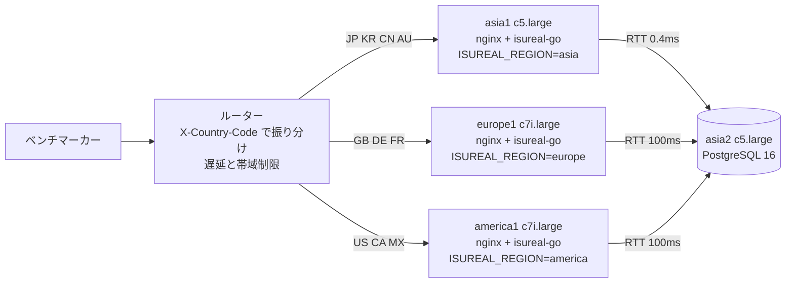

- アプリの台は 3 台で、どれも 2 コア・4GB です。DB は asia2 の 1 台を 3 台で共有します。
- 台どうしの通信もルーターを通ります。ルーターを迂回する通信や、遅延・帯域制限の回避は禁止です（manual.md「禁止事項」）。
- 利用者は自分のリージョンの台に固定されます。セッションのリージョンと台の `ISUREAL_REGION` が違うと、403 `region_mismatch` を返します（`region.go:16-18`）。
- europe1 と america1 では、DB への 1 往復に 100ms かかります。1 リクエストの時間は、ほぼ「クエリの往復回数 × 100ms」で決まります。例として、フィードはセッションの確認 1 回、viewer の読み込み 5 回、投稿 1 回で、7 往復以上です（調査役の見立て）。
- 各アプリ台では `isureal-guard` も動いています。ジャーナルの JSON ログ（ログインの 401・不正な画像・署名の不正）を読み、`ip_bans` に書きます（調査役の調べ）。
- アプリの DB 接続は台ごとに最大 30 本です（`server.go:34`）。PostgreSQL の `max_connections` は 100 で、`shared_buffers` は 128MB と既定値に近い値でした（調査役の調べ）。

## コードの構成

アプリは `webapp/go/` の Go（echo v5、sqlx、pgx）です。

- `server.go`：ルーティングです（`server.go:47-88`）。どのリクエストにも `ActionLogMiddleware` と `IPBanMiddleware` がかかります。ログインが要る API は `SessionMiddleware` と `RegionMiddleware` を通ります。
- `config.go`：環境変数から設定を読みます。`ISUREAL_LOG_LEVEL` の既定は `debug` で、全リクエストをジャーナルに出します（`config.go:27`、`action_log.go:56-76`）。
- `session.go`：`Authorization: Bearer` のトークンを SHA-256 にして、`login_sessions` と `users` を毎回引きます（`session.go:50-55`）。
- `ip_ban.go`：200ms ごとに `ip_bans` を全件読みます（`ip_ban.go:14`、`ip_ban.go:49-58`）。
- `post.go`：投稿の読み込みと、閲覧権限の判定（`loadViewerContext`・`canView`）です。
- `feed_api.go`：4 種類のフィードです。
- `post_api.go`：投稿の作成・取得・変更・削除です。
- `image_api.go` と `image_signature.go`：署名付き URL の画像の配信と、署名の作成です。
- `notification_api.go`：SSE の通知です。
- `admin_posting_window_api.go`：投稿期間を開く管理者の API です。
- `memory_api.go`・`export_api.go`：Memories とエクスポートです。
- `comment_api.go`・`realmoji_api.go`：コメントと RealMoji です。
- `user_api.go`・`user_read_api.go`・`relationship_api.go`・`relationship_list_api.go`・`friend_request_api.go`・`profile_image_api.go`・`account_deletion_api.go`：登録・ログイン・検索・関係・プロフィール画像・退会です。
- `initialize.go`：`../sql/init.sh` を実行して `language` などを返します（`initialize.go:20-30`）。

初期化は次のとおりです。

- `webapp/sql/init.sh` は `reset.sql` を流すだけです。
- `reset.sql` は、セッション・関係のテーブルを TRUNCATE します。そのあと、`initial_data_boundary` の時刻より新しい通知・コメント・RealMoji・投稿・投稿期間・画像・ユーザーを消します。最後に、`initial_*` のテーブルから利用者の属性と関係を戻します。
- `initial_*` のテーブルと境界の時刻は `003-initial-snapshot.sql` が作ります。境界は 2026-10-28 01:36:31 UTC でした（asia2 で読み取り、2026-10-31）。
- DB の外にキャッシュを持ったら、その初期化も足す必要があります（manual.md「データベースのデータの初期化」）。

## エンドポイントと画面

### 画面ごとの記録の前提

検証役が手元の docker で画面を巡り、通信を記録しました（`.claude/worktrees/local/logs/screens/map.md`）。

- 手元はアプリが asia の 1 台だけです。DB は部分的なダンプで、画像のデータ（image_objects の中身）を抜いています。そのため、画像はほぼすべて 403 でした（`image_api.go:50-52` は行が無いと 403）。本番では 200 のはずです。
- 地域の変更（`PATCH /api/me` の region）と、通知の受信（投稿期間を開いて通知が届く流れ）は確かめていません（未確認）。投稿期間を開く API を呼ぶ画面はフロントエンドに無く、ベンチマーカーだけが呼ぶと見ています（推測）。
- `GET /api/memories/:date` を呼ぶ画面はありませんでした。ベンチマーカーだけが呼ぶと見ています（推測）。

ログイン後のどの画面でも、次の 2 つを呼びます。

- `GET /api/me` を 1〜3 回呼びます。
- `GET /api/notifications` を 1 本つなぎます。通知が無ければ 30 秒ほど応答を返さず、1 件返すと接続を閉じます。クライアントはすぐ（受信が無いときは 1 秒後に）つなぎ直します。
- 画像を出す画面では、画像ごとに `GET /api/images/:id?exp&sig` を 1 回呼びます。ログインは要りません。

### 画面と API の対応と、初期ベンチの回数・合計時間

- 回数と合計時間（秒）は、初期ベンチ（2026-10-31 10:40、rev c747f44、スコア 3925）の alp です。c747f44 は、初期アプリに pg_stat_statements の設定を足しただけです。
- asia1 は `logs/20261031-104000-alp.txt`、europe1 は `logs/20261031-104000-alp-europe1.txt`、america1 は `logs/20261031-104000-alp-america1.txt` です。
- 4xx と 5xx も回数に含みます。「-」は 0 回です。
- `GET /api/notifications` の合計時間は、通知を待っている時間をほぼそのまま数えています。重さの目安にはなりません。

| 画面 | API | asia1 回数 | asia1 秒 | europe1 回数 | europe1 秒 | america1 回数 | america1 秒 |
|---|---|---:|---:|---:|---:|---:|---:|
| 全画面 | GET /api/notifications | 117 | 1556.1 | 42 | 421.4 | 37 | 364.5 |
| 全画面 | GET /api/me | 9 | 0.1 | 4 | 1.6 | 4 | 1.3 |
| 画像を出す画面 | GET /api/images/:id | 912 | 430.1 | 94 | 104.5 | 82 | 105.2 |
| ログイン | POST /api/auth/login | 777 | 38.0 | 24 | 32.6 | 21 | 27.1 |
| 新規登録 | POST /api/auth/register | 34 | 55.3 | 5 | 25.6 | 5 | 17.8 |
| ホーム | GET /api/posting-window/current | 98 | 7.6 | 29 | 17.0 | 26 | 17.6 |
| ホーム | GET /api/feeds/friends | 198 | 41.6 | 25 | 40.0 | 20 | 31.4 |
| ホーム | GET /api/feeds/friends-of-friends | 96 | 24.9 | 1 | 1.6 | 1 | 1.5 |
| ホーム | GET /api/feeds/public | 67 | 12.2 | 7 | 9.8 | 2 | 2.3 |
| ホーム | GET /api/feeds/following | 72 | 13.4 | 1 | 1.0 | 1 | 1.1 |
| 撮影・投稿 | POST /api/posts | 78 | 127.6 | 27 | 124.4 | 21 | 76.8 |
| 自分の現在の投稿 | GET /api/posts/me/current | 79 | 4.6 | 23 | 12.3 | 18 | 12.0 |
| 自分の現在の投稿 | PATCH /api/posts/:id | 9 | 0.8 | 2 | 2.6 | 2 | 2.4 |
| 自分の現在の投稿 | DELETE /api/posts/:id | 6 | 0.5 | - | - | - | - |
| 投稿詳細 | GET /api/posts/:id | 92 | 18.0 | 3 | 2.9 | - | - |
| コメント | GET /api/posts/:id/comments | 20 | 3.7 | - | - | - | - |
| コメント | POST /api/posts/:id/comments | 27 | 8.4 | - | - | - | - |
| コメント | DELETE /api/comments/:id | 8 | 0.6 | - | - | - | - |
| RealMoji | GET /api/posts/:id/realmojis | 9 | 1.8 | - | - | - | - |
| RealMoji | POST /api/posts/:id/realmojis | - | - | - | - | - | - |
| RealMoji | DELETE /api/realmojis/:id | - | - | - | - | - | - |
| Memories | GET /api/memories | 208 | 39.8 | 50 | 50.4 | 43 | 42.3 |
| 画面なし | GET /api/memories/:date | 40 | 2.1 | 6 | 4.1 | 7 | 6.1 |
| つながり | GET /api/relationships/friends | 33 | 3.1 | 13 | 5.5 | 11 | 4.8 |
| つながり | GET /api/relationships/incoming-requests | 39 | 2.9 | 4 | 2.7 | 2 | 0.7 |
| つながり | GET /api/relationships/following | 3 | 0.2 | - | - | - | - |
| つながり | POST /api/friend-requests/:id/:action | 58 | 36.5 | 8 | 17.1 | 4 | 9.0 |
| ユーザー検索 | GET /api/users | 30 | 4.8 | 19 | 20.3 | 15 | 14.1 |
| ユーザー | GET /api/users/:id | 45 | 3.3 | 2 | 1.2 | - | - |
| ユーザー | POST /api/friend-requests | 85 | 56.6 | 38 | 70.9 | 35 | 68.5 |
| ユーザー | PUT /api/follows/:id | 11 | 1.8 | 4 | 16.0 | 4 | 19.2 |
| ユーザー | PUT /api/blocks/:id | 4 | 1.7 | 1 | 1.7 | 1 | 1.6 |
| プロフィールメニュー | POST /api/auth/logout | 34 | 1.3 | 4 | 3.7 | 4 | 3.8 |
| プロフィール設定 | PATCH /api/me | 1 | 3.8 | - | - | - | - |
| プロフィール設定 | PUT /api/me/profile-image | 146 | 231.7 | - | - | - | - |
| エクスポート | GET /api/me/export | 15 | 20.0 | 1 | 1.1 | 1 | 2.6 |
| 退会 | POST /api/me/account-deletion | 1 | 0.3 | - | - | 1 | 0.9 |
| 管理者（画面なし） | POST /api/admin/posting-window | 18 | 69.2 | - | - | - | - |
| 管理者（画面なし） | PUT /api/admin/users/:id/certification | 5 | 1.1 | - | - | - | - |
| 管理者（画面なし） | POST /api/initialize | 1 | 2.9 | - | - | - | - |

表から読めることは次のとおりです。

- 平均の応答時間は、europe1 と america1 が asia1 よりおおむね 3〜10 倍長いです。例として、`GET /api/feeds/friends` の平均は asia1 0.210 秒、europe1 1.599 秒、america1 1.570 秒です。DB との往復の遅延が効いていると見ています（推測）。
- europe1 と america1 の回数は、asia1 のおよそ 10 分の 1 です。初期の利用者がほぼ asia にいるためと見ています（推測）。
- `POST /api/auth/login` は asia1 で 777 回のうち 565 回が 4xx でした。調査役は、ログインの失敗で BAN が試されていると見ています（推測）。
- `PUT /api/me/profile-image` は asia1 で 146 回のうち 2xx が 2 回、4xx が 117 回、5xx が 27 回でした。理由は確かめていません。
- `POST /api/posts/:id/realmojis` は 3 台とも 0 回でした。RealMoji の送信は 5 点ですが、初期ベンチでは加点されていないことになります。理由は確かめていません。
- 管理者の API・初期化・プロフィール画像の変更は、asia1 にしか来ていません。

### 画面

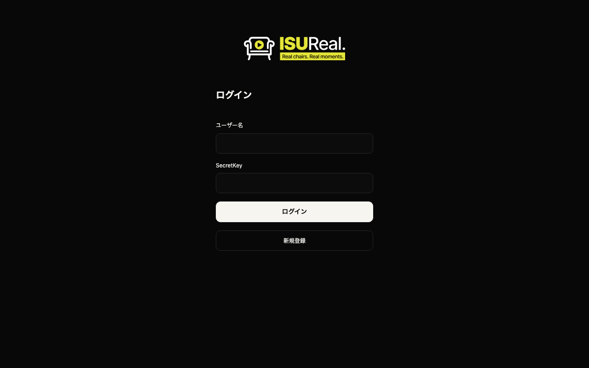

ログイン（`/login`）です。表示では API を呼びません。

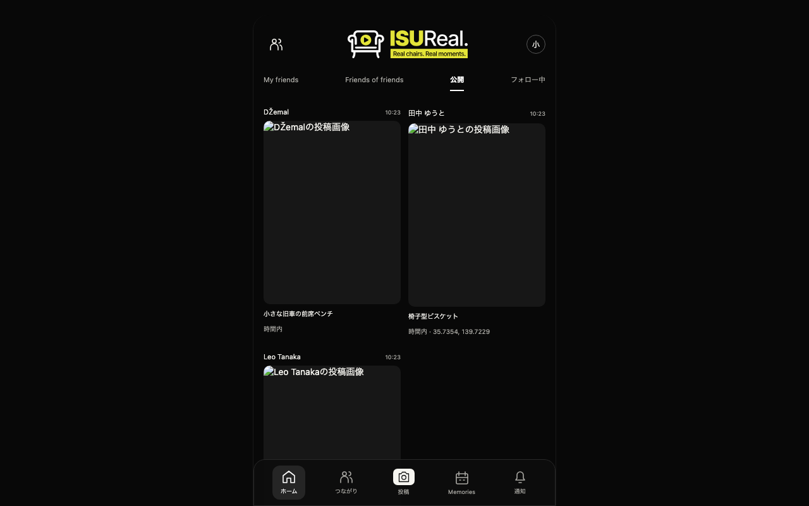

ホームの公開フィード（`/feeds/public`）です。画像は手元では 403 なので出ていません。今日まだ投稿していない利用者には、My friends に「投稿すると、友達の写真が見られます。」と出て、`GET /api/feeds/friends` を呼びません。

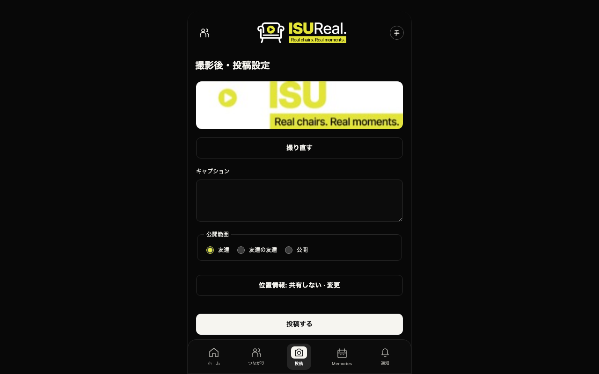

撮影・投稿（`/posts/new?step=settings`）です。同じ投稿期間の 2 回目は 409 `post_slot_unavailable` になります。

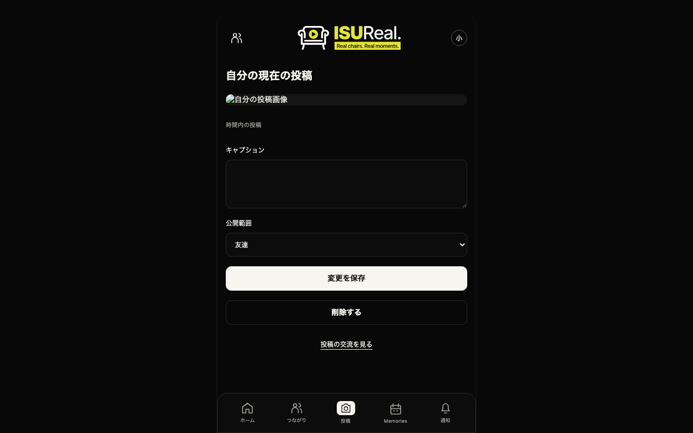

自分の現在の投稿（`/posts/me/current`）です。

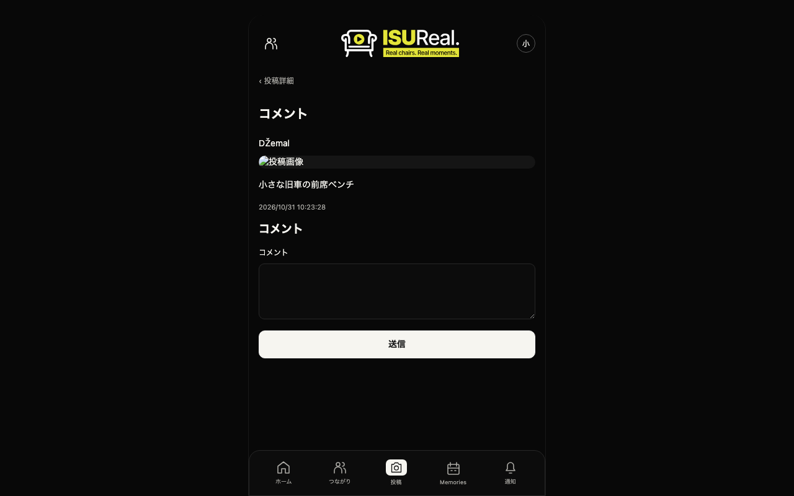

コメント（`/posts/:id/comments`）です。

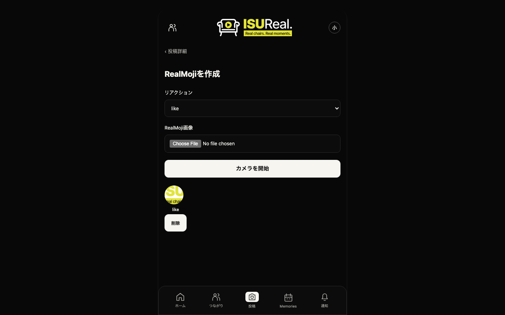

RealMoji（`/posts/:id/realmoji`）です。同じ投稿へは置き換えになります。512px を超える画像は 400 `invalid_realmoji` です。

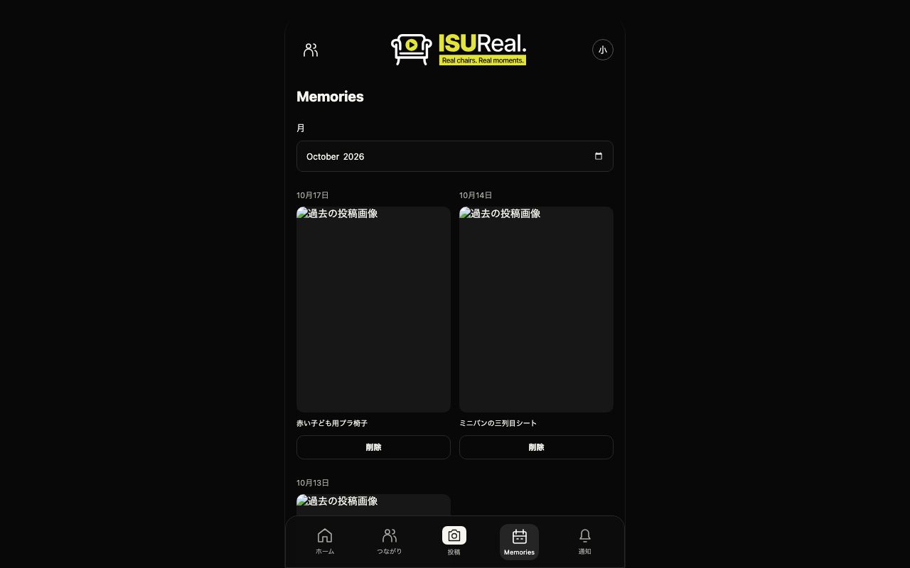

Memories（`/memories`）です。月を替えると `GET /api/memories?month=` を呼び直します。

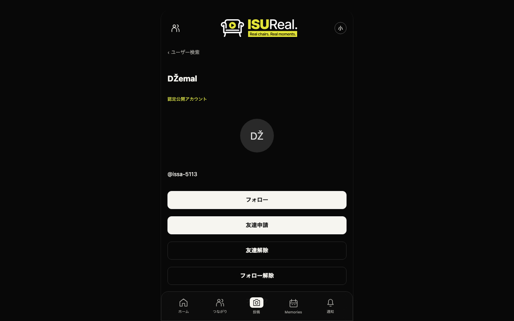

ユーザー（`/users/:id`）です。フォロー・友達申請・ブロックの操作があります。

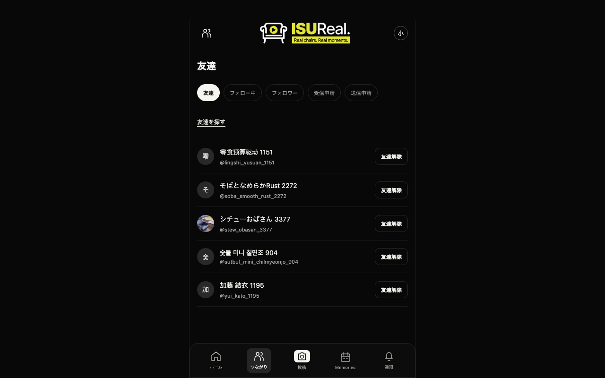

つながり（`/relationships/friends`）です。

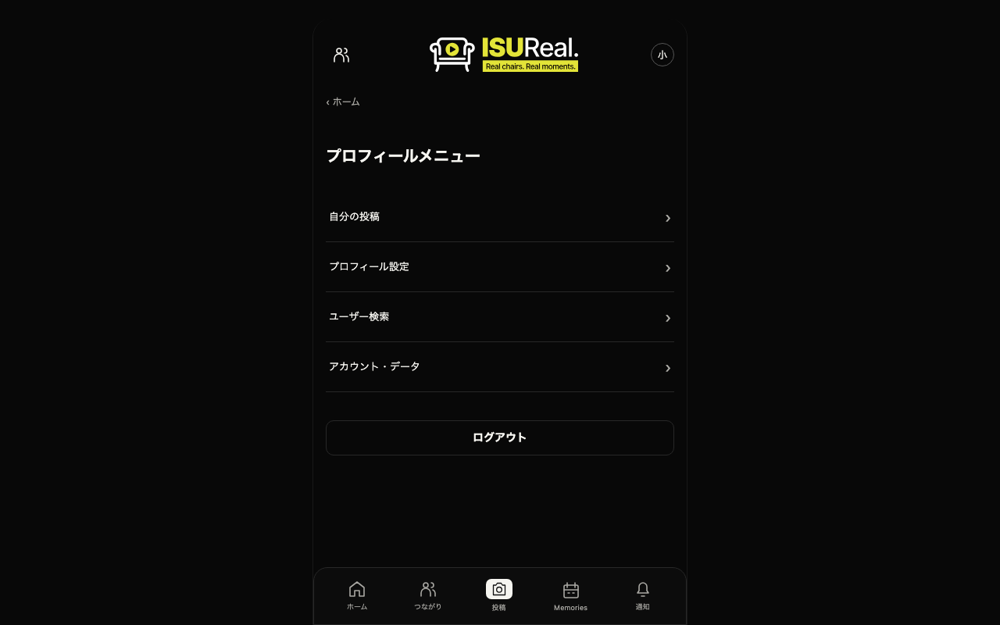

プロフィールメニュー（`/settings`）です。

## データモデル

スキーマは `webapp/sql/001-schema.sql` です。件数は asia2 で 2026-10-31 に読み取った値で、統計の推定値です。初期データに、それまでのベンチで書いた行が少し加わっています。

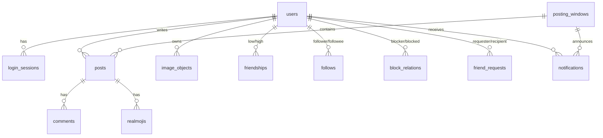

- `image_objects`：画像の中身を bytea で持ちます（約 15GB、約 183 万行）。主キーが `(id, created_at)` で、`created_at` の月ごとのパーティションです（`001-schema.sql:22-29`）。id だけの検索は約 30 区画を見ます（調査役の調べ）。平均は 7.5KB です（調査役の調べ）。
- `001-schema.sql:21` には「画像を DB に置かないと、別のサーバーから返したときに 404 になる。決して変更しないこと」というコメントがあります。調査役は、根拠はリージョンをまたいだ画像の取得で、各台に置くキャッシュでも満たせると見ています。
- `users`：初期データは 5000 人です。asia が 4835 人（ほかに退会済み 113 人）、america が 29 人、europe が 23 人です（`initial_users` を読み取り）。調査役のまとめの asia 4858・america 34・europe 27 は、ベンチで登録が足されたあとの数と見ています（推測）。
- `posting_windows`：初期データは 1095 行で、各リージョンに 2025-10-28 から 2026-10-27 までの 365 日分です。開いている期間はリージョンごとに 1 つです（部分一意インデックス `posting_windows_one_active_region`）。
- `posts`：初期データは約 62.5 万行です。インデックスは `author_id` と `posting_window_id` だけです。
- `notifications`：約 185 万行です。投稿期間を開くたびに、そのリージョンの全員分を INSERT します。
- `realmojis`（約 120 万行）・`comments`（約 55 万行）・`friendships`（約 2.5 万行）・`friend_requests`（約 2.9 万行）・`follows`（約 1 万行）・`block_relations`（約 250 行）です。
- DB 全体は約 16GB です。

調査役が挙げた、欠けているインデックスは次のとおりです。

- `login_sessions(token_hash)`：ログインが要る全リクエストで引きます。
- `notifications(user_id, created_at)`：SSE が 500ms おきに引きます。
- `friendships(user_high_id)`、`follows(followee_id)`、`block_relations(blocked_id)`、`friend_requests(recipient_id / requester_id, status)` です。

## 主な処理の流れ

### 投稿期間を開く

`POST /api/admin/posting-window`（`admin_posting_window_api.go:25-88`）は、1 つのトランザクションで次を行います。

1. `LOCK TABLE users IN SHARE ROW EXCLUSIVE MODE` を取る（`:46`）。
2. 同じリージョンの前の期間を終わらせる。
3. 新しい期間を INSERT する。
4. そのリージョンの全員分の通知を INSERT する（`:70-75`）。asia ではおよそ 4800 行になる。

表ロックのあいだは、同じ表ロックを取る登録（`user_api.go:93`）などが待ちます。初期ベンチの `LOCK TABLE users` は 62 回で、平均 1762ms でした（`logs/20261031-104000-pgss.txt`）。

### 投稿する

`POST /api/posts`（`post_api.go:49-155`）は次のとおりです。

1. JPEG をデコードして大きさを確かめる。
2. トランザクションで、自分の users の行を `FOR NO KEY UPDATE` で取る（`:95`）。
3. 開いている投稿期間の行を `FOR UPDATE` で取る（`:107`）。同じリージョンの投稿は、この行で 1 本ずつに並ぶ。
4. 同じ日の投稿の数を数え、画像を `image_objects` に、投稿を `posts` に INSERT する。

初期ベンチでは、投稿期間の `FOR UPDATE` は 146 回で平均 1121ms でした（`logs/20261031-104000-pgss.txt`）。2 の users の行のロックは、投稿の変更・削除（`post_api.go:277`、`:340`）とログアウト（`session.go:89`）と同じクエリで、合わせて 249 回、平均 25ms でした。

### フィードを見る

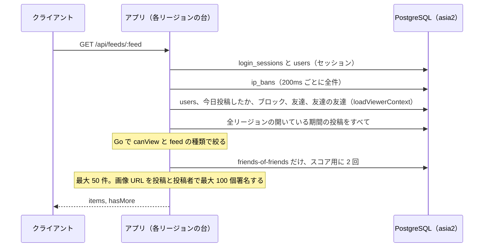

- 投稿は、リージョンを問わず、開いている期間のものを全部読みます（`feed_api.go:72-76`）。権限と種類は Go で絞ります（`feed_api.go:80-85`）。
- 署名 1 つで HMAC-SHA256 を 1000 回まわします（`image_signature.go:15`、`image_signature.go:25-33`）。asia1 は c5.large で SHA の命令が無く遅いと、調査役は見ています（推測）。

### 画像を取る

`GET /api/images/:id`（`image_api.go:23-98`）は次のとおりです。

1. 署名と期限の形を確かめる。
2. 持ち主の `secret_key_hash` を引き（`:45-49`）、署名を 1000 回の HMAC で作り直して比べる。
3. 画像の中身を、プロフィール画像・削除されていない投稿・有効な RealMoji のどれかに当たるかの条件付きで読む（`:70-86`）。

初期ベンチでは、3 の SELECT が 870 回で平均 463ms、合計 403 秒でした。DB 側の合計時間でいちばん大きいクエリです（`logs/20261031-104000-pgss.txt`）。

### 通知を受ける

`GET /api/notifications`（`notification_api.go:21-82`）は、接続 1 本ごとに 500ms おきに `getUser` と通知の SELECT を回します（`:37-80`）。初期ベンチでは、通知の SELECT が 7160 回呼ばれていました（`logs/20261031-104000-pgss.txt`）。

### DB 側の計測

`logs/20261031-104000-pgss.txt` は pg_stat_statements を手で取り出したものです。いつリセットしたかは確かめていません。pg_stat_statements を読み込むために PostgreSQL を再起動してからの累計で、ほぼ初期ベンチの区間と見ています（推測）。合計時間の上位は次のとおりです。

- 画像の中身の SELECT：870 回、合計 402917ms、平均 463ms です。
- 投稿期間の `FOR UPDATE`：146 回、合計 163630ms、平均 1121ms です。
- ログインでの users の `FOR NO KEY UPDATE`（`session.go:131`）：764 回、合計 120486ms、平均 158ms です。
- `LOCK TABLE users`：62 回、合計 109256ms、平均 1762ms です。
- 友達の取得（`user_low_id = $1 OR user_high_id = $1`）：847 回、合計 31830ms、平均 38ms です。
- 通知の全員分の INSERT：18 回、合計 26516ms、29504 行です。

呼び出しの回数の上位には、users と posting_windows への外部キーの確認がそれぞれ約 3 万回あります。通知の INSERT の行数（29504）とほぼ同じなので、通知の INSERT が引き起こしていると見ています（推測）。

## 調査で決めたこと

サーバーの `~/AGENTS.md` と `~/webapp/AGENTS.md`（リポジトリでは `webapp/AGENTS.md` と `webapp/go/AGENTS.md`）は「本番環境です」と書き、`synchronous_commit=off` などを「提案も実行もしてはならない」としています。マニュアルには AGENTS.md の記述がありません。人間が 2026-10-31 の 11 時台に次のように決めました（`logs/notes/research-summary.md` の「人間に確かめたいこと」）。

- 安全側に倒し、AGENTS.md の禁止事項は避けます。`synchronous_commit=off` は入れません。
- AGENTS.md の 3 節のほかの項目は、施策ごとに人間が決めます。
- 2 節（sudo・restart・apt・設定変更の禁止）には従わず、マニュアルの範囲で作業します。
- AGENTS.md は今は書き換えません。
- ログの出力を減らす案は、ログの停止として避けます。`ISUREAL_LOG_LEVEL` は `debug` のまま変えません。

## その時点で入っている施策とスコアの推移

施策はまだ入っていません。基準の 54c746f は初期アプリそのものです。記録は `docs/scores.tsv` の最初の 2 行です。

| time | rev | pass | score | memo |
|---|---|---|---:|---|
| 20261031-102616 | ? | true | 2520 | 初期状態（deploy 前、人間がポータルで回した初回ベンチ） |
| 20261031-104000 | c747f44 | true | 3925 | chore: PostgreSQL のクエリを pg_stat_statements で計測する |

- c747f44 は、初期アプリに pg_stat_statements の設定（`server/asia2/etc/postgresql/16/main/conf.d/isu-measure.conf`）を足しただけです。その前の 03733fc は、サーバーにあった nginx と PostgreSQL の設定をそのまま取り込んだコミットです。
- 2 回目は 1 回目より 1405 点高いです。ベンチの記録の見込み（expect 列）は「初回 2520 と同じ帯」でした。差の理由は確かめていません。1 回目は DB のキャッシュが冷えていたなど、ベンチのぶれと見ています（推測）。
