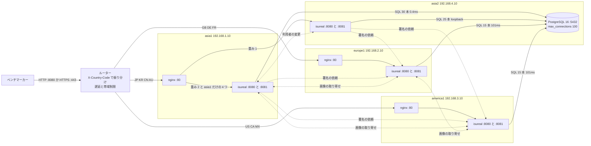
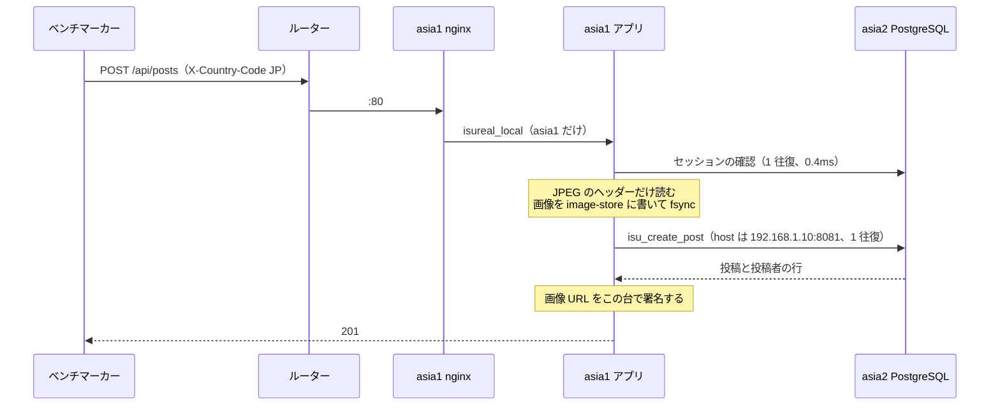
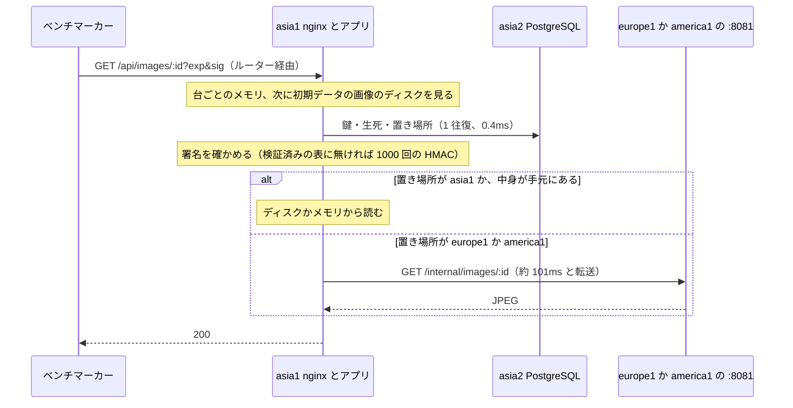
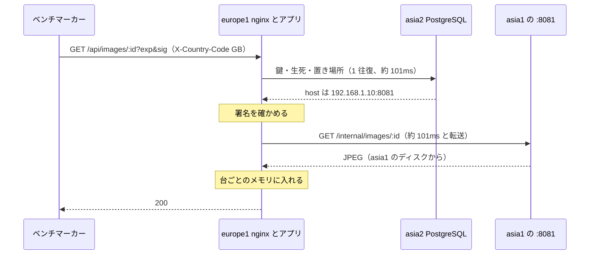
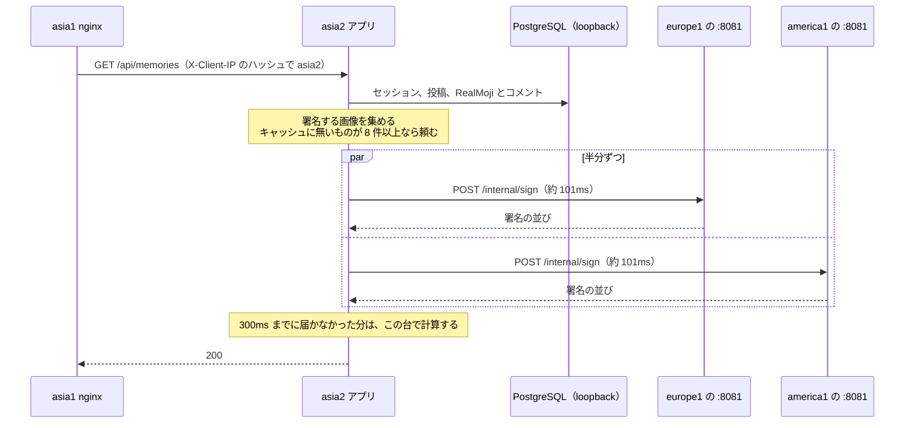
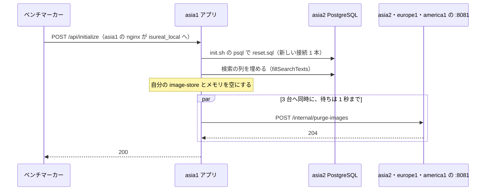

# ISUReal の通信の構成（アプリが 4 台になった時点）

- 書いた日時：2026-10-31 16:45
- 基準のコミット：3e49f45（chore: ベンチ結果を記録する）
- コードと設定は、c2df023 に b16dc30（計測を戻す）を足したものと同じです。`git diff c2df023 3e49f45` は、scores.tsv と計測の設定 2 つだけでした。
- 3e49f45 は計測ありの状態です。PostgreSQL の全クエリのログ（`log_min_duration_statement = 0`）・pg_stat_statements・pprof・nginx の LTSV のログが入っています。締めの 94267 点（ab6d319）は、計測を外した状態の点です。
- 前のスナップショットは `docs/overview/001_initial-app.md`（基準 54c746f）です。この文書は、台をまたぐ通信を中心に書きます。
- 材料は次のとおりです。
  - 3e49f45 のコード（`webapp/go/`）と設定（`server/`・`isu.env`・`sql/`）
  - `git log 54c746f..3e49f45`、`docs/scores.tsv`、`gh issue list --state all`（#1〜#16）
  - `manual.md` と `contest_cloudformation.yaml`
  - 調査役のメモ（main のチェックアウトの `logs/notes/`、git の管理外）：research-summary.md・asia2-app-runbook.md・sign-offload-done.md・image-files-design.md・state-mirror-design.md・bench-results.md
  - `logs/20261031-145155-*`（1c713a9 の回の alp と CPU の集計）と `logs/kit-notes.md`
- 実機は、2026-10-31 16:24〜16:27 に ssh で読み取りました（`ss`・`systemctl`・`pg_stat_activity`・`SHOW`・`ping`・`tracepath`・`ls`）。
  - その時点で台に deploy されていたのは 55042b9 です（16:22、main のチェックアウトの `logs/deployed`）。55042b9 は 3e49f45 の後に main に入ったコミットで、変えたのは `sql/012_relationship_functions.sql`・`friend_request_api.go`・`relationship_api.go` だけです。通信の構成は変えていません。この文書の中身には含めません。
  - 16:24 の asia1 には、ルーターからの接続が 1000 本を超えてありました。ベンチの最中だったと見ています（推測）。
- 書いている間に、main は 7d77e98 まで進み、16:36 に deploy されました。3e49f45 の後のコミット（55042b9・458d437・8042f30・e0cabdd とその revert の b325802・9bc4b00・7d77e98）は含めません。
  - このうち 458d437（計測を外す）は通信 11 の pprof を、8042f30（europe1・america1 でセッションを 3 秒覚える）と 7d77e98（europe1・america1 の DB の接続と文の準備）は通信 3 を変えます。件名と変えたファイルから読んだだけで、中身は確かめていません。
- `logs/`・`logs/notes/` は git の管理外で、main のチェックアウトにあります。
- コードの行番号は 3e49f45 のものです。

## 前のスナップショットからの変化

- アプリが 3 台から 4 台になりました。DB の台 asia2 でもアプリが動き、asia1 の nginx が `X-Client-IP` のハッシュで asia1 と asia2 に 2:1 で振り分けます（8955a76、#16）。
- 投稿・エクスポート・初期化・画像の取得は、asia1 のアプリだけが受けます（8955a76・6d95258、#16）。
- アプリどうしの通信ができました。全台のアプリが内部の窓口 `:8081` を開け、次の 4 つを受けます。
  - 署名の依頼 `POST /internal/sign`（e798511）
  - 画像の取り寄せ `GET /internal/images/:id` と、置き場所を空にする `POST /internal/purge-images`（f77ab40、#12）
  - 利用者の変更の知らせ `POST /internal/user-changed`（8955a76、#16）
- 走行中の投稿の画像は、DB ではなく投稿を受けた台のディスクに置きます（f77ab40、#12）。初期データの投稿の画像は、asia1 のディスクに書き出しました（a1e9547、#15）。
- 投稿期間の開始で通知を DB に書かなくなりました。各台のアプリが投稿期間を 50ms ごとに見張ります（f701eda、#1）。
- DB との往復を減らしました。投稿・ログイン・登録・友達申請を、PostgreSQL の関数か 1 文にしました（dc24c8b・a8076bd・9dde8d3・5c305fe、#12）。
- DB の接続の本数を台ごとに決め、待機させる接続を最大数にそろえました（fb20e64・168d53e・8955a76）。
- 001 の「調査で決めたこと」のうち、`synchronous_commit=off` とログの `info` への引き下げは、人間が後から入れると決めました（3b932da・ecbd55e）。どちらも設定ファイルのコメントにそう書いてあります。
- スコアは 3925 点（c747f44）から、最高 94267 点（ab6d319）になりました。

## 採点の仕組み

001 と同じです（`docs/overview/001_initial-app.md` の「採点の仕組み」）。

001 で「分かりません」とした「負荷が増える条件」について、その後に分かったことだけを足します。

- 走行中の新規登録は、asia だけがスコアとともに増えました。europe と america は、どの回も 5 人ずつでした（#7 の本文の表。01:22〜02:14 UTC の 6 回を、各台のジャーナルの `"action":"register"` で数えたもの）。
- europe と america の新しい利用者は、13:55 と 14:05 の回では 1 日 0〜4 人でした（`logs/notes/bench-results.md`）。
- asia の新しい利用者は、前の投稿期間に途中から入った人が期間のうちに投稿できると増える、と見ています（推測）。根拠は #12 の表と、f77ab40 の回で 5 日目の新規が 6〜11 人から 293 人に増えたことです（`logs/notes/bench-results.md`）。決める条件そのものは分かっていません。

## 業務ドメイン

001 と同じです（`docs/overview/001_initial-app.md` の「業務ドメイン」）。

## システム構成

### 台と待ち受け

16:24 の `ss -lntp` と `systemctl` で確かめた値です。IP とインスタンスの種類は `contest_cloudformation.yaml`（:261・:448・:635・:822・:1003）です。

- asia1（192.168.1.10、c5.large、asia）
  - nginx `:80`、isureal `:8080`・`:8081`、pprof `127.0.0.1:6060`
  - isureal-go・isureal-guard・nginx が enabled・active です。
- asia2（192.168.4.10、c5.large、asia）
  - PostgreSQL 16 `:5432`、isureal `:8080`・`:8081`、pprof `127.0.0.1:6060`
  - isureal-go・isureal-guard・postgresql が enabled・active です。nginx は disabled・inactive で、`:80` を待ち受けていません。
- europe1（192.168.2.10、c7i.large、europe）と america1（192.168.3.10、c7i.large、america）
  - nginx `:80`、isureal `:8080`・`:8081`、pprof `127.0.0.1:6060`
  - isureal-go・isureal-guard・nginx が enabled・active です。
- ルーター（公開側 192.168.11.10、データ側 192.168.10.10、c6in.large）
  - 公開側で `:8080`（HTTP）と `:443`（HTTPS）を待ち受け、各台の `:80` に送ります（`contest_cloudformation.yaml:1061-1064`）。ログインと設定の変更は禁止です（manual.md:196）。
- 各台のアプリの環境変数は `/home/isucon/env.sh` です（リポジトリでは管理していない）。16:24 に読んだ値は次のとおりです。
  - `ISUREAL_REGION`：asia1 と asia2 は `asia`、europe1 は `europe`、america1 は `america` です。
  - `ISUREAL_DB_HOST`：asia1・europe1・america1 は `192.168.4.10`、asia2 は `127.0.0.1` です。asia1・europe1・america1 の値は CloudFormation の UserData が書きます（`contest_cloudformation.yaml:359`・`:546`・`:733`）。

### 全体の図



- 実線はリクエストと SQL の通信、点線は内部の窓口 `:8081` への通信です。
- 台をまたぐ線は、どれもルーターのデータ側（192.168.10.10）を通ります。各台のルートテーブルが、ほかの台のサブネットへの行き先をルーターにしているためです（`contest_cloudformation.yaml:209-231` ほか）。16:25 に asia1 から asia2 へ `tracepath` を打つと、1 段目が 192.168.10.10 でした。
- 台どうしの通信では、ルーターは送信元の IP を書き換えません。16:24 の europe1 の `:8081` への接続は、送信元が 192.168.1.10 と 192.168.4.10 でした。
- asia2 のアプリから PostgreSQL への接続は、台の中の loopback で、ルーターを通りません。
- 図に描いていない通信（初期化で置き場所を空にする依頼、isureal-guard、投稿期間の見張り、計測など）は、次の「通信の一覧」にあります。

### 台どうしの往復時間

16:25 に各台から `ping -c 5 -i 0.2` を打った平均（ms）です。行が送信元、列が宛先です。ベンチの最中だったと見ています（推測）。

| 送信元＼宛先 | asia1 | asia2 | europe1 | america1 |
|---|---:|---:|---:|---:|
| asia1 | - | 0.44 | 100.93 | 100.83 |
| asia2 | 0.37 | - | 100.92 | 100.93 |
| europe1 | 100.88 | 100.92 | - | 101.42 |
| america1 | 100.99 | 100.95 | 101.33 | - |

- 001 に書いた値（asia1 から asia2 は 0.4ms、europe1・america1 から asia2 は 100ms）と同じです。
- europe1 と america1 のあいだも、約 101ms でした。リージョンが違う台どうしは、どの組も約 100ms です。
- 帯域制限の値は分かりません。マニュアルには「リージョン間の通信には遅延と帯域制限があります」とだけあります（manual.md:214）。
- ベンチマーカーとルーターのあいだの遅延は測っていません。

## 通信の一覧

### 1. ベンチマーカー → ルーター → 各台の nginx :80

- 向き：ベンチマーカー → ルーター → asia1・europe1・america1 の nginx `:80` です。asia2 には来ません。
- プロトコルとポート：ルーターの公開側の `:8080`（HTTP）か `:443`（HTTPS）で受け、各台の `:80` に HTTP で送ります（`contest_cloudformation.yaml:1061-1064`）。ベンチがどちらで入るかは確かめていません。
- 振り分け：`X-Country-Code` が JP・KR・CN・AU なら asia1、GB・DE・FR なら europe1、US・CA・MX なら america1 です。省略は JP です（manual.md:200-209）。
- `X-Client-IP`：ベンチが利用者ごとに違う値を付け、ルーターはそのまま渡します（manual.md:219-223）。アプリはこの値で BAN を引きます（`ip_ban.go:61-66`）。
- 16:24 の接続：ルーター（192.168.10.10）から asia1 の `:80` が 1084 本、europe1 が 24 本、america1 が 40 本でした。
- 1 リクエストで 1 往復です。nginx はルーターとの接続を使い回します。`keepalive_requests 100000`・`keepalive_timeout 120s`（`server/all/etc/nginx/nginx.conf:25-26`、b7a235b）と、`worker_connections 16384`・`worker_rlimit_nofile 65535`（同 :7・:11、38e2c2f、#14）です。

### 2. nginx → アプリ :8080

asia1 の nginx（`server/asia1/etc/nginx/sites-available/isureal.conf`、8955a76・a8ed3c6・6d95258、#16）は、次のように送ります。

- `/api/` は upstream `isureal_app` に送ります（:4-9、:35-37）。
  - `127.0.0.1:8080` が `weight=2`、asia2 の `192.168.4.10:8080` が `weight=1` です。
  - `hash $http_x_client_ip consistent` で、同じ接続元はいつも同じ台に行きます。isureal-guard が台ごとのジャーナルで失敗を数えるので、接続元を 1 台に集めるためです（:1-3 のコメント）。
  - `max_fails=3 fail_timeout=5s`、`keepalive 128` です。
- 次の 4 つは upstream `isureal_local`（`127.0.0.1:8080` だけ、`keepalive 32`）に送ります（:11-14）。
  - `POST /api/posts`（`location = /api/posts`、:40-42）：画像を fsync で置くので、DB と同じディスクを取り合わない asia1 で受けます。
  - `/api/me/export`（:45-47）と `/api/images/`（:54-56、6d95258）：初期データの投稿の画像が asia1 のディスクにだけあるためです。
  - `/api/initialize`（:49-51）
- HTTP/1.1 で接続を使い回します（:23-25）。アップロードは流し込み、応答はメモリだけで受けます（:29-33、a8ed3c6）。
- asia1 から asia2 の `:8080` へは、ルーターを通ります（RTT 0.4ms）。asia2 に振られたリクエストは、この往復が 1 回足されます。
- 16:24 の接続：asia1 のアプリの `:8080` への nginx からの接続が 563 本、asia2 のアプリの `:8080` への asia1 からの接続が 284 本でした（どちらも受ける側で数えた値。数秒前に asia1 の側で数えたときは、asia2 の `:8080` への接続が 511 本）。開いたままの SSE（`GET /api/notifications`）が多いためと見ています（推測）。

europe1・america1 の nginx（`server/all/etc/nginx/sites-available/isureal.conf:8-11`）は、`/api/` を `http://127.0.0.1:8080` に送るだけです。

- upstream の `keepalive` も `proxy_http_version` もありません。nginx の既定のままで、1 リクエストごとにアプリとの接続を張り直します（設定からの読み取り）。
- asia2 には nginx がありません。

### 3. 各アプリ → asia2 の PostgreSQL :5432

- 向き：4 台のアプリ → asia2 の PostgreSQL 16 です。
- プロトコルとポート：PostgreSQL のプロトコル（pgx）、`:5432` です。接続先は `/home/isucon/env.sh` の `ISUREAL_DB_HOST` です（`config.go:22`）。
- 経路：asia1・europe1・america1 からはルーターを通ります。asia2 のアプリは `127.0.0.1` で、ルーターを通りません。
- 接続の本数は `server.go:39-48` が決めます。`SetMaxOpenConns` と `SetMaxIdleConns` を `ISUREAL_DB_MAX_CONNS`（既定 30）にそろえ、空いた接続は 1 分で閉じます（fb20e64・168d53e・8955a76）。
  - asia1：30（既定値です。drop-in はありません）
  - asia2：25（`server/asia2/etc/systemd/system/isureal-go.service.d/isu-node.conf:5`）
  - europe1：15（`server/europe1/etc/systemd/system/isureal-go.service.d/isu-node.conf:3`）
  - america1：15（`server/america1/etc/systemd/system/isureal-go.service.d/isu-node.conf:3`）
  - 合計は 85 本です。
- PostgreSQL の側は、`max_connections` が 100、`superuser_reserved_connections` が 3 でした（16:24 に `SHOW` で読み取り）。どちらも `server/asia2/etc/postgresql/16/main/conf.d/` では変えていません。`listen_addresses = '*'` は `server/asia2/etc/postgresql/16/main/conf.d/isucon.conf:1` です。
- 16:24 の `pg_stat_activity`（client backend）：
  - 192.168.1.10 から 30 本（アプリ）と 1 本（isureal-guard）
  - 127.0.0.1 から 25 本（アプリ）と 1 本（isureal-guard）
  - 192.168.2.10 から 15 本、192.168.3.10 から 15 本
  - どれも idle でした。
- 1 往復の時間：asia1 は 0.4ms、asia2 は loopback、europe1・america1 は約 101ms です。
- 1 リクエストあたりの往復は、コードから数えると次のとおりです。フィードや Memories などは数えていません。
  - ログインが要る API は、まずセッションの確認で 1 往復します（`session.go:50-55`）。
  - `POST /api/posts`：セッションの 1 往復と、`isu_create_post` の 1 往復です（`post_api.go:99-109`、dc24c8b・f77ab40）。
  - `POST /api/auth/login`：`isu_login` の 1 往復です（`user_api.go:123`、a8076bd）。
  - `POST /api/auth/register`：`INSERT ... RETURNING` の 1 往復です（`user_api.go:92`、9dde8d3）。
  - `POST /api/friend-requests`：セッションの 1 往復と、`isu_create_friend_request` の 1 往復です（`friend_request_api.go:37`、5c305fe）。
  - `GET /api/images/:id`：`getServableImage` の 1 往復です（`image_location.go:84`、c2df023）。`image_object_locations` に無い画像（表を足す前の画像や、存在しない id）だけ、2 回目を引きます。ログインは要りません。
  - `GET /api/notifications`：セッションの 1 往復と `clock_timestamp()` の 1 往復で始まります（`notification_api.go:27`）。そのあとは、投稿期間か利用者の状態が変わるたびに users を 1 往復で読みます（:46）。

### 4. リクエストの外で台ごとに回る DB の読み取り

- 投稿期間の見張り：各台のアプリが、自分のリージョンの開いている投稿期間を引き、50ms 休んでまた引きます（`posting_window_hub.go:18`・`:83-108`、f701eda、#1）。
  - asia1 と asia2 は、それぞれ毎秒約 20 回です。
  - europe1 と america1 は、1 回に約 100ms かかるので、毎秒 6〜7 回と見ています（推測。往復の時間からの計算）。
- `ip_bans` の読み直し：前回から 200ms 過ぎていたら、そのとき来たリクエストの中で、有効な行を全部読み直します（`ip_ban.go:14`・`:31-59`）。
  - europe1 と america1 では、読み直しに当たったリクエストに約 100ms が足されます（コードからの読み取り）。

### 5. isureal-guard → PostgreSQL

- 4 台とも enabled・active でした（16:24）。deploy は systemd の enable を配らないので（`logs/kit-notes.md` の 14:33 の行）、asia2 の isureal-guard は手で有効にしたと見ています（推測。`logs/notes/asia2-app-runbook.md` の手順 2）。
- ユニットは `/etc/systemd/system/isureal-guard.service` で、リポジトリでは管理していません。
  - `EnvironmentFile=/home/isucon/env.sh` なので、その台のアプリと同じ `ISUREAL_DB_HOST` につなぎます。
  - `GUARD_JOURNAL_UNIT=isureal-*.service`、`GUARD_FAIL_THRESHOLD=10`、`GUARD_FAIL_WINDOW=10s`、`GUARD_BAN_DURATION=2m` です。
- 向き：その台のジャーナルを読み（台の外には出ません）、asia2 の `ip_bans` に書きます。全台が `ip_bans` を 200ms おきに読み直すので、どの台で BAN しても全台に効きます（コードからの読み取り）。
- 16:24 には、asia1 と asia2 の isureal-guard が 1 本ずつ接続を持っていました。europe1 と america1 の isureal-guard の接続はありませんでした。必要なときだけつなぐと見ています（推測）。
- 本体（`/opt/isureal-guard/bin/isureal-guard`）の中は読んでいません。

### 6. 初期化の psql

- `POST /api/initialize` は asia1 だけが受けます（通信 2）。
- `initialize.go:20` が `../sql/init.sh` を起こし、`webapp/sql/init.sh:16-24` が psql で `ISUREAL_DB_HOST`（192.168.4.10）に新しい接続を 1 本張って、`reset.sql` を流します。ルーターを通ります。
- アプリの接続のプールの外の 1 本です。168d53e で空いた接続を 1 分で返すようにしたのは、この psql が `too many clients` で落ちないようにするためです（`server.go:47` のコメント、#14）。
- 続けて `fillSearchTexts` が、アプリの接続で検索の列を埋めます（`initialize.go:27`）。往復の回数は数えていません。

### 7. 署名の依頼 POST /internal/sign

- 向き：asia1 と asia2 → europe1（`192.168.2.10:8081`）と america1（`192.168.3.10:8081`）です。
  - 頼む先は `signerPeersForRegion` が決めます（`image_signer.go:100-105`）。`ISUREAL_REGION` が `asia` の台だけが頼み、europe1 と america1 は誰にも頼みません。
  - asia2 も `ISUREAL_REGION=asia` なので、asia2 も頼みます。16:24 には、asia2 から europe1 の `:8081` に 6 本、america1 の `:8081` に 10 本の接続がありました。
  - e798511 は asia2 にアプリが無いときに入りました。`server.go:61` のコメントは今も「asia1 の署名の計算を europe1・america1 に頼む」のままです。
- プロトコル：HTTP/1.1 と JSON です。本文は期限 `exp` と、画像ごとの署名の鍵（16 進）と画像の id の組の並びで、応答は署名の並びです（`image_signer.go:25-37`・`:52-73`）。
  - 署名の鍵が VPC の中を流れます。人間が仕様として了承しました（`logs/notes/sign-offload-done.md`、13:05 ごろ）。
- 経路：ルーターを通ります（RTT 約 101ms）。
- 起きる処理：応答を組み立てる前に、要る署名をまとめて頼みます（`prefetchImageSignatures`、`image_signer.go:138-143`）。
  - `GET /api/memories` と `GET /api/memories/:date`（`listMemories`、`memory_api.go:100`）
  - `GET /api/users`（`user_read_api.go:181`）
  - `GET /api/me/export`（`export_api.go:81-86`）。エクスポートは asia1 だけが受けるので、asia2 からは頼みません。
  - フィード・投稿の詳細・投稿の応答などは頼まず、その台で計算します。
- 1 リクエストあたり：キャッシュに無い署名が 8 件以上のときだけ頼みます（`image_signer.go:125-126`・`:159-161`）。
  - 半分ずつに分け、2 台へ同時に 1 往復ずつ送ります（:165-186）。
  - 待つのは 300ms までです（:125）。1 台に送るのは 2000 件までです（:22・:162-164）。
  - 届かなかった分は、応答を組み立てるときにその台で計算します（:137 のコメント）。
- 受け取った署名は、署名のキャッシュと検証済みの表に入れます（`image_signature.go:72-101`）。
- 受ける側：CPU の数だけ並べて計算します（`image_signer.go:78-97`）。送信元が 192.168.0.0/16 か loopback でなければ 403 を返します（:39-48・:53-56）。
- 接続：`MaxIdleConnsPerHost: 32` で使い回します（:124）。応答の本文を読み切ってから閉じます（:216-217）。
- 量の目安：14:51 の回（1c713a9）の asia1 の nginx では、`GET /api/memories` が 4093 回、`GET /api/memories/:date` が 646 回、`GET /api/users` が 2484 回、`GET /api/me/export` が 286 回でした（`logs/20261031-145155-alp.txt`。asia2 に振った分も含む）。このうち何回が実際に頼んだかは分かりません。
- 同じ回の CPU（ベンチ中の平均、1 コア = 100%）は、europe1 の isureal が 18.0%、america1 が 17.1% でした（`logs/20261031-145155-europe1/summary.txt`・`-america1/summary.txt`）。自分の利用者の分と署名の分は分けていません。
- コミット：e798511（13:15）。コミットに issue の番号はありません。

### 8. 画像の取り寄せ GET /internal/images/:id

- 向き：画像の中身を持たない台 → 中身を持つ台の `:8081` です。
  - 中身を持つ台は、その投稿を受けた台です。`image_object_locations.host` に、その台の窓口の URL を書きます（`sql/010_image_files.sql:5`・`:57`、`post_api.go:109` の `images.self`）。
  - 投稿を受けるのは asia1・europe1・america1 の 3 台です。
  - asia2 は `ISUREAL_IMAGE_SELF=http://192.168.4.10:8081` を名乗ります（`server/asia2/etc/systemd/system/isureal-go.service.d/isu-node.conf:4`）。ただし asia1 の nginx が `POST /api/posts` を asia2 に送らないので、asia2 の置き場所は空でした（16:26 に `/home/isucon/image-store` が 0 件）。
- プロトコル：HTTP/1.1 の GET で、応答は JPEG の中身です（`image_store.go:138-153`・`:195-207`）。
- 経路：ルーターを通ります（RTT 約 101ms と転送の時間）。asia2 は画像を持たず、画像の取得も受けないので、asia1 と asia2 のあいだの取り寄せは起きないと見ています（推測）。
- 起きる処理：`GET /api/images/:id`（`image_api.go:70-79`）と `GET /api/me/export`（`export_api.go:66-80`）です。中身が台ごとのメモリに無く、持つ台が自分でないときに取りに行きます。
  - asia の `GET /api/images/:id` は asia1 だけが受けます。asia1 が取りに行く先は、europe1 と america1 です。
  - europe1 と america1 は、asia1 で投稿された画像と、もう一方の台で投稿された画像を取りに行きます。
  - エクスポートでは、リージョンを移った人の昔の投稿の画像で起きます（`logs/notes/image-files-design.md`）。投稿ごとに順に取りに行くので、1 枚ごとに 1 往復します（`export_api.go:66-80`、コードからの読み取り）。
- 1 リクエストあたり：画像 1 枚で 1 往復です。取った中身は台ごとのメモリ（`ImageDataCache`、512MB まで、`image_data_cache.go:11`）に入れ、同じ台では 2 回目から取りに行きません（`image_store.go:120-136`）。
- 投稿の画像は 1 枚 363〜380KB ほどです（#8 の題名、`sql/010_image_files.sql:1` のコメント）。帯域制限の値が分からないので、転送の時間は分かりません。
- 待ちは 2 秒まで、接続は台ごとに 32 本まで残します（`image_store.go:39-43`、e5040e6）。
- 受ける側：自分のディスク（`/home/isucon/image-store/<id>`）から返します。送信元が VPC の外なら 403 です（`image_store.go:195-207`）。
- 16:24 の接続：europe1 から asia1 の `:8081` に 1 本、america1 から asia1 に 1 本、europe1 から america1 に 1 本でした。asia1 から europe1・america1 への 16 本ずつは、署名の依頼と画像の取り寄せの両方を含みます。どちらの接続かは分けていません。
- 取り寄せないもの：
  - 初期データの投稿の画像：asia1 は自分のディスク（`/home/isucon/initial-images`、a1e9547、#15）から読みます。asia2・europe1・america1 には書き出しが無く（16:26 に `.done` が無い）、DB から中身を読みます。
  - プロフィール画像と RealMoji の画像：今も DB に中身を書きます（`profile_image_api.go:48`、`realmoji_api.go:94`）。
- コミット：f77ab40・e5040e6（#12）、8955a76（asia2 を台の一覧に足した、#16）、6d95258（画像の取得を asia1 に寄せた、#16）です。

### 9. 置き場所を空にする POST /internal/purge-images

- 向き：asia1 → asia2・europe1・america1 の `:8081` です。
- 起きる処理：`POST /api/initialize` の最後です（`initialize.go:31` → `image_store.go:170-191`）。初期化を受けた台が、自分の置き場所とメモリを空にしてから、ほかの 3 台に頼みます。
- 1 回の初期化で、3 台に同時に 1 往復ずつ送ります。待つのは 1 秒までです。届かなかった台のファイルは残りますが、DB に行が無いので返りません（`image_store.go:169` のコメント）。
- 経路：ルーターを通ります。asia2 へは 0.4ms、europe1・america1 へは約 101ms です。
- 14:51 の回の `POST /api/initialize` は 1 回、7.25 秒でした（`logs/20261031-145155-alp.txt`）。
- コミット：f77ab40（#12）です。

### 10. 利用者の変更の知らせ POST /internal/user-changed

- 向き：asia1 → asia2、asia2 → asia1 です。同じリージョンでアプリが動くもう 1 台に送ります（`image_store.go:61-69`）。europe1 と america1 は、同じリージョンにほかの台が無いので送りません。
- 起きる処理：`PATCH /api/me` でリージョンを変えたとき（`user_api.go:213-215`）と、退会のとき（`account_deletion_api.go:37`）です。コミットの後に、待たずに送ります（`image_store.go:229-247`、待ちは 1 秒まで）。
- 受けた台は、SSE をつないでいる利用者に状態を確かめ直させます（`image_store.go:208-217`、`posting_window_hub.go:65-81`）。確かめ直しで、SSE の接続ごとに users を 1 往復で読みます（`notification_api.go:46`）。
- 1 回の変更で 1 往復です（RTT 0.4ms）。
- 14:51 の回の `PATCH /api/me` は 401 回でした（`logs/20261031-145155-alp.txt`）。そのうちリージョンを変えたものの数は分かりません。
- コミット：8955a76（#16）です。

### 11. ベンチの外の通信

- 疎通確認：`make deploy` が ssh で各台に入り、台の中で `http://localhost:8080/internal/health` を叩きます（`isu.env:21`、`server.go:69`、570343a、#16）。nginx は `/api/` しか通さないので、外からは届きません。
- pprof：アプリが `127.0.0.1:6060` で待ち受けます（`cmd/isureal/main.go:23-28`、a740597）。`ISU_MEASURE=1` のときだけで、3e49f45 は 1 です（`server/all/etc/systemd/system/isureal-go.service.d/isu-measure.conf:3`、b16dc30）。16:24 には 4 台とも待ち受けていました。
- pprotein：手元の pprotein が、ssh のトンネルで各台の pprotein-agent `:19000` に届きます（`scripts/lib.sh:23`、`docs/kit/pprotein.md`）。16:27 には、4 台とも pprotein-agent が disabled・inactive でした。
- `make deploy`・`make analyze`：手元から各台の公開 IP の ssh `:22` を使います。ルーターは通りません。
- このリポジトリで触っていない待ち受け：4 台とも、pmcd `:44321`・pmproxy `:44322`・`:44323`・pmlogger `:4330` が待ち受けていました（16:24）。AMI に入っていたものと見ています（推測）。
- 起動時に台の情報をポータルに送る `isucon-register.service` もあります（`contest_cloudformation.yaml`、manual.md の「競技環境の確認」）。変えてはいけないものです（manual.md の「変更してはいけない点」）。

## コードの構成

001 の構成（`docs/overview/001_initial-app.md` の「コードの構成」）に、次のファイルが加わりました。

- `cmd/isureal/main.go`：`:8080`（echo）・`:8081`（内部の窓口）・`localhost:6060`（pprof）の 3 つを待ち受けます（:23-38）。`extract-initial-images` の引数で、初期データの投稿の画像を書き出して終わります（:16-22）。
- `image_signer.go`：署名の依頼を送る側と受ける側です。内部の窓口のハンドラも作ります（`NewSignerHandler`、:50-76）。
- `image_store.go`：走行中の投稿の画像の置き場所です。書く・読む・ほかの台から取り寄せる・空にする・利用者の変更を知らせる、を持ちます。台の窓口の一覧は :25-37 です。
- `initial_image_store.go`：asia1 のディスクに書き出した初期データの投稿の画像を読みます。
- `image_location.go`：画像の id から区画の時刻と置き場所を引き、返してよいかを 1 回のクエリで読みます。
- `image_data_cache.go`：画像の中身を台ごとのメモリに持ちます（512MB まで）。
- `posting_window_hub.go`：投稿期間を見張り、SSE の接続に知らせます。
- `request_body.go`：本文を読まずに返すときも読み切ります（29f9663、#6）。

設定のファイルも増えました。

- `server/asia1/etc/nginx/sites-available/isureal.conf`：asia1 だけの振り分けです。
- `server/<台>/etc/systemd/system/isureal-go.service.d/isu-node.conf`：台ごとの DB の接続数と、asia2 の画像の窓口です。
- `server/all/etc/systemd/system/isureal-go.service.d/`：ログの水準（`isu-loglevel.conf`）、計測（`isu-measure.conf`）、メモリの上限（`isu-memlimit.conf`、全台 1500MiB、asia2 だけ 600MiB）です。
- `server/asia2/etc/postgresql/16/main/conf.d/isu-tuning.conf`：`shared_buffers`・`synchronous_commit`・`max_wal_size` などです。

## エンドポイント

API の一覧と画面との対応は、001 と同じです（`docs/overview/001_initial-app.md` の「エンドポイントと画面」）。

受ける台は次のとおりです。

- asia の利用者
  - `POST /api/posts`・`/api/me/export`・`/api/initialize`・`/api/images/`：asia1 だけが受けます。
  - そのほかの `/api/`：asia1 と asia2 が、`X-Client-IP` のハッシュで 2:1 に分けて受けます。開いたままの SSE も、管理者の API も同じです。
- europe と america の利用者：それぞれ europe1 と america1 だけが受けます。
- 利用者は自分のリージョンの台に固定されます（`region.go:16-18`）。asia1 と asia2 はどちらも `ISUREAL_REGION=asia` なので、asia の利用者はどちらに振られても通ります。

001 の後に足した口は、どれも nginx を通りません。

- `:8080` の `GET /internal/health`（`server.go:69`）
- `:8081` の `POST /internal/sign`・`GET /internal/images/:id`・`POST /internal/purge-images`・`POST /internal/user-changed`（`image_signer.go:52`、`image_store.go:195`・`:208`・`:218`）。どれも送信元が 192.168.0.0/16 か loopback でなければ 403 です。

## データモデル

スキーマの基本は 001 と同じです（`docs/overview/001_initial-app.md` の「データモデル」）。変わったところは次のとおりです。

- `image_object_locations`（`sql/005_image_object_locations.sql`、f616cf7）：画像の id から区画の時刻を引く表です。f77ab40 で `host` 列を足しました（`sql/010_image_files.sql:5`）。
  - `host` が空なら、中身は DB の `image_objects.data` にあります（初期データ・プロフィール画像・RealMoji の画像）。
  - `host` があれば、中身はその台のディスクにあり、`image_objects.data` は空のバイト列です（`post_api.go:108`）。
- `users` に、検索用の正規化した名前の列 `search_username`・`search_display_name` を足しました（`sql/011_users_search_text.sql`、e045604・a368728、#13）。
- `notifications` は、投稿期間の開始で書かなくなりました（f701eda、#1）。通知の id は、利用者と投稿期間から決めます（`posting_window_hub.go:22-25`）。
- 投稿・友達申請・ログインの手順を、PostgreSQL の関数にしました（`sql/007`〜`sql/010`）。
- インデックスを足しました（`sql/001`〜`sql/006`）。
- DB の外にあるデータは次のとおりです（16:26 に `ls`・`du` で読み取り）。
  - 走行中の投稿の画像：投稿を受けた台の `/home/isucon/image-store/<id>` です。asia1 が 2296 件・1.1GB、europe1 が 56 件・27MB、america1 が 87 件・45MB、asia2 が 0 件でした。初期化で空にします（通信 9）。
  - 初期データの投稿の画像：asia1 の `/home/isucon/initial-images/<id の先頭 2 文字>/<id>` だけにあります。約 62 万枚・約 9.5GB です（`initial_image_store.go:19` のコメント）。ベンチの外で一度だけ書き出し、初期化では消しません。
  - 台ごとのメモリ：画像の中身（512MB まで）、署名のキャッシュ（50 万件まで）、検証済みの署名（20 万件まで）です（`image_data_cache.go:11`、`image_signature.go:48`・`:135`）。台どうしで同期はしません。

## 主な処理の流れ

### 投稿する（asia の利用者）



- europe と america の利用者の投稿は、europe1 と america1 が同じ手順で受けます。DB との 2 往復が約 101ms ずつになり、画像はその台のディスクに置きます。
- DB の関数が失敗したと分かったときだけ、書いたファイルを消します（`post_api.go:110-114`、e5040e6）。

### 画像を取る

asia の利用者は、asia1 だけが受けます。



europe の利用者が、asia1 で投稿された画像を取るときは次のとおりです。



- 初期データの投稿の画像を europe1 や america1 で取るときは、取り寄せではなく、同じクエリで DB から中身を読みます（`image_location.go:55-67` の `data` の列）。中身も約 101ms の経路を通ります。

### 署名を頼む（asia2 に振られた利用者の Memories）



- asia1 に振られた利用者でも同じです。asia1 は `GET /api/me/export` でも頼みます。

### 初期化



- 初期データの投稿の画像（asia1 の `/home/isucon/initial-images`）は消しません。初期データは初期化でも変わらないためです（`initial_image_store.go:19-21` のコメント）。

### 退会とリージョンの変更

- asia1 か asia2 で退会かリージョンの変更を受けると、コミットの後に、もう 1 台へ `POST /internal/user-changed` を待たずに送ります（通信 10）。
- 両方の台で、SSE をつないでいる利用者が users を読み直し、リージョンが変わっていれば接続を閉じます（`notification_api.go:42-55`）。

## 通信まわりで気付いたこと

コードと 16:24 の観察から気付いたことです。効き目は測っていません。

- asia2 も署名を europe1・america1 に頼んでいます（通信 7）。e798511 を入れたときは、頼むのは asia1 だけの想定でした（`logs/notes/sign-offload-done.md`）。今の動きが意図どおりかは確かめていません。
- asia2 が出した画像 URL を、asia1 が検証します（画像の取得は asia1 だけ）。検証済みの表は台ごとなので、asia1 が同じ URL を自分でも出していなければ、asia1 は 1000 回の HMAC を計算し直します。`image_signature.go:115` のコメントの「この台が出した URL はこの台に取りに来る」は、6d95258 の後、asia2 が出した URL では成り立ちません（推測）。
- isureal-guard は台ごとのジャーナルで失敗を数えます。asia2 に振られた接続元では、ログインの 401 は asia2 に、画像の不正な署名は asia1 に記録されます。失敗が 2 台に分かれるので、BAN が遅れうると見ています（推測）。
- エクスポートでほかの台の画像を取るときは、1 枚ずつ順に取ります（`export_api.go:66-80`）。リージョンを移った人で枚数が多いと、約 101ms × 枚数かかります（推測。件数は数えていません）。
- 1 台が止まると、その台が受けた投稿の画像は、ほかの台から返せません（`logs/notes/image-files-design.md` の「リスク」）。待ちは 2 秒までで、そのあと 5xx になります（コードからの読み取り）。
- DB の接続は、アプリの 85 本、isureal-guard の最大 4 本、初期化の psql の 1 本を足して 90 本です。`max_connections` 100 から `superuser_reserved_connections` 3 を引いた 97 本に収まります（計算）。
- `logs/notes/state-mirror-design.md` にある「状態の写し」と、そのための `/internal/state-changed` は、3e49f45 には入っていません（未実装）。

## その時点で入っている施策とスコアの推移

### スコアの推移

`docs/scores.tsv` の、001 で引いた 2 行より後の行です。列は time・rev・pass・score・fail だけを引きます（memo と expect は scores.tsv にあります）。

```text
time	rev	pass	score	fail
20261031-104418	8642ac4	true	4998	
20261031-105432	1263859	true	13903	
20261031-111307	a740597	true	9518	
20261031-111735	f701eda	true	19447	
20261031-112922	059b5ba	true	18714	
20261031-114331	84553e9	true	20072	
20261031-114926	de9cd43	true	27639	
20261031-115603	29f9663	true	28851	
20261031-120624	fbe5cc0	true	28885	
20261031-121433	b1c9365	true	35370	10
20261031-123015	f616cf7	true	36029	
20261031-123739	ed2db68	true	40100	17
20261031-124329	6aef9dc	true	42709	0
20261031-124803	168d53e	true	42794	0
20261031-125431	1faf051	true	45745	0
20261031-125956	dc24c8b	true	44918	0
20261031-130629	9dde8d3	true	45169	
20261031-131608	3c20c5e	true	44796	
20261031-132256	e798511	false	0	
20261031-132903	24b7235	true	58270	0
20261031-133759	1fa48af	true	59315	
20261031-134148	2050df7	true	57015	
20261031-134835	2c9d075	true	56651	
20261031-135512	f77ab40	true	77400	
20261031-140527	e5040e6	true	77121	
20261031-140915	a753354	true	79694	
20261031-141214	e045604	true	89993	
20261031-141728	43f8b5c	true	90281	
20261031-142957	a1e9547	true	82418	
20261031-143711	570343a	true	58319	
20261031-144350	a8ed3c6	true	81218	
20261031-144722	6d95258	false	0	
20261031-145153	1c713a9	true	88333	
20261031-150801	c2df023	true	89215	
20261031-151641	ab6d319	true	93541	
20261031-151641	ab6d319	true	94267	
20261031-155626	b16dc30	true	92525	
```

- 最高は 94267 点（ab6d319、計測を外した締めの 2 回目）です。同じ版の 1 回目は 93541 点で、全台の再起動の試験の後でした（expect 列）。
- 3e49f45 と同じコードの b16dc30（計測あり）は 92525 点でした。expect 列は「europe・america の調査用（計測あり）」です。
- fail は 2 回です。
  - e798511 の回：走行後の整合性チェックで Memories を取れず fail しました。原因は同じ回に入れた c0f8a6b（Memories とエクスポートの同時実行を 1 本に絞る）で、24b7235 で戻しました（`logs/notes/bench-results.md`）。e798511（署名の依頼）は残しました。
  - 6d95258 の回：55s〜1m0s のエラー率（897/3865）が上限の 10% を超えて fail しました（expect 列に書かれた記録）。1c713a9 のコミットは、asia1 のアプリが OOM で kill され 502 が続いたためと書いています。全台に `GOMEMLIMIT` を付けて直しました。
- asia2 にアプリを足した 570343a の回（8955a76 を含む）は、82418 点から 58319 点に下がりました。理由の記録はありません。次の a8ed3c6 の回で 81218 点に戻りました。

### 回ごとに入った施策

各行の rev までに入った perf と fix のコミットです（`git log <前の rev>..<この rev>`、道具の直しと記録は除く）。

- 104418（4998）：8642ac4（PostgreSQL のメモリ）・a72299c（インデックス）
- 105432（13903）：1263859（登録の表ロックをやめる）・17b319e（投稿で期間の行を FOR SHARE）・eedd31c（HMAC の鍵の状態の使い回し）
- 111307（9518）：745b536（画像の中身と鍵を台ごとに持つ）・a740597（pprof）
- 111735（19447）：f701eda（通知を台ごとに配る、#1）・8e8662b（745b536 を戻す）
- 112922（18714）：059b5ba（エクスポートの区画）
- 114331（20072）：41c0796（advisory lock、#4）
- 114926（27639）：de9cd43（署名を 60 秒単位で使い回す、#5）・fd3d884（JPEG のヘッダーだけ読む）
- 115603（28851）：29f9663（本文の読み切り、#6）
- 120624（28885）：fbe5cc0（画像の中身を台ごとのメモリに、#8）
- 121433（35370）：4f4dd8b・b1c9365（検索と受け取った申請、#3）
- 123015（36029）：b7a235b（nginx の keepalive）・f616cf7（画像の区画の表）
- 123739（40100）：fb20e64（待機させる接続）・7639713（login_sessions のインデックス）・ed2db68（エクスポートで画像のキャッシュ）
- 124329（42709）：38e2c2f（worker_connections、#14）・6aef9dc（フィードを SQL で絞る、#9）
- 124803（42794）：6bccaf7（署名を 1 時間単位で使い回す、#10）・168d53e（空いた接続を 1 分で返す、#14）
- 125431（45745）：d82964c・1faf051（署名の検証のキャッシュと Memories の 51 件目、#10）
- 125956（44918）：dc24c8b（投稿を関数に、#12）
- 130629（45169）：8a5bc7d・5c305fe・a8076bd・9dde8d3（投稿の 409・友達申請・ログイン・登録、#12）
- 131608（44796）：3c20c5e（全クエリのログを外す、#14）
- 132256（fail）：3b932da（`synchronous_commit=off`、#14）・ecbd55e（ログを info に、#14）・c0f8a6b（同時実行の絞り、#12）・e798511（署名の依頼）
- 132903（58270）：24b7235（c0f8a6b を戻す、#12）
- 133759（59315）：1fa48af（`max_wal_size`、#14）
- 134148（57015）：2050df7（検索の候補をまとめて読む、#13）
- 134835（56651）：2c9d075（検索のメモ、#13）
- 135512（77400）：f77ab40（投稿の画像を受けた台のディスクに、#12）
- 140527（77121）：e5040e6（ファイルの消し方と取り寄せの接続、#12）
- 140915（79694）：a753354（エクスポートの期間の表、#15）
- 141214（89993）：e045604（検索を正規化した列で絞る、#13）
- 141728（90281）：a368728（検索のトリガー、#13）・43f8b5c（鍵を台ごとのメモリに、#10）
- 142957（82418）：a1e9547（初期データの画像を asia1 のディスクに、#15）
- 143711（58319）：8955a76（asia2 でもアプリ、#16）・570343a（疎通確認、#16）
- 144350（81218）：a8ed3c6（asia1 の nginx のバッファ、#16）
- 144722（fail）：6d95258（画像の取得を asia1 だけに、#16）
- 145153（88333）：1c713a9（`GOMEMLIMIT`、#16）
- 150801（89215）：c2df023（鍵と生死を 1 回のクエリで、43f8b5c の鍵のキャッシュを外す、#10）
- 151641（93541・94267）：ab6d319（計測を外す）
- 155626（92525）：b16dc30（計測を戻す）

### 3e49f45 に入っている施策

戻したものと、後のコミットで置き換わったものは除きます。

- 台の構成と通信：8955a76・570343a・a8ed3c6・6d95258・1c713a9（#16）、e798511、f77ab40・e5040e6（#12）、a1e9547（#15）、f701eda（#1）、b7a235b・38e2c2f（#14）、fb20e64・168d53e（#14）
- PostgreSQL の設定：8642ac4、3b932da・1fa48af（#14）。3c20c5e（全クエリのログを外す）は、3e49f45 では b16dc30 で計測ありに戻っています。
- DB との往復を減らす：dc24c8b・8a5bc7d・5c305fe・a8076bd・9dde8d3（#12）
- ロック：1263859・17b319e、41c0796（#4）
- インデックスと表：a72299c・7639713・f616cf7、b1c9365（#3）、6aef9dc（#9）
- 画像と署名：eedd31c・fd3d884、29f9663（#6）、fbe5cc0（#8）、6bccaf7・d82964c・1faf051・c2df023（#10）
- ユーザー検索：4f4dd8b（#3）、2050df7・2c9d075・e045604・a368728（#13）
- エクスポート：059b5ba・ed2db68、a753354（#15）
- アプリのログ：ecbd55e（#14）
- 計測：a740597（pprof）、b16dc30（計測あり）

戻したもの・置き換わったもの：

- 745b536 は 8e8662b で戻しました。
- c0f8a6b は 24b7235 で戻しました。
- de9cd43（60 秒単位）は 6bccaf7（1 時間単位）で置き換わりました。
- 43f8b5c の鍵のキャッシュは、c2df023 で外しました。

issue の状態（16:36 に `gh issue list --state all` で読み取り）：#10・#11・#12・#13・#15・#16 が OPEN です。#1〜#9 と #14 は CLOSED です。
