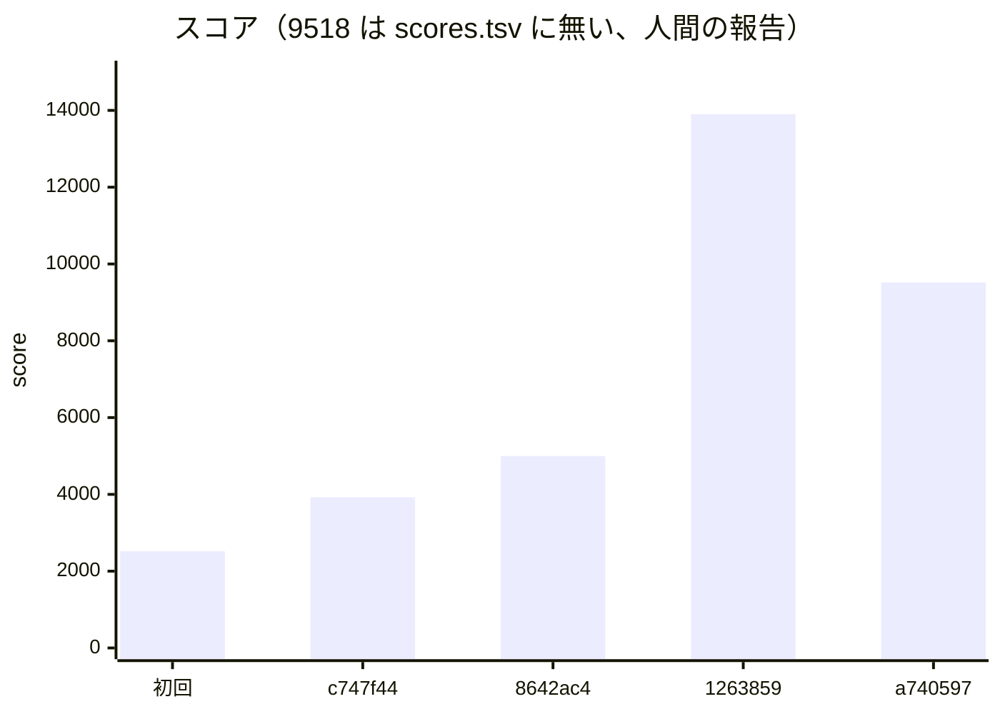

# 振り返り：立ち上げから画像のキャッシュまで（2026-10-31 の午前）

- 書いた日時：2026-10-31 11 時台
- 基準のコミット：5bc4a01（docs: 画面と API の対応を画像入りの単体の HTML で残す）
- 題材は ISUCON2026（ISUReal、PostgreSQL 16、アプリ 3 台＋DB 1 台）です。
- この時点のスナップショットです。調査役は今も次の改善を探しています。後から書き直しません。
- 材料は git log・`docs/scores.tsv`・`logs/`・`gh issue list --state all`・`logs/kit-notes.md`・`logs/notes/kickoff.md`・`logs/notes/research-summary.md`・`logs/notes/retro-material.md`（どれも main のチェックアウト、`logs/` は git の管理外）・`docs/overview/001_initial-app.md` です。
- セッションの会話にしか無い事実は `logs/notes/retro-material.md` から引きました。そこから引いたものは、その旨を書きます。

## スコアの推移

`docs/scores.tsv` の行をそのまま引きます。

```text
time	rev	pass	score	memo	expect	fail
20261031-102616	?	true	2520	初期状態（deploy 前、人間がポータルで回した初回ベンチ）		
20261031-104000	c747f44	true	3925	chore: PostgreSQL のクエリを pg_stat_statements で計測する	計測を足しただけ。初回 2520 と同じ帯の見込み	
20261031-104418	8642ac4	true	4998	perf: PostgreSQL の shared_buffers などを台のメモリに合わせて上げる	画像の取得の全件走査が消え、GET /api/images の合計時間が大きく減る	
20261031-105432	1263859	true	13903	perf: 登録のユーザー名の重複を表ロックでなく一意インデックスで防ぐ	投稿期間の FOR UPDATE と登録の LOCK TABLE users の待ちが減り、europe の POST /api/posts が速くなる	
```

この後にもう 1 回、ベンチがあります。scores.tsv には無い行です。

- 9518 点（rev は a740597。745b536 の画像のキャッシュと pprof を足した版）。scores.tsv に無い、人間の報告です。人間がポータルで回し、調査役のセッションに伝えたスコアです。fail もエラーも無かったと聞いています（`logs/notes/retro-material.md`）。
- `logs/deployed` は `a740597 2026-10-31 10:57:57` です。745b536 と a740597 は同じ deploy で入りました。



ベンチはすべて人間がポータルで回しました（`logs/notes/retro-material.md`）。

## やったことと効果（時系列）

### 立ち上げ（10:00〜10:28）

- 役なしのセッションが、manual.md と CloudFormation から `logs/notes/kickoff.md` を作りました。キットの MySQL 前提が PostgreSQL に合わない所（deploy の sql の適用・analyze の slow log・local-seed・reboot-test）を、ssh の前に洗い出しました。
- cd8e7e7 で isu.env を 4 台と PostgreSQL に合わせ、54c746f で初期アプリを、03733fc で nginx と PostgreSQL の設定を取り込みました。
- 初回ベンチは 2520 点でした（deploy 前）。
- c747f44 で pg_stat_statements（pgss）を入れ、slow log の代わりにしました。612ae5a で alp の `ALP_MATCH` を UUID の ID に合わせました。
- 人間の決定で、サーバーの `~/AGENTS.md`・`~/webapp/AGENTS.md` の禁止事項は安全側に倒して避けました（`logs/notes/research-summary.md` の「人間に確かめたいこと」）。
  - 立ち上げの 3 施策のうち、バイナリログと `innodb_flush_log_at_trx_commit=2` に当たる `synchronous_commit=off` は入れていません。
  - `ISUREAL_LOG_LEVEL` は debug のままです。
- c747f44 の回は 3925 点でした。初回とほぼ同じコードで 36% 高く出ました。ベンチのぶれが大きいことが、ここで分かりました。

### インデックスと PostgreSQL のメモリ（a72299c・8642ac4、4998 点）

- a72299c で `sql/001_indexes.sql` に 4 本のインデックスを足しました（`realmojis(image_id)`・`posts(image_id)`・`friendships(user_high_id)`・`friend_requests(requester_id, recipient_id)`）。
- 8642ac4 で asia2 の `shared_buffers` を 1GB にするなど、台のメモリに合わせました。
- asia1 の `GET /api/images/<id>` は平均 0.472s → 0.136s になり、回数は 912 → 1575 に増えました（`logs/20261031-104000-alp.txt`・`logs/20261031-104418-alp.txt`）。
- 画像の権限確認のクエリ（`SELECT i.data, i.media_type FROM image_objects i JOIN users u ...`）は、870 回・平均 463.12ms → 1502 回・平均 21.70ms になりました（`logs/20261031-104000-pgss.txt` 3 行目・`logs/20261031-104418-pgss.txt` 7 行目）。
- reviewer の指摘で、deploy が PostgreSQL を restart しないと分かりました。操作役が手で restart し、`logs/kit-notes.md` に控えました。
- このベンチの pgss で、待ちの上位がロックになりました（`logs/20261031-104418-pgss.txt`）。

```text
   153 |    87933 |  574.73 |  ... posting_windows ... FOR UPDATE
    62 |    64384 | 1038.46 |  ... LOCK TABLE users IN SHARE ROW EXCLUSIVE MODE
```

- 持ち越す 3 件を issue にしました（#1 投稿期間を開く処理のロック、#2 europe・america の DB への往復、#3 友達申請の受信側とユーザー検索の全件読み）。

### 署名・投稿・登録のロック（eedd31c・17b319e・1263859、13903 点）

- 3 つを調査役が worktree（research/image・research/lock）で 1 コミットずつ作り、操作役が cherry-pick しました。
  - eedd31c：画像の署名で HMAC の鍵の状態を使い回し、同じ秒の署名と検証済みの署名を覚えます。
  - 17b319e：投稿で投稿期間の行を `FOR UPDATE` でなく `FOR SHARE` で取ります。
  - 1263859：登録のユーザー名の重複を、`LOCK TABLE users` でなく一意インデックス（`sql/002_users_username.sql`）で防ぎます。
- 人間の判断「2 回にわける」で、3 つをまとめて 1 回ベンチしました。効く API が分かれているので、alp と pgss で見分ける前提です（`logs/notes/retro-material.md`）。
- 結果は 13903 点で、前の回の約 2.8 倍でした。
- 負荷が増えました（`logs/20261031-104418-alp.txt` → `logs/20261031-105432-alp.txt`、asia1）。
  - `GET /api/images/<id>` は 1575 → 2736 回です。
  - `GET /api/feeds/friends` は 353 → 861 回です。
  - `POST /api/posts` は 89 → 242 回です。
- 投稿のロック待ちが消えました（`logs/20261031-105432-pgss.txt`）。
  - `posting_windows ... FOR UPDATE` は上位から消えました。
  - `LOCK TABLE users` は 62 回・64384ms → 18 回・3411ms です。
  - asia1 の `POST /api/admin/posting-window` は平均 2.155s → 1.244s です。
  - europe1 の `POST /api/posts` は平均 3.647s → 2.391s、america1 は 3.369s → 2.353s です（`logs/20261031-*-alp-europe1.txt`・`-america1.txt`）。
- 通知の全員分の `INSERT INTO notifications`（18 回・11779ms）は残りました。
- reviewer の要対応が 1 件ありました。`FOR SHARE` は待っている UPDATE を追い越すので、投稿期間を閉じる UPDATE が待たされ続ける恐れがあります（推測、負荷しだい）。ベンチ中の `pg_locks` では待ちは 0 でした（`logs/notes/retro-material.md`）。
- 同じ時間帯に、検証役が手元の docker 環境を PostgreSQL に合わせました（5dc7d04）。

### 画像のキャッシュと pprof（745b536・a740597、9518 点。scores.tsv に無い、人間の報告）

- 745b536 で、画像の中身と持ち主の鍵を台ごとにずっと持ち、持ち主の状態と参照（削除されたか）は 2 秒だけ持つようにしました（`webapp/go/image_cache.go`）。
- pprotein の pprof が Failed だったので、a740597 でアプリに pprof（localhost:6060）を足し、同じ deploy で入れました。
- 結果は 9518 点で、前の回より下がりました。
- asia1 は、1 回あたりは速くなり、回数が減りました（`logs/notes/retro-material.md`。pprotein の httplog から）。
  - 画像は平均 0.167s → 0.096s、フィードは 0.298s → 0.147s です。
  - フィードは 861 → 379 回、投稿は 242 → 127 回、通知は 269 → 147 回です。
- 回数が減った理由は分かっていません。調査役の見立ては、ベンチのぶれか、pprotein の CPU プロファイル（3 台で 240 秒）の負担です（推測）。
- pprof（asia1）では、CPU の 42% が SHA-256 でした。c5.large には SHA 命令がありません。europe1・america1（c7i）はほぼ空いています。署名を一番作るのは Memories（CPU の 21%）です（`logs/notes/retro-material.md`）。
- 745b536 の reviewer の要対応は、まだ直していません（後の「うまくいかなかったこと」）。
- 調査役の依頼で、doc-writer が overview 001 を書きました（c499822）。検証役が画面と API の対応を HTML にしました（5bc4a01）。

## 的確だったアプローチ

- 立ち上げで、キットの MySQL 前提が合わない所を先に洗い出しました（`logs/notes/kickoff.md`）。slow log の代わりを pgss に決めてから計測に入れたので、初回の計測から DB の上位を読めました。
- 計測（pgss・alp）から候補を出し、効いた場所を数字で確かめました。インデックスでは画像の権限確認のクエリ、ロックの施策では `FOR UPDATE` と `LOCK TABLE users` が、それぞれ上位から下がったことを確かめています。
- 採点の仕組みとコードの地図を、調査役が先にまとめました（`logs/notes/research-summary.md`）。europe・america から DB への RTT が 100ms で、1 リクエストが「クエリの往復回数 × 100ms」で決まることが早く分かり、#2 につながりました。
- ロックの待ちを取ったのが一番効きました。13903 点の回で、負荷（リクエストの回数）が大きく増えました。
- 役を分け、調査役が worktree で 1 コミットずつ作り、操作役が cherry-pick しました。main の作業ツリーは操作役だけが書き換えています。
- 調査役から伝聞で「人間が選んだ」と届いた施策は、操作役が人間に直接確かめてから入れました（`logs/notes/retro-material.md`）。
- 施策ごとに reviewer を回し、deploy が PostgreSQL を restart しないことや、`FOR SHARE` とキャッシュの危うさを、ベンチの前後で拾えました。
- AGENTS.md の禁止事項と、レギュレーションに関わる判断（`synchronous_commit`、ログの量）は人間に上げ、安全側で決めました。

## うまくいかなかったこと

- 記録が漏れました。9518 点の回は、操作役が記録していないので scores.tsv にありません。人間がポータルで回すベンチは、記録を取る役が決まっていないと抜けます。
- analyze の窓がずれました。9518 点の回の `logs/20261031-105930-*` は、ベンチの最初の数秒しか取れていません。
  - `logs/20261031-105930-alp.txt` は合計 138 件です。
  - `logs/20261031-105930-asia1/summary.txt` は vmstat が 6 秒分、pidstat がベンチ中 4 区間です。
  - そのため、点が下がった回の材料が pprotein の httplog（asia1）と pprof だけになりました。
- ベンチのぶれで、効果を切り分けられませんでした。
  - 初回 2520 点と c747f44 の 3925 点は、ほぼ同じコードで 36% の差です。
  - 9518 点の回は、745b536 の画像のキャッシュ・a740597 の pprof・pprotein の CPU プロファイルが重なりました。点が下がった原因を、キャッシュ・計測の負担・ぶれのどれとも決められていません。
  - 前の回の asia1 は、isureal の %CPU が平均 72.0%、最大 187% で、111 区間のうち 22 区間が 150% を超えていました（`logs/20261031-105432-asia1/summary.txt`・`pidstat.txt`）。CPU に余裕が少ない台に計測の負担が乗った、というのは推測です。
- 3 つの施策をまとめて 1 回ベンチしました（13903 点の回）。API ごとの alp と pgss では見分けられましたが、スコアへの寄与は施策ごとに分かりません。
- 745b536 の reviewer の要対応が、未対応のまま次へ進んでいます（`logs/notes/retro-material.md`）。
  - 投稿の削除以外（プロフィール画像の差し替え・RealMoji・退会）では、ほかの台が古い画像を最大 2 秒 200 で返します。manual の「データの反映」に文面上反します。
  - 初期化が、ほかの台のキャッシュを消しません。manual は独自のキャッシュも初期化すると明記しています。
  - 同じ台でも、削除と同時の GET が古い状態を入れ直すことがあります。
  - 操作役は、直しを調査役に頼むか人間に聞いている途中です。FAIL の条件に触れうるので、点を取りに行く前に片付ける必要があります。
- 17b319e の `FOR SHARE` の要対応（投稿期間を閉じる UPDATE が待たされ続ける恐れ）も、計測で待ち 0 を見ただけで、構造としては残っています。
- 操作役のセッションが途中で終わり、745b536 の reviewer が返りませんでした。pprof と合わせて回し直しました。
- 道具が PostgreSQL に合わず、手で回避した所がありました。どれも `logs/kit-notes.md` に控えてあります。
  - deploy（apply-overlay）が PostgreSQL の設定を変えても restart も構文の確認もしません。
  - pprotein の slowlog が `SLOW_LOG=""` でも DB の台に入り、500 で Failed になります。
  - local の compose と apply-sql が MySQL 前提で、local-seed は mysqldump のままです。
- pprotein の pprof は、アプリが :6060 を待ち受けていなかったので最初は Failed でした（a740597 で直しました）。
- まだ手が付いていない所があります。
  - asia1 の `PUT /api/me/profile-image` は 4xx・5xx が多いです（c747f44 の回の `logs/20261031-104000-alp.txt` で 146 回中 2xx 2・4xx 117・5xx 27）。不正な画像で BAN を試していると推測します。5xx の原因は分かっていません。
  - `POST /api/posts/:id/realmojis` は、初回ベンチで 3 台とも 0 回でした（1 件 5 点）。ベンチがそこまで進んでいないと推測します。
- issue の状態です。#1 は完了の条件を満たし、close を人間に提案中です。#2・#3 は手つかずです。

## 次に活かすこと

- ポータルで人間がベンチを回したら、その回のうちに `make portal`（または `make score`）で scores.tsv に残します。スコアを受け取った役が、記録の有無を確かめます。
- analyze の窓は、ベンチの始まりと終わりに合わせて取ります。取れた件数（alp の合計・vmstat の秒数）が前の回と大きく違えば、その回の材料は使わないと決めます。
- ぶれが大きいので、点の差だけで良し悪しを決めません。迷う回は同じ版で 2 回回し、API ごとの回数と平均（alp）・pgss の上位で判断します。
- 計測（pprotein の CPU プロファイルなど）は、施策と同じ回に足しません。計測だけの回を挟むか、施策の前後で同じ計測にそろえます。
- キャッシュなど状態を持つ施策は、reviewer の要対応（データの反映・初期化）を片付けてから次へ進みます。初期化でほかの台のキャッシュも消す仕組みを先に決めます。
- 次の候補は、計測が指す所です（この時点の材料からの見立て）。
  - asia1 の CPU の 42% を占める SHA-256（Memories の署名の数を減らすなど）。調査役が探している途中です。
  - europe・america の DB への往復の回数（#2）。倍率 1.5 のリージョンです。
  - 通知の全員分の INSERT（#1 の残り）。
- キットへの気付きは `logs/kit-notes.md` の控えのとおりです。終わってから isucon-kit の issue にします。
