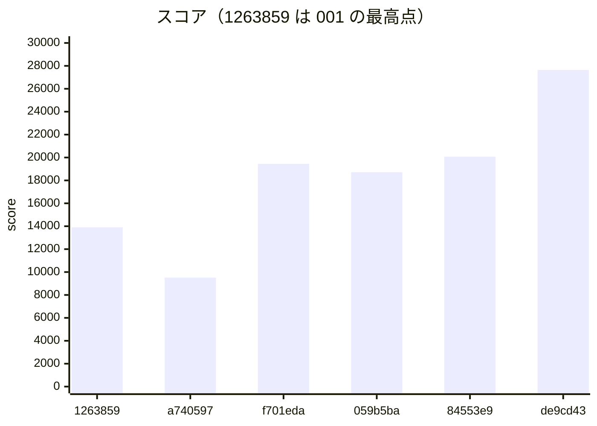

# 振り返り：画像のキャッシュを戻してから画像 URL の期限の切り下げまで（2026-10-31 の 11 時台）

- 書いた日時：2026-10-31 12:03
- 基準のコミット：16ce3fa（chore: ベンチ結果を記録する。de9cd43 の 27639 点の行）
- docs/retro/001_up-to-image-cache.md（基準 5bc4a01、13903 点まで）の続きです。範囲は、745b536 の画像の台ごとのキャッシュ（9518 点）から 16ce3fa までです。001 と重なる所は短くし、001 の後に起きたことを中心に書きます。
- 材料は次のとおりです。
  - git log fcbaaa2..16ce3fa、`docs/scores.tsv`、issue の本文とコメント（`gh issue view --comments`）
  - `logs/kit-notes.md`、`logs/notes/score-400k-elements.md`・`jpeg-decodeconfig.md`・`sig-exp-minute.md`
  - `logs/` の analyze の出力と、`pprotein/data/` のファイルの時刻
  - `logs/` と `pprotein/` は git の管理外で、main のチェックアウトにあります。
- issue の状態は 12:02 に確かめました。#1・#4・#7 が CLOSED（#4 と #7 は 11:50 に閉じた）、#2・#3・#5・#6・#8・#9 が OPEN です。
- 書いている間に、main は先へ進みました。29f9663（#6 の直し）が 11:52 に deploy されて 28851 点（11:56 の記録）になり、fbe5cc0（#8）がコミットされています。範囲の外なので、この文書では評価しません。ただし、de9cd43 の効き目と #5・#6 の確かめに要る材料だけは、範囲の外と断って引きます。

## スコアの推移

`docs/scores.tsv` の 20261031-111307 以降の行を、そのまま引きます。

```text
time	rev	pass	score	memo	expect	fail
20261031-111307	a740597	true	9518	画像のキャッシュ＋pprof（pprotein で 3 台の pprof を収集中）。スコアは調査役経由	画像の権限確認のクエリが消え、europe・america の GET /api/images が速くなる	
20261031-111735	f701eda	true	19447	perf: 通知を投稿期間の開始で全員分 INSERT せず、台ごとに投稿期間を見張ってつながっている利用者に配る (#1)	画像のキャッシュを戻して 13903 の帯に戻り、通知の INSERT と LOCK TABLE users が消えて投稿期間の開始が数十 ms になる	
20261031-112922	059b5ba	true	18714	perf: エクスポートで画像を投稿の posted_at で区画を絞って読む	エクスポートのクエリのバッファ参照が減る。スコアへの効き目は小さい見込み	
20261031-114331	84553e9	true	20072	feat: PostgreSQL のログを slp pg で読み、pprotein と make analyze でクエリごとの時間を見る	users の行ロックの待ちが上位から外れる。全クエリのログで asia2 の書き込みが増える	
20261031-114926	de9cd43	true	27639	perf: 画像 URL の期限を 60 秒単位に切り下げ、同じ分の中は署名を使い回す (#5)	asia1 の JPEG のデコードと署名の CPU が減り、asia の人数とスコアが伸びる	
```

- time 列は記録した時刻です。ベンチはその数分前に走っています（例：de9cd43 の回は、asia の負荷が 02:47:10〜02:49:18 UTC。#7 のコメント）。
- 9518 点の行は、001 を書いた後に `make score` で足しました（4449900、11:13）。001 では「scores.tsv に無い」と書いた行です。
- 1 回のベンチに入った施策は、次のとおりです。施策ごとの行はありません。
  - f701eda の回：8e8662b（キャッシュを戻す）と f701eda（通知、#1）
  - 059b5ba の回：059b5ba（エクスポート）だけ
  - 84553e9 の回：41c0796（advisory lock、#4）と 84553e9（PostgreSQL の全クエリのログ。計測を足す変更）
  - de9cd43 の回：fd3d884（JPEG のヘッダーだけ読む）と de9cd43（署名の使い回し、#5）。間の 1226ce3・1f86576 は手元の道具の直しで、アプリは変えません。
- 41c0796 と fd3d884 には、単独の行がありません。



asia1 の alp（`logs/<時刻>-alp.txt`。059b5ba の回は `logs/20261031-112922-export-alp-asia1.txt`）から、負荷の大きさを並べます。登録は、ベンチが走行中に増やす asia の利用者の数です。

```text
回        score  登録  POST /api/posts 回・平均・最小  GET /api/feeds/friends 回・平均  asia1 の合計リクエスト
1263859   13903    90  242・0.808・0.157               861・0.298                        10859
f701eda   19447   137  516・1.202・0.151              1039・0.909                        13734
059b5ba   18714   144  495・1.286・（列なし）          994・0.840                        14597
84553e9   20072   129  494・1.295・0.150              1070・0.836                        14209
de9cd43   27639   197  700・0.613・0.056              1389・0.790                        19108
```

## やったことと効果（時系列）

### 画像のキャッシュを戻し、通知を配り直す（8e8662b・f701eda、19447 点）

- 001 の最後の回（a740597、9518 点）では、745b536 で画像の中身と持ち主の状態を台ごとに持っていました。reviewer の要対応（ほかの台で古い画像が最大 2 秒見える、初期化でほかの台のキャッシュが消えない）は未対応でした。
- 8e8662b で、そのキャッシュ（`webapp/go/image_cache.go`）を丸ごと戻しました。コミットに書いた理由は 2 つです。13903 点から 9518 点に下がったことと、ほかの台で古い画像が見えることです。
- f701eda（#1）で、投稿期間を開く処理から、全員分の `INSERT INTO notifications` と `LOCK TABLE users` を外しました。
  - 各アプリ台が 50ms おきに自分のリージョンの開いている投稿期間を読み、SSE でつながっている利用者に配ります（`webapp/go/posting_window_hub.go`）。
  - 同じリージョンの開始どうしは `pg_advisory_xact_lock` で並べます（`webapp/go/admin_posting_window_api.go`）。
  - 調査役が research/notify で作った 91ef2a0 を、キャッシュを戻した上に入れ直したものです。
- 2 つを 1 回でベンチし、19447 点になりました。13903 点の 1.40 倍です。
- 効いた所です。
  - pg_stat_statements（pgss）で、通知の INSERT と `LOCK TABLE users` は 0 件になりました（`logs/20261031-111737-pgss.txt` の末尾）。
  - 投稿期間を閉じる UPDATE の平均は、217.02ms（1263859）→ 116.89ms になりました。
  - asia1 の `POST /api/admin/posting-window` の平均は、1.244 秒 → 0.539 秒（最小 0.019、最大 2.161）です。
  - asia の登録は 90 → 137 です。asia1 のリクエストは 10859 → 13734 件です。
- 次の待ちが見えました。pgss の 1 位は、users の行ロック（`SELECT id FROM users WHERE id = $1 AND status = $2 FOR NO KEY UPDATE`、3821 回・129312ms・平均 33.84ms）です。
- 9518 点の原因について、分かったことです。
  - この回も、pprotein は 3 台の CPU プロファイルを取っていました（`pprotein/data/dminsr1z*-pprof.pb.gz`、11:18）。
  - 計測の負担が同じでも 19447 点が出たので、9518 点の主な原因が計測の負担だった見込みは小さいと見ます（推測）。
  - ただし、キャッシュを戻したことと通知の施策が同じ回なので、キャッシュが原因だったとも決められません。
- #1 は 11:08 に一度閉じ、11:12 に開き直しています（人間の判断。通知の INSERT が残っていたため）。11:17 に閉じる条件を書き足し、11:18 に閉じました。閉じ方は「うまくいかなかったこと」に書きます。

### 40 万点に要る要素の見立て（11:25、`logs/notes/score-400k-elements.md`）

- 調査役が、f701eda の回のデータ（asia2 の DB、3 台のジャーナル、pprof）から、負荷の増え方を調べました。
  - ベンチは、走行中に asia の利用者だけを登録して増やします。europe と america の登録は、どの回も 5 件ちょうどです（#2 のコメント）。
  - asia1 の isureal が 150〜190%（上限 200%）に張り付いたところで、人数の増え方が鈍りました。asia2 の PostgreSQL は平均 77%、europe1 と america1 は 1% 前後でした。
  - asia1 の CPU の内訳は、投稿の JPEG のデコードが 37%、画像 URL の署名が 29%（うち Memories が 17.5%）、ユーザー検索が 10% です（`pprotein/data/dminsr1zjvi0-pprof.pb.gz`）。
- これで、次の施策の的が「DB の待ち」から「asia1 の CPU」に移りました。JPEG と署名の施策（後の 27639 点の回）は、ここから選ばれています。
- #2（europe・america の DB への往復）は、速くしても上積みは約 4500 点（推測）として、後回しを提案しました（#2 のコメント）。

### エクスポートの区画を絞る（059b5ba、18714 点）

- 059b5ba で、エクスポートの JOIN に `i.created_at = p.posted_at` を足しました。image_objects は created_at の月で区画に分かれているので、区画を 1 つに絞る狙いです。
- 18714 点で、前の回より 3.8% 低くなりました。expect にも「スコアへの効き目は小さい見込み」とあり、ぶれの内と見ます（推測）。
- エクスポートのクエリ（`... i.data AS image_data FROM posts p JOIN posting_windows ...`）の平均は、478.37ms（f701eda）→ 381.79ms（059b5ba）→ 464.13ms（84553e9）→ 565.93ms（de9cd43）でした。blk_read は 32067 → 40928 で、減っていません。区画が絞れたかは、EXPLAIN で確かめていません。
- この回は `make analyze` の出力がありません。手で取った alp と pgss（`logs/20261031-112922-export-*`）だけで、vmstat と pidstat はありません。

### users の行ロックを advisory lock に（41c0796、#4）と全クエリのログ（84553e9）、20072 点

- 41c0796 で、関係の操作（友達申請・承認・フォロー・ブロック・解除・RealMoji）とコメントが 2 人の users の行を `FOR NO KEY UPDATE` で取るのをやめました。代わりに、2 人の組ごとの `pg_advisory_xact_lock` で並べます（`webapp/go/relationship.go` の beginRelationshipTx と lockUserPair）。調査役の research/rowlock の 751f47b と同じ変更です。
- 84553e9 で、asia2 の PostgreSQL に `log_min_duration_statement = 0` を入れ、全クエリを本体のログに書くようにしました。そのログを slp pg で集計します（後の「道具の直し」）。
- 2 つは 11:33 に同じ deploy で入り、1 回でベンチしました。41c0796 の単独の行はありません。
- 20072 点で、前の回より 7%、f701eda の回より 3% 高くなりました。
- DB の待ちは、ほぼ消えました。
  - users の行ロックのクエリは、879 回・合計 17ms で 152 位です（#4 のコメント、11:45 に asia2 で読み取り）。前の 2 回は 1 位で、3821 回・129312ms と 4006 回・167344ms でした。
  - 1 位は、画像の中身の読み取り（`SELECT i.data, i.media_type FROM image_objects ...`、3215 回・94022ms）に替わりました（`logs/20261031-114331-pgss.txt`）。
- 一方で、asia の負荷はほとんど増えていません。登録は 144 → 129、投稿は 495 → 494 です。
  - DB の待ちの 1 位を消しても点が伸びなかったのは、asia1 の CPU が先に詰まっていたからと見ます（推測）。この回は CPU が取れておらず（後の「うまくいかなかったこと」）、確かめられていません。
  - 全クエリのログの負担が打ち消した可能性もあります（推測）。
- この回の asia1 の nginx の error.log とアプリのログを突き合わせて、#6 の 502 の原因がほぼ分かりました（#6 のコメント）。
  - アプリが 403 を返したのは 24 件、nginx の記録は 403 が 22 件と 502 が 2 件でした。502 はどれも `Connection reset by peer` です。
  - BAN の判定は、本文（画像）を読まずに 403 を返します。読み残しが大きいと Go のサーバーが接続を閉じ、本文を送っている途中の nginx が 502 にした、という見立てです（推測）。
- #4 は 11:50 に閉じました。「うまくいかなかったこと」に、閉じ方の注意を書きます。

### JPEG のヘッダーだけ読む（fd3d884）と署名の使い回し（de9cd43、#5）、27639 点

- fd3d884 で、投稿の画像の検査を `jpeg.Decode` から `jpeg.DecodeConfig` に替えました（`webapp/go/post_api.go` の createPostHandler）。
  - 縦横 4096 の上限は残しました。
  - RealMoji とプロフィール画像は変えていません。プロフィール画像の 400 は、BAN の判定に使われるためです（`logs/notes/jpeg-decodeconfig.md`）。
  - 壊れた JPEG でもヘッダーが正しければ通る、という差があります。それまでのベンチで、投稿の 4xx は 0 件でした。
  - claude/jpeg-decodeconfig-733ee7 の 75a0b37 と同じ変更です。
- de9cd43 で、画像 URL の exp を 60 秒単位に切り下げ、同じ分の中は署名を使い回すようにしました（`webapp/go/image_signature.go` の imageURLExp）。
  - 切り上げでなく切り下げにしたのは、人間の判断です（11:40 ごろ、#5 のコメント）。有効時間は 23 時間 59 分〜24 時間になり、24 時間を超えません。署名の形式と検証の結果は変わりません。
  - research/sig の 0235566 と同じ変更です。
- 2 つは 11:46 に同じ deploy で入り、1 回でベンチしました。fd3d884 の単独の行はありません。どちらの効き目かは、切り分けられていません。
- 27639 点で、前の回の 1.38 倍、今の最高点です。pass は true です。
- asia の負荷が大きく増えました。登録は 129 → 197、投稿は 494 → 700、asia1 のリクエストは 14209 → 19108 件です。
- `POST /api/posts` の平均は 1.295 → 0.613 秒、最小は 0.150 → 0.056 秒になりました。
  - 最小が縮んだのは、投稿 1 件ごとのデコード（fd3d884 のコメントで約 71ms）が消えた分と見ます（推測）。
- スコアの上がり分は、2 つの施策に分けられません。この回の pprof が無いためです。11:46:40 に始めた pprotein の収集（11:56:40 に保存）は、httplog と slowlog だけで、pprof のファイルがありません。
- 範囲の外の材料ですが、次の 29f9663 の回の asia1 の pprof（`pprotein/data/dmiomfyh8l74-pprof.pb.gz`、11:53 から 300 秒）が、CPU の面の手がかりになります。29f9663 は #6 の直しだけを足した版で、JPEG と署名のコードは de9cd43 と同じです。f701eda の回の pprof（`dminsr1zjvi0`、240 秒）と比べました。
  - `image/jpeg.Decode` は、36.70 秒（37.44%）から一覧に出なくなりました。
  - `imageSignature` は、28.69 秒（29.27%）→ 31.46 秒（39.21%）です。asia1 のリクエストは 13734 → 19784 件（1.44 倍）なので、1 リクエストあたりでは約 2 割減っただけです。
  - `sha256.blockAVX2` の flat は 23.57% → 32.48% です。
  - CPU を空けたのは、主に fd3d884 と見ます（推測）。de9cd43 の署名の使い回しは、見込み（署名の CPU が半分以下）ほど効いていません。理由は確かめていません。
- CPU は、f701eda の回と比べて次のとおりです（`logs/20261031-111737-*/summary.txt`・`logs/20261031-114926-*/summary.txt`）。
  - asia1 の isureal は、平均 146.3% → 123.0% に下がりました。リクエストは 1.39 倍なので、1 リクエストあたりの CPU は大まかに 4 割減った計算です（推測を含む概算）。
  - asia2 の postgres は、平均 77.0% → 116.3% に上がりました。実行待ちは平均 8.4、最大 36 です。
- DB の上位です（`logs/20261031-114926-pgss.txt`）。
  - 1 位は画像の中身の読み取りで、4531 回・154449ms です。
  - 2 位は `INSERT INTO image_objects` で、765 回・92974ms です。平均は 37.32ms（84553e9）→ 121.53ms に伸びました。asia2 が詰まってきた兆しと見ます（推測）。
- この回の vmstat で、#7（asia2 にもアプリを立てる）の進める条件を見ました（#7 のコメント）。
  - 条件の 1 つは「asia2 が、負荷の区間の半分以上の秒で 60% 未満」です。60% 未満だった秒は 9% だけで、80% 以上が 59% でした。
  - DB の台も詰まっているので、asia2 にアプリを足しても伸びない見込みとして、#7 は not planned で閉じました。
- 11:48 に、次の候補として #8（画像の中身を各台に持つ）と #9（フィードを SQL で絞る）を立てました。

### 道具の直し

- 84553e9：PostgreSQL のログを、pprotein と `make analyze` で読めるようにしました（research/pgslow の 5ccf1f8 と同じ変更）。
  - pprotein v1.2.4 は slp を `slp my` で呼ぶと決め打ちしています。`scripts/slp-pg.sh` を挟み、`SLOW_LOG_KIND=pg` のときは `slp pg` で読みます。
  - アプリ（pgx）は拡張問い合わせなので、ログが parse・bind・execute の 3 行に分かれます。execute の行を `statement:` の形に直し、parse と bind を捨てます。
  - deploy は PostgreSQL を reload しないので、手で reload しました（`server/asia2/etc/postgresql/16/main/conf.d/isu-measure.conf` のコメント）。
- 1226ce3：prebench が、PostgreSQL のログを空にできていませんでした（research/truncate の e497c77 と同じ変更）。
  - 前は `sudo truncate -s0 ... 2>/dev/null || true` で、失敗を握りつぶしていました。
  - `/var/log/postgresql` は、グループが書けるスティッキーなディレクトリです。`fs.protected_regular=2` の下では、truncate が O_CREAT 付きで開くので root でも断られます（`logs/kit-notes.md`）。
  - `truncate -c` にし、失敗したら警告を出すようにしました。
- 1f86576：slp pg の読み方を 2 つ直しました。
  - slp pg は 1 件を 1 行でしか読まず、複数行の SQL の続きを落とします。アプリの SQL はほとんど複数行なので、続きを 1 行につないで渡します。
  - slp の `--limit` は表示の件数ではなく、まとめたクエリの種類の上限です。超えるとエラーで止まるので、5000 に上げ、表示は head で絞ります。
- 4db0c5d：issue のテンプレート（`.github/ISSUE_TEMPLATE/kaizen.md`）に「閉じる条件」を足しました。#1 が完了の条件の一部だけで閉じられたためです（`logs/kit-notes.md`）。11:17 に、#1〜#6 にも閉じる条件をコメントで足しました（#1〜#3 のコメントに「人間の依頼」とあります）。

## 的確だったアプローチ

- 状態を持つキャッシュを、直すより先に戻しました（8e8662b）。点が下がり、FAIL の条件に触れうる要対応も残っていたからです。次の回で 19447 点になり、データの反映の心配も消えました。
- 戻した学びを、次の案に入れました。#8 は、変わらない画像の中身だけを台に持ち、権限と削除は毎回 DB で確かめる設計です。745b536 との違いを、issue の経緯に書いています。
- 負荷の増え方そのものを調べて、的を決め直しました（`logs/notes/score-400k-elements.md`）。
  - 「ベンチは asia の人数を増やし、asia1 の CPU で止まる」と分かりました。
  - pprof で CPU の内訳を出し、上位 2 つ（JPEG・署名）を選びました。この 2 つで 27639 点になりました。
- europe・america を、根拠を付けて後回しにしました。登録がどの回も 5 件で、今の遅さでも期間内に回り切っていることを、ジャーナルで確かめています（#2 のコメント）。
- 閉じる条件を、数字で先に書くようにしました（4db0c5d）。
  - #4 は、pgss の順位という数字で効き目を示して閉じました（条件の 1 つの扱いは後述）。
  - #7 は「asia2 が半分以上の秒で 60% 未満」という進める条件を先に決め、満たさないことを測ってから not planned にしました。台の役割を変える前に、測って止められました。
- 仕様に触れうる判断を、人間に上げました。exp の切り上げ・切り下げ（#5）と、#1 の開き直しです。
- 役を分けて、1 コミットずつ取り込みました。調査役や役なしのセッションが worktree で作り、操作役が cherry-pick しています。41c0796・84553e9・1226ce3・4db0c5d・fd3d884・de9cd43 は、worktree の元のコミットと同じパッチです（`git patch-id` で確かめた）。f701eda は、キャッシュを戻した上に入れ直したので、元の 91ef2a0 とは違います。
- 001 の記録の漏れを埋めました。9518 点を `make score` で足し、その後の 4 回もすべて scores.tsv にあります。
- 道具が黙って失敗していた所（prebench の truncate）を見つけ、`|| true` を外して警告に替えました。
- 前の回のログの突き合わせ（nginx の error.log とアプリのログ）で、原因不明だった #6 の 502 を説明できました。

## うまくいかなかったこと

- 施策を 2 つずつ 1 回でベンチし、スコアへの寄与を分けられませんでした。
  - 8e8662b と f701eda：9518 点の原因が、キャッシュかぶれかを決められないままです。
  - 41c0796 と 84553e9：計測を足す変更を、施策と同じ回に入れました。001 の「計測は施策と同じ回に足さない」を繰り返しています。
  - fd3d884 と de9cd43：27639 点のうち、どちらがどれだけかは分かりません。
- 計測の窓が、また外れました。
  - 84553e9 の回は、vmstat と pidstat が 02:33:46〜02:37:45 UTC の 240 秒で終わりました。ベンチは 02:38〜02:43 UTC ごろでした（#6 のコメント）。`logs/20261031-114331-asia1/summary.txt` は「ベンチ中と分かる区間なし」です。
  - prebench（11:33 の deploy の直後）から 4 分以上たってからベンチが始まり、ポータル用の窓（`PORTAL_MEASURE_SECONDS=240`）を過ぎました。
  - pprotein の pprof も、11:37 の小さなファイル（5〜7KB）だけです。ベンチ前の空いている時間を取ったと見ます（推測）。
  - そのため、「行ロックを消しても点が伸びなかったのは asia1 の CPU のせい」を確かめられませんでした。
- 059b5ba の回は `make analyze` を回していません。手で取った alp と pgss だけで、CPU がありません。
  - 手で取ったファイルには、ほかに `logs/20261031-113133-same-*` があります。どの走行のものかは、確かめられませんでした。
- de9cd43 の回の pprof がありません。#5 の閉じる条件（asia1 の sha256.blockAVX2 の flat が 15% 未満）を、その回では確かめられませんでした。次の回（範囲の外）の pprof では 32.48% で、条件に届いていません。
- #1 は、閉じる条件の 1 つを満たさないまま閉じました。
  - 11:17 に書いた条件の 1 つは、「asia の alp で `POST /api/admin/posting-window` の平均が 0.1 秒を切る」です。11:18 に閉じたときは 0.539 秒でした。
  - 調査役は 11:19 に「1 つだけ満たしたので、まだ閉じません」とコメントしています。issue は閉じたままです。
  - その後の回も 0.449 秒（84553e9）・0.333 秒（de9cd43）で、0.1 秒を切っていません。
  - 調査役の見立ては、投稿期間を閉じる UPDATE が、処理中の投稿の `FOR SHARE` の行ロックを待つ、です（推測）。001 で reviewer が指摘した 17b319e の要対応と同じ所です。
- #4 も、閉じる条件の 1 つに触れずに閉じました。
  - 条件の 1 つは「ログイン側（createLoginSessionTx）と関係の操作側の、片方だけを直した施策では閉じない」です。41c0796 はログイン側を変えていません。`webapp/go/session.go` は今も `FOR NO KEY UPDATE` を取ります。
  - 調査役は、ログインの待ちも消えたので巻き込まれていただけと見て（推測）、閉じるかを人間に上げていました。閉じるコメントは、この条件に触れていません。
- 059b5ba（エクスポート）は、効き目を確かめられていません。平均は回ごとに上下し、blk_read は減っていません。
- asia2 に全クエリのログ（`log_min_duration_statement = 0`）が入ったままです。
  - de9cd43 の回の分として pprotein が集めたログは 79MB です（`pprotein/data/dmiohljckt5k-slowlog.log`、11:56）。
  - asia2 が詰まってきた今、その負担は測っていません。小さくない可能性があります（推測）。
  - `make measure-off` は、これを外しません。`scripts/measure.sh` が書き換えるのは、MySQL の `server/all/etc/mysql/conf.d/isu-slow.cnf` だけです。

## 次に活かすこと

- 1 回のベンチに入れる施策は 1 つにします。2 つ入れるなら、alp と pprof で寄与を分けられる組み合わせに限り、その回の pprof を必ず残します。
- 計測を足す・外す変更は、施策と別の回にします。
- ポータルのベンチは、`make prebench` の直後に始めてもらいます。間が空いたら prebench を回し直します。analyze の後、`summary.txt` に「ベンチ中の N 区間」が出ているかを確かめ、出ていなければその回の CPU は使いません。
- pgss の 1 位を消しても、点は伸びないことがあります。先に、CPU が張り付いている台を見て、そこに効く施策を選びます。今は asia1 に加えて、asia2（DB）も詰まり始めています。
- issue を閉じるときは、閉じる条件を 1 つずつ照らし、満たさないものがあれば閉じずに人間に上げます。条件を変えるなら、その旨をコメントに書いてから閉じます。
- open の issue との関係です（12:02 の状態）。
  - #8（画像の中身を各台に持つ）：de9cd43 の回の DB の 1 位（4531 回・154 秒）です。asia2 の負荷を下げる本命と見ます。745b536 の学びどおり、権限と削除は毎回 DB で確かめます。初期化で全台のメモリを消すかは、入れる前に人間が決めます。施策は fbe5cc0 で main に入りました（範囲の外）。状態を持つ施策なので、001 の学びのとおり、reviewer の要対応（データの反映・初期化）を片付けてから点を見ます。
  - #9（フィードを SQL で絞る）：asia の人数が増えるほど重くなります。asia1 の `GET /api/feeds/friends` は、1263859 の回の平均 0.298 秒から、人数が増えた回では 0.79〜0.91 秒になりました。de9cd43 の回は 1389 回・合計 1097 秒です。
  - #3（友達申請の受信側とユーザー検索）：ユーザー検索は asia1 の CPU の約 10%（f701eda の pprof）です。de9cd43 の回の pgss でも 599 回・49394ms・平均 82.46ms で、asia1 と asia2 の両方に効きます。
  - #5（署名）：施策は de9cd43 で入りましたが、次の回（範囲の外）の pprof で sha256.blockAVX2 の flat は 32.48% で、閉じる条件（15% 未満）に届いていません。署名を多く作る所（`listMemories` は同じ pprof で 18.70 秒）と、使い回しが効かない理由を、調べ直します。
  - #6（PUT /api/me/profile-image の 5xx）：直しは 29f9663 で入りました。29f9663 の回（範囲の外）の asia1 の alp では、5xx は 0 件でした（`logs/20261031-115603-alp.txt`）。それまでは f701eda 0・059b5ba 5・84553e9 2・de9cd43 3 件で、0 件の回もあったので、もう 1 回見てから閉じるのが安全です。
  - #2（europe・america の往復）：europe と america の人数は 5 人のままです。asia の伸びが止まるまで後回しにし、止まったら人数を増やす条件をもう一度調べます。
- 閉じた issue の残りです。
  - #1 の残り（投稿期間の開始の平均 0.333 秒、`FOR SHARE` との待ち）が要るなら、新しい issue にします。
  - #7（asia2 にアプリを足す）は、#8 などで asia2 が空いてから測り直します。
- asia2 が詰まってきたので、全クエリのログの負担を測る回（外して 1 回）を、どこかで入れます。最終盤に外す手順も決めます（`make measure-off` では外れない）。
- キットへの気付きです。終わってから isucon-kit の issue にします。
  - このリポジトリで直したもの（isucon-kit にも入れる）：slp pg の挟み込みと複数行の SQL（84553e9・1f86576）、prebench の `truncate -c` と警告（1226ce3）、issue テンプレートの閉じる条件（4db0c5d）。
  - `logs/kit-notes.md` に控えたままのもの：pprotein.sh が `SLOW_LOG=""` でも slowlog を足す、deploy が PostgreSQL を restart も reload もしない、`tests/test_local.sh` が main で 3 件 NG。
  - この振り返りで見つけたもので、`logs/kit-notes.md` にまだ無いもの：ポータル用の窓（240 秒）を prebench から数えるので、ベンチの開始が遅れると外れる。`make measure-off` が PostgreSQL の全クエリのログを外さない。
