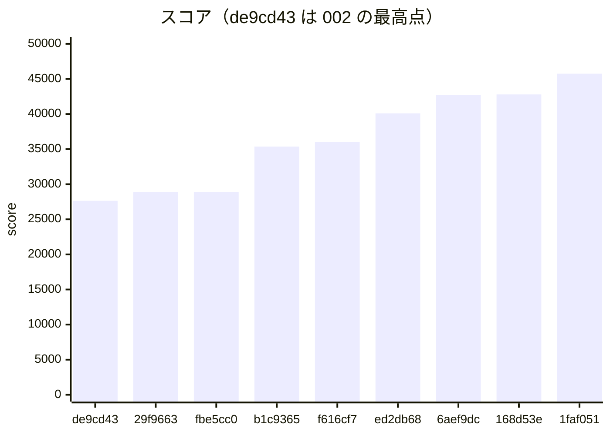
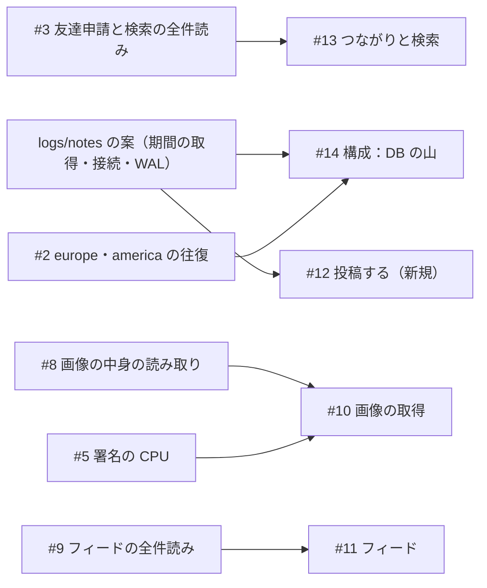

# 振り返り：#6 の本文の読み切りから、署名を検証のキャッシュに入れるまで（2026-10-31 の 12 時台）

- 書いた日時：2026-10-31 13:00
- 基準のコミット：dc24c8b（コミットした時点の main の先頭）。記録の最新は、6a4cd2a が足した 1faf051 の 45745 点の行です。
- docs/retro/002_up-to-sig-exp-minute.md（基準 16ce3fa、27639 点まで）の続きです。範囲は、29f9663（#6、28851 点）から 6a4cd2a までです。
  - 002 は、29f9663 と fbe5cc0 を範囲の外として一部だけ引いています。この 2 つは短くし、002 の後に起きたことを中心に書きます。
  - 依頼の時点では、main の先頭は 6aef9dc でした。書いている間に、42709 点・42794 点・45745 点の 3 行と、6bccaf7・168d53e・d82964c・1faf051 が足されました。どれも含めます。
  - dc24c8b（投稿の手順を PostgreSQL の関数にまとめる、#12）は、書き終える直前に main に入りました。記録の行がまだ無いので、評価しません。
- 材料は次のとおりです。
  - git log 16ce3fa..6a4cd2a、`docs/scores.tsv` の 20261031-115603 以降の行
  - issue の本文とコメント（`gh issue view --comments`）。12:45 に読み、12:58 に状態が変わっていないことを確かめました。
  - `logs/notes/` の 002 の後のメモ：proposals-after-35370.md・feed-9.md・search-3.md・plan-combined.md・drain-body.md・sig-load-options.md・newcomer-post-rate.md（と .sql）・bench-results.md・issue-goals.md・pg-measure.md・sign-offload-design.md
  - `logs/` の analyze の出力（20261031-115603〜125437）と `logs/kit-notes.md`
  - `pprotein/data/` の asia1 の pprof と httplog（12:07〜12:55 の収集）。ed2db68 の回の httplog は、手元の `.tools/alp` で `make analyze` と同じ引数で集計しました。
  - `benchlog1.md`（35370 点の回のベンチの出力。aa27563 で GitHub の画面から置かれた）
  - 全体のレビュー：`~/obsidian/ai-docs/isucon2026/20261031_main/システムレビュー_計測とエージェントのノイズ.md`（リポジトリの外。冒頭の記載は 12:30 ごろ、ファイルの更新は 12:22）
  - `logs/`・`pprotein/`・`logs/notes/` は git の管理外で、main のチェックアウトにあります。
- dc24c8b の時点で main に入っていないものです（`git merge-base --is-ancestor` で確かめた）。
  - 4d57680：PostgreSQL の計測を `make measure-off` で外せるようにする（ブランチ fix/pg-measure）
  - 4a84b78：issue を機能ごとの目標で立てる決まり（ブランチ issue-goals）
- issue の状態（12:58）：#10〜#14 が OPEN です。#1〜#9 は CLOSED です。#6 は 12:20 に完了で、#2・#3・#5・#8・#9 は 12:36〜12:37 に重複（duplicate）で閉じました。

## スコアの推移

`docs/scores.tsv` の 20261031-115603 以降の行を、そのまま引きます。

```text
time	rev	pass	score	memo	expect	fail
20261031-115603	29f9663	true	28851	fix: BAN などで本文を読まずに返すときも本文を読み切り、403 が nginx で 502 にならないようにする (#6)	PUT /api/me/profile-image の 5xx が 0 になり 403 に変わる。スコアへの効き目は小さい	
20261031-120624	fbe5cc0	true	28885	perf: 画像の中身だけを台ごとのメモリに持ち、生きているかは毎回 DB に聞く (#8)	画像の取得のクエリが中身を運ばなくなり、asia2 の CPU と画像の取得の合計時間が下がる	
20261031-121433	b1c9365	true	35370	#3 ユーザー検索と受け取った友達申請。messages に失敗が十件ほど（件数は人間の目視）	ユーザー検索が 97ms から 10ms 前後に下がり、asia1 の CPU の検索の分が減る	10
20261031-123015	f616cf7	true	36029	nginx の keepalive と画像の区画の表。スコアは調査役経由	通信の失敗が 0 になり、画像の取得と鍵のクエリが軽くなって asia2 の CPU が下がる	
20261031-123739	ed2db68	true	40100	DB 接続の待機数・login_sessions のインデックス・エクスポートの画像キャッシュ。messages は 502 が 2・closed network connection が 10・friend-requests の EOF が 5 ほど（人間の目視）	セッションの確認とエクスポートが軽くなり、接続の張り直しが減る	17
20261031-124329	6aef9dc	true	42709	perf: フィードの候補を投稿者か公開範囲で SQL から絞り、投稿期間と投稿者の複合インデックスを足す (#9)	worker_connections の不足と通信の失敗が消え、フィードのクエリが軽くなる	0
20261031-124803	168d53e	true	42794	fix: 空いた DB の接続を 1 分で返し、初期化の接続の空きを残す (#14)	asia1 の CPU の署名の割合が下がり、途中から入った人の投稿の割合が上がる	0
20261031-125431	1faf051	true	45745	perf: Memories で次のページの有無を見るためだけに読む 51 件目を、応答を作る前に落として署名しない (#10)	画像の取得の検証で署名を計算し直さなくなり、asia1 の CPU の署名の割合が下がる	0
```

- 8 回とも pass です。27639 点（de9cd43）から 45745 点まで、1.66 倍になりました。
- 1 回のベンチに入った施策は、次のとおりです。8 回のうち 6 回が、複数の施策を 1 回で測った行です。施策ごとの行はありません。
  - 29f9663 の回：29f9663（本文の読み切り、#6）だけ
  - fbe5cc0 の回：fbe5cc0（画像の中身を台ごとに持つ、#8）だけ
  - b1c9365 の回：4f4dd8b（ユーザー検索）と b1c9365（受け取った友達申請のインデックス）。どちらも #3 です。
  - f616cf7 の回：b7a235b（nginx の keepalive）と f616cf7（画像の区画の表）
  - ed2db68 の回：fb20e64（DB の待機させる接続）・7639713（login_sessions のインデックス）・ed2db68（エクスポートで画像のキャッシュ）
  - 6aef9dc の回：38e2c2f（nginx の worker_connections、#14）と 6aef9dc（フィードを SQL で絞る）
  - 168d53e の回：6bccaf7（画像 URL の期限を 1 時間単位に、#10）と 168d53e（空いた DB の接続を 1 分で返す、#14）
  - 1faf051 の回：d82964c（署名を検証のキャッシュにも入れる、#10）と 1faf051（Memories の 51 件目を署名しない、#10）
- memo に施策の組を書いたのは、b1c9365・f616cf7・ed2db68 の行です。6aef9dc・168d53e・1faf051 の行の memo は最後のコミットの件名だけで、38e2c2f・6bccaf7・d82964c は memo に出てきません（expect には出てくる）。
- fail 列について、事実を分けて書きます。
  - b1c9365 の 10 と ed2db68 の 17 は、人間がベンチの messages を目で数えた件数です（memo にそう書いてある）。benchlog1.md の messages は 9 件でした。
  - f616cf7 の行は空です。調査役の記録（`logs/notes/bench-results.md`）では、失敗が 1 件ありました。
  - 6aef9dc・168d53e・1faf051 の行は 0 です。
  - `make best` は、fail が 0 より大きい行を除きます。そのため、35370 点と 40100 点の行は、良かったコミットの候補に出ません（`make best` で確かめた）。
- 同じ版を 2 回測った行はありません。28851 点と 28885 点、42709 点と 42794 点の差がぶれの内かは分かりません。



asia1 の nginx のアクセスログ（`logs/<時刻>-alp.txt`）から、負荷の大きさを並べます。ed2db68 の回だけは analyze の出力がないので、pprotein の httplog（`pprotein/data/dmiphkdiup1s-httplog.log`）を集計した値です。登録は、ベンチが走行中に増やす asia の利用者の数です。CPU は `logs/<時刻>-<台>/summary.txt` の pidstat の平均（1 コア = 100%）です。

```text
回        score  登録  asia1 のリクエスト  POST /api/posts 回・平均  GET /api/feeds/friends 回・平均  asia1 isureal  asia2 postgres
de9cd43   27639   197  19108               700・0.613                1389・0.790                        123.0%         116.3%
29f9663   28851   208  19784               736・0.537                1548・0.754                        120.1%         115.1%
fbe5cc0   28885   239  19561               784・0.663                1328・1.003                        119.8%         108.9%
b1c9365   35370   328  24417               1018・0.744               1735・1.225                        107.5%         118.3%
f616cf7   36029   315  24631               1030・0.681               1773・1.124                        116.3%         109.5%
ed2db68   40100   381  28083               1089・0.688               1795・1.188                        （なし）       （なし）
6aef9dc   42709   371  29987               1168・0.694               2028・1.106                        126.8%         102.3%
168d53e   42794   376  29310               1193・0.736               2035・1.122                        130.4%          97.4%
1faf051   45745   397  31078               1206・0.734               2174・1.103                        126.1%         103.1%
```

asia1 の CPU プロファイル（どれも 240 秒、`go tool pprof -top -cum`）から、主な関数の cum を並べます。ファイルは、各回の収集でいちばん大きいものです。b1c9365 と f616cf7 の回は、`logs/notes/sig-load-options.md` と #10 が asia1 として引いているファイルと同じです。

```text
回        ファイル        総サンプル  imageSignature   listMemories    エクスポート     ユーザー検索     フィード
fbe5cc0   dmiouitxwhq8    77.43s      31.77s 41.03%    16.45s 21.24%   12.68s 16.38%    18.20s 23.51%    4.06s 5.24%
b1c9365   dmip0bnsaoxs    72.49s      33.86s 46.71%    20.75s 28.62%    8.81s 12.15%     8.54s 11.78%    5.74s 7.92%
f616cf7   dmip8u8akjjs    77.41s      38.01s 49.10%    20.85s 26.93%   13.21s 17.06%     7.78s 10.05%    5.50s 7.11%
ed2db68   dmiphkdiue8w    86.05s      48.72s 56.62%    28.19s 32.76%   15.93s 18.51%     9.21s 10.70%    5.71s 6.64%
6aef9dc   dmipmsre4vwo    86.01s      51.77s 60.19%    29.23s 33.98%   16.98s 19.74%     9.27s 10.78%    1.81s 2.10%
168d53e   dmipqgtjk0ts    84.69s      49.37s 58.29%    27.55s 32.53%   17.22s 20.33%    10.21s 12.06%    1.77s 2.09%
1faf051   dmipvlgjrmug    81.74s      46.40s 56.77%    28.81s 35.25%   18.47s 22.60%     9.13s 11.17%    1.86s 2.28%
```

- listMemories とエクスポートの cum には、その中で呼ぶ imageSignature の分が含まれます。

## やったことと効果（時系列）

### 本文を読み切る（29f9663、#6、28851 点）

- 002 で原因を書いた、BAN の 403 が nginx で 502 になる件の直しです。research/drain の bd72209 と同じパッチです（`git patch-id` で確かめた。以下の cherry-pick も同じ方法で確かめています）。
- 28851 点で、27639 点の 1.04 倍です。expect どおり、点への効き目は小さい施策です。
- `PUT /api/me/profile-image` の 5xx は、29f9663・fbe5cc0・b1c9365 の 3 回とも 0 件でした。12:20 に、3 回分の表をコメントに貼って #6 を完了で閉じました。002 の「0 件の回もあったので、もう 1 回見てから閉じる」を守った形です。

### 画像の中身だけを台ごとに持つ（fbe5cc0、#8、28885 点）

- 変わらない中身だけを台のメモリに持ち、生死と権限は毎回 DB で確かめる設計です。001 で戻した 745b536 の学びを入れています。research/imgdata の 6a33f30 と同じパッチです。
- 28885 点で、前の回とほぼ同じです。
- expect の「asia2 の CPU と画像の取得の合計時間が下がる」は、ほとんど起きませんでした。
  - 画像のクエリ（pgss の 1 位）は、4531 回・平均 34.09ms（de9cd43）→ 4438 回・31.54ms です（`logs/20261031-120624-pgss.txt`）。
  - asia2 の postgres は 115.1% → 108.9% です。
  - asia1 の `GET /api/images/<id>` の平均は 0.248 → 0.301 秒で、伸びました。
- 後の f616cf7 で、このクエリが重い理由が分かりました。image_objects は created_at の月で約 36 の区画に分かれていて、id だけで引くと全区画を引いていました（1 回あたり約 345 バッファ、`sql/005_image_object_locations.sql` のコメント）。中身を運ぶ量ではなく、区画を探す量が重さの元だったと見ます。f616cf7 の後に平均が 9.84ms に下がったことが根拠です。

### ユーザー検索と受け取った友達申請（4f4dd8b・b1c9365、#3、35370 点）

- 役なしのセッションがサブエージェントに作らせ、差分とテストを見直しました（`logs/notes/search-3.md`）。15669c2・6e780b2 と同じパッチです。
  - 4f4dd8b：検索の 1 回目は、照合に使う 3 列だけを部分インデックス（`sql/003_users_search.sql`）から読みます。カーソルの有無で SQL を 2 つに分けました。pgx が使い回す実行計画が、Seq Scan と Sort を選ぶためです。正規化の結果は台ごとのメモリに覚えます。
  - b1c9365：`friend_requests(recipient_id, status)` のインデックスを足しました（`sql/004_friend_requests_recipient.sql`）。
  - 前の実装を参照としてテストに残し、応答がバイト単位で同じことを確かめています（`TestSearchUsersMatchesReference`）。
- 2 つを 12:10 に cherry-pick し、1 回でベンチしました。35370 点で、前の回の 1.22 倍です。この範囲で最も大きい伸びです。
- 効いた所です。
  - asia1 の pprof で、`searchUsersHandler` の cum は 18.20 秒（23.51%）→ 8.54 秒（11.78%）になりました。
  - asia の登録は 239 → 328、asia1 のリクエストは 19561 → 24417 件です。
  - 検索のクエリは、682 回・平均 97.16ms（全列を読む前の SQL）→ 955 回・28.23ms（3 列の SQL）です。expect の「10ms 前後」には届いていません。テスト DB（PostgreSQL 17、users 約 5000 件）では 1ms 前後でした。本番は 16 で、計画が違う可能性があります（推測）。
- どちらがどれだけ効いたかは、分けられません。asia1 の CPU が 1 割ほど空いた検索の側が主だと見ます（推測）。受け取った申請の一覧は、alp で 360 回・平均 0.282 秒と小さく、EXPLAIN での確かめもまだです（#13 の項目）。
- この回の messages に、通信の失敗が 9 件ありました。後の「通信の失敗と nginx の設定」に書きます。

### 35370 点の回の読み解き：人数が 4 日目で止まる

- 12:17 に、人間がベンチの出力を `benchlog1.md` として GitHub の画面から置きました（aa27563）。asia の利用者は、投稿期間ごとに 18 → 51 → 141 → 311 → 311 → 310 人で、4 日目から増えていません。europe は 7〜8 人、america は 6 人のままです。
- 役なしのセッションが、asia2 の DB を読み取って、期間ごとの登録と投稿を数えました（`logs/notes/proposals-after-35370.md`）。

```text
期間  その期間に登録した人  うち投稿できた人  前からいた人の投稿
1      4                    0                 19
2     37                   35                 18
3     92                   91                 46
4    174                   83                130
5      6                    0                292
6      2                    0                304
```

- 途中から入った人は、期間の開始の約 2 秒後に登録します。その期間の通知は届かないので、残りの約 7 秒で登録・ログイン・期間の取得・投稿を終える必要があります。4 日目は、これが 48% しかできませんでした。
- 「新しく来た人が最初の期間に投稿できないと、ベンチは人数を増やさない」という見立てです（推測）。この割合を、施策の効き目の目安にしました。
  - 12:33 ごろ、ベンチの後に流す読み取りだけの SQL を `logs/notes/newcomer-post-rate.sql` に置きました。
  - 新しい issue の #12 の目標（途中から入った人の 9 割以上が、その期間に投稿できる）になりました。
- 4 日目の割合は、48%（b1c9365）→ 57%（f616cf7）→ 36%（ed2db68）でした。6aef9dc からの 3 回は、`bench-results.md` に記録がありません。
- このときの詰まりは asia2 の DB と見ていました。asia2 の vmstat で、us+sy が 20% 以上の 67 秒のうち、52 秒が 80% 以上でした（#14）。
- 同じ見立ての中で、次の案が並びました。DB の待機させる接続、nginx の keepalive、WAL のチェックポイント、期間の取得を軽くする、worker_connections、全クエリのログを外す、エクスポートで画像のキャッシュを使う、です。このうち 4 つ（待機の接続・keepalive・worker_connections・エクスポート）が、この後に入りました。

### nginx の keepalive（b7a235b）と画像の区画の表（f616cf7）、36029 点

- b7a235b は、操作役が main で作りました。`keepalive_requests 100000` と `keepalive_timeout 120s` を足しています（`server/all/etc/nginx/nginx.conf`）。
- f616cf7 は、research/imgloc の 60fe842 と同じパッチです。
  - 画像の id から区画の時刻を引く表 `image_object_locations` を足しました（`sql/005_image_object_locations.sql`）。既存の約 183 万行を埋めます。
  - 画像の取得と削除で、区画を 1 つに絞ります。表に無い画像は、id だけで引き直します（`webapp/go/image_location.go`）。
- 2 つは 12:21 に同じ deploy で入り、1 回でベンチしました。36029 点で、前の回の 1.02 倍です。スコアは、人間から調査役を経て記録されました。
- DB の負荷は大きく下がりました（`logs/20261031-123015-pgss.txt`）。
  - 画像の生死と権限の判定：5332 回・平均 33.98ms・合計 181 秒（1 位）→ 5369 回・9.84ms・53 秒（3 位）
  - 持ち主の鍵のクエリ：平均 4.62ms → 2.62ms
  - 画像の INSERT：平均 146.94ms → 92.25ms
  - asia2 の us+sy が 80% 以上の秒：52 → 38（#14）
- 一方で、点も人数もほとんど動いていません。登録は 328 → 315 です。asia1 の pprof で imageSignature は 46.71% → 49.10% になり、詰まりが asia1 の CPU に移ったと見ます（推測）。
- 通信の失敗は 9 件から 1 件に減りました（`bench-results.md`）。

### 全体のレビュー（12:22）

- リポジトリの外に、全体のレビューが書かれました。計測の仕組み・エージェントにとってのノイズ・アプリのコードの 3 観点で、読んだ範囲は c6b4e7c〜b1c9365 です。
- 結論の 1 つ目は、PostgreSQL の計測（全クエリのログ）を外す手段がないことです。2 つ目は、点と施策の結び付きが弱いこと。3 つ目は、キットが MySQL 前提のまま残っていることです。
- 指摘のうち、何が main に入ったかは、後の「全体のレビューの指摘の行き先」に分けて書きます。

### DB の待機接続・login_sessions のインデックス・エクスポートの画像キャッシュ（fb20e64・7639713・ed2db68）、40100 点

- fb20e64 は、research/conn の 82619e3 と同じパッチです。`SetMaxOpenConns(30)` だけで待機の接続が Go の既定の 2 本だったのを、`SetMaxIdleConns(30)` にそろえました。レビューの 3-1 と、35370 点の見立ての 1 番目に当たります。
- 7639713 は、research/export の e92da63 と同じパッチです。`login_sessions(token_hash)` と、有効なセッションの `user_id` のインデックスを足しました（`sql/006_login_sessions.sql`）。セッションの確認は 17158 回あり、1 回あたり約 48 ブロックを読んでいました。
- ed2db68 は、research/export の 111f415 と同じパッチです。エクスポートで、台が持っている画像の中身を使い、持っていない分だけ DB から読みます。JOIN の条件 `i.created_at = p.posted_at`（059b5ba）は、そのまま残しています。
- 3 つは 12:33 に続けて入り、1 回でベンチしました。40100 点で、前の回の 1.11 倍です。
- 効いた所です（`bench-results.md`。pgss は 03:33 UTC にリセットした後の分を、調査役が asia2 で読み取った）。
  - セッションの確認は、上位 9 位から消えました。
  - 画像の生死の判定は平均 9.8 → 6.1ms、画像の INSERT は 92 → 73ms です。
  - エクスポートのクエリは 551 → 478ms です。1 回あたり約 2450 ブロックで、キャッシュの当たりは少ないと見ています（推測）。
  - ユーザー検索のクエリは 1066 回・平均 18ms です。
  - 登録は 315 → 381、asia1 のリクエストは 24631 → 28083 件です。
- 接続の張り直しが減ったかは、確かめていません。`pg_stat_database.sessions` の累計は、12:25 ごろの 25916 から 27209 になりました。間に f616cf7 と ed2db68 の 2 回の走行があり、分けられません。
- fb20e64 の後、DB の接続は常時 94 本になりました。一般ユーザーが使える 97 本（max_connections の既定 100 から予約の 3 本を引いた数）に対して、余裕は 3 本です。これは reviewer の指摘で、後の 168d53e につながります。
- 4 日目の途中から入った人の投稿は、208 人中 74 人（36%）で、前の回の 57% から下がりました。
  - 調査役は、4 日目の詰まりを asia1 の CPU と見ています。4 日目の間、asia1 の id は 0〜14% でした。新しく来た人の経路は、3 日目より 10 倍前後遅くなっています（ログイン 0.031 → 0.307 秒、友達申請 0.061 → 0.639 秒、投稿 0.181 → 0.763 秒など）。
  - asia1 の pprof では、imageSignature が 56.62% です。Memories とエクスポートは人ごとに違う画像を返すので、60 秒単位の使い回しが当たりにくいと見ています（推測）。
- この回だけ、`logs/` に analyze の出力がありません。CPU の平均（pidstat）と vmstat の値が残っていません。

### issue を機能ごとの目標で立て直す（12:36〜12:37）

- 12:36 に #10〜#14 を立て、旧 #2・#3・#5・#8・#9 を重複で閉じました。経緯と狙いは、後の「issue の作り直し」に書きます。

### nginx の worker_connections（38e2c2f、#14）とフィード（6aef9dc）、42709 点

- 38e2c2f は、操作役が main で作りました。`worker_connections` を 768 → 16384 にし、`worker_rlimit_nofile 65535` を足しています。40100 点の回の通信の失敗の直しです（次の節）。
- 6aef9dc は、a6f3f6d と同じパッチです。役なしのセッションがサブエージェントに作らせました（`logs/notes/feed-9.md`）。
  - フィードの種類ごとに、アプリで絞っていた条件を SQL にも入れ、候補を先に絞ります。
  - `posts(posting_window_id, author_id)` の複合インデックスを足しました（`sql/005_posts_window_author.sql`）。無いと、pgx の使い回しの計画で、友達の友達のフィードが投稿者の過去の投稿まで読んでいました。
  - 前の実装を参照にして、4 種類とページ送りで応答が同じことをテストで確かめています（`TestFeedMatchesReference`）。
- 2 つは 12:40 に同じ deploy で入り、1 回でベンチしました。42709 点で、前の回の 1.07 倍です。fail は 0 です。
- 効いた所です。
  - asia1 の nginx の 5xx は、38 件 → 0 件になりました。
  - asia1 の pprof で、フィードのハンドラの cum は 5.71 秒 → 1.81 秒です。
  - asia1 のリクエストは 28083 → 29987 件です。
  - asia2 の us+sy が 80% 以上の秒は 12 秒でした（後の「#14 の数字」）。
- 効かなかった所です。
  - `GET /api/feeds/friends` の平均は 1.188 → 1.106 秒で、#11 の閉じる条件（0.61 秒未満）に遠く届きません。CPU が減っても応答が速くならない理由は、調べていません。asia1 の CPU が署名で埋まっているためと見ます（推測）。
  - `logs/20261031-124329-pgss.txt` のクエリの文は途中で切れていて、どれがフィードのクエリかを、この文書では決められませんでした。#11 の「1 回に読む行数」は確かめていません。
- コミットの末尾は `(#9)` です。a6f3f6d は、issue を立て直す前に作られたからです。新しい番号では #11 に当たります。

### 画像 URL の期限を 1 時間単位に（6bccaf7、#10）と、空いた DB の接続を 1 分で返す（168d53e、#14）、42794 点

- 6bccaf7 は、research/exphour の 28b8734 と同じパッチです。画像 URL の exp を 60 秒単位から 1 時間単位に切り下げ、同じ 1 時間の中は署名を使い回します。有効時間は最大 59 分短くなります。人間の判断です（コードのコメント）。署名のキャッシュには、50 万件の上限を付けました。
- 168d53e は、操作役が main で作りました。`SetConnMaxIdleTime(1 * time.Minute)` を足し、空いた接続を 1 分で返します。3 台が 30 本ずつ持ち続けると、初期化の psql が too many clients で落ちうる、という理由です（コードのコメント）。
- 2 つは 12:45 に同じ deploy で入り、1 回でベンチしました。42794 点で、前の回とほぼ同じです。
- expect の「asia1 の CPU の署名の割合が下がる」は、起きていません。imageSignature は 51.77 秒（60.19%）→ 49.37 秒（58.29%）です。
  - 負荷の区間（asia2 の us+sy が 20% 以上の秒）は 63〜69 秒です。60 秒単位でも、署名を作り直すのは 1〜2 回でした。署名の大半は、初めて出す組（鍵 × 画像）だと見ます（推測）。
  - `logs/notes/sign-offload-design.md` は、この回の結果を見てから、署名を europe1・america1 に任せる案を進めるかを決める、としています。進める条件の 1 つ（imageSignature が 20% 以上残る）は満たしました。
- 168d53e の効き目（接続の数）は、この回の pgss と DB の接続の値が残っておらず、確かめていません。

### 署名を検証のキャッシュにも入れる（d82964c）と Memories の 51 件目（1faf051）、45745 点

- どちらも research/sigcache で作られ、`logs/notes/sig-load-options.md` の案 1 と案 6 に当たります。
  - d82964c：署名した URL を検証のキャッシュにも入れ、この台が出した URL の検証で、署名を計算し直さないようにしました。35370 点の回の pprof で、検証の分は 4.43 秒（asia1 の CPU の 6.1%）でした。ed40803 と、足した行・消した行は同じです。前後の行（6bccaf7 で変わった所）だけが違うので、patch-id は一致しません。
  - 1faf051：Memories が次のページの有無を見るために読む 51 件目を、署名する前に落とします。e7f1bac と同じパッチです。
- 2 つは 12:51 に同じ deploy で入り、1 回でベンチしました。45745 点で、前の回の 1.07 倍です。fail は 0 です。
- asia1 のリクエストは 29310 → 31078 件、登録は 376 → 397 です。
- asia1 の pprof で、検証（`verifyImageSignature`）の cum は 6.04 秒（7.13%）→ 0.80 秒（0.98%）、画像の取得のハンドラは 8.46 → 3.29 秒になりました。d82964c の見込みどおりです。
- imageSignature 全体は 49.37 秒（58.29%）→ 46.40 秒（56.77%）で、まだ 6 割近くです。残りの大半は、Memories（28.81 秒）とエクスポート（18.47 秒）の中の署名です。
- 1faf051 の見込みは 1% 弱で、pprof の上では見分けられません。点の伸びの主は d82964c だと見ます（推測）。

## 通信の失敗と nginx の設定

35370 点の回から、ベンチの messages に通信の失敗が出ました。回ごとの値を並べます。

```text
回        記録の fail  messages（数えた人と場所）                         asia1 の nginx の 5xx  見立て
b1c9365   10           9 件（benchlog1.md）                                0                      nginx が keepalive の上限で接続を閉じた（推測）
f616cf7   空           1 件（bench-results.md）                            0                      ルーターの側で接続が閉じた（推測）
ed2db68   17           502 2・closed 10・EOF 5 ほど（人間の目視）           38                     worker_connections の不足（error.log）
6aef9dc   0            記録の fail だけ                                     0                      ―
168d53e   0            記録の fail だけ                                     0                      ―
1faf051   0            記録の fail だけ                                     0                      ―
```

- 35370 点の回の 9 件は、投稿とログインと友達申請の承認の `EOF`（4 件）、投稿の `use of closed network connection`（2 件）、画像の 502（3 件）です（benchlog1.md）。
  - 失敗したリクエストは、asia1・europe1・america1 のどの nginx のアクセスログにも、アプリのログにもありません。nginx の error.log にも、その時刻（03:12〜03:13 UTC）の行がありません（`proposals-after-35370.md`）。asia1 の alp でも、画像の 5xx は 0 件です。
  - そこで、nginx が既定の 1000 リクエストで接続を閉じた瞬間に、ルーターが次のリクエストを送った、と見ました（推測）。確かめる計測はしていません。その対処が b7a235b です。
- b7a235b の後の 36029 点の回は、失敗が 1 件（投稿の `use of closed network connection`）でした。これも nginx とアプリのログにありません。f616cf7 と同じ回で、1 回だけの値なので、b7a235b が効いたとは言い切れません。
- 40100 点の回は、別の原因で失敗が増えました。
  - asia1 の error.log に、`768 worker_connections are not enough` が約 180 件ありました（03:35:26 に 55 件、03:35:27 に 121 件）。最終日の開始（03:35:23）の直後です。europe1・america1 には出ていません（`bench-results.md`、調査役の読み取り）。
  - asia1 のアクセスログの 5xx は 38 件です。ログイン 13・画像 8・期間の取得 5・投稿 5・Memories 3・友達フィード 2・通知 1・自分の投稿 1 です（httplog の集計）。
  - 調査役の見立ては、SSE（`GET /api/notifications`、最大 60 秒開いたまま）の接続が asia の人数とともに増えた、です。nginx は、処理中のリクエスト 1 件につき、ルーター側とアプリ側の 2 本の接続を使います。
  - messages の 17 件の 1 件ずつの時刻は残っていません。全部があふれた 2 秒に重なるかは、確かめられません。
- b7a235b との関係は分かっていません。keepalive の上限と待ち時間（既定の 75 秒 → 120 秒）を伸ばしたので、ルーターとの接続を長く持つようになりました。それが 768 の枠を押した可能性はあります（推測）。ただし、b7a235b が入った 36029 点の回ではあふれていません。40100 点の回は登録が 315 → 381 に増えたので、人数の増加が主だと見ます（推測）。
- 38e2c2f の後の 3 回は、fail が 0、asia1 の 5xx も 0 件でした。6aef9dc と同じ回ですが、6aef9dc は接続の数に関わらないので、失敗が消えたのは 38e2c2f によると見ます（推測）。その後の error.log は、この文書では確かめていません。

## #14 の数字（asia2 の CPU の山）

#14 の閉じる条件は、「施策を入れたベンチの asia2 の vmstat で、ベンチ中の毎秒の行のうち、us+sy が 80% 以上の行が 26 以下になる。そのベンチが fail しない」です。`logs/<時刻>-asia2/vmstat.txt` から数えました。12:14 と 12:30 の値は、#14 の本文の値と同じになります。

```text
記録    コミット  スコア  us+sy が 20% 以上の秒  うち 80% 以上の秒  wa の平均  postgres の平均
12:14   b1c9365   35370   67                     52                 6%         118.3%
12:30   f616cf7   36029   69                     38                 4%         109.5%
12:37   ed2db68   40100   （analyze の出力なし）
12:43   6aef9dc   42709   63                     12                 14%        102.3%
12:48   168d53e   42794   66                     12                 11%         97.4%
12:54   1faf051   45745   66                     15                 12%        103.1%
```

- 6aef9dc の回から 3 回続けて、80% 以上の秒は 26 以下で、fail も 0 です。数字の上では、閉じる条件を満たしています。閉じるかは、操作役が証拠を付けて人間に諮ることです。
- 38 秒から 12 秒に下がった間には、fb20e64・7639713・ed2db68・38e2c2f・6aef9dc の 5 つが入っています。どれが効いたかは分かりません。
- wa（ディスクの待ち）は 4〜6% から 11〜14% に上がりました。CPU が空いた代わりに、書き込みを待つ時間が目立ってきたと見ます（推測）。全クエリのログ（1 回あたり 100MB 超）と画像の INSERT が候補です。

## 全体のレビューの指摘の行き先

番号はレビューの節の番号です。dc24c8b の時点で確かめました。

### main に入ったもの

- 3-1 DB の接続を 2 本しか残さない：fb20e64 で入りました。レビューは「90 本は max_connections 100 に近いので、増やすなら DB 側も上げる」と添えていました。その余裕の少なさを reviewer が 94 本 / 97 本として指摘し、168d53e で空いた接続を 1 分で返すようにしました。max_connections は上げていません。
- 3-3 asia1 の nginx の接続数の上限：40100 点の回の error.log で不足が確かめられ、38e2c2f で入りました。
- 2-4 古い issue のコメント：issue の立て直しで、旧 issue の最後のコメントに、入ったコミットと満たしていない条件が書かれました。`logs/notes/` の古いメモの片付けは、されていません。
- 1-2 点と施策の結び付き：道具は変わっていません。レビューの後の f616cf7 と ed2db68 の行は、人間が memo に施策の組を書きました。その後の 3 行は、また最後のコミットの件名だけです。

### main に入っていないもの

- 1-1 PostgreSQL の計測を外せない：直しの 4d57680 はブランチ fix/pg-measure にあり、main には入っていません。asia2 は、今も全クエリをログに書いています。pprotein が集めた slowlog は、1 回あたり 104MB（12:37）・109MB（12:44）・106MB（12:49）・113MB（12:55）です。計測をすべて外した回も、まだありません。
- 1-2 の道具の直し：prebench で deploy 済みの版を書く、memo に測ったコミットを並べる、同じ版を回し直してぶれを測る、のどれも入っていません。
- 1-3 europe1 と america1 を計測していない：変わっていません。
- 1-4 計測の窓が prebench から 240 秒の固定：変わっていません。
- 2-1 reboot-test が PostgreSQL で動かない：変わっていません。`logs/` に rows-before のファイルは 1 つもなく、再起動試験は一度も通していません。その間に、台ごとに状態を持つ施策が増えました（fbe5cc0 の画像の中身、4f4dd8b の正規化の結果、6bccaf7 の 1 時間分の署名、d82964c の検証のキャッシュ）。CLAUDE.md の「nginx / MySQL は deploy が自動で元に戻している」も、そのままです。
- 2-2 CLAUDE.md の立ち上げの施策と AGENTS.md の食い違い：変わっていません。
- 2-3 worktree が多く古い：レビューの時点では 18 個、今は main を除いて 23 個です。
- 2-5 fork と役なしのセッションの守り：変わっていません。
- 2-6 細かい所：`benchlog1.md` は、リポジトリの直下に置かれたままです。
- 3-2 エクスポートの JOIN の条件を、初期データで確かめていない：確かめた記録は見つかりませんでした。
  - ed2db68 は、条件 `i.created_at = p.posted_at` を残したまま、キャッシュの経路を足しました。
  - 新しい投稿は、画像と投稿に同じ時刻を書くので、食い違いません（`webapp/go/post_api.go` の createPostHandler）。投稿の画像を後から差し替える処理もありません。危ないのは、初期データだけです。
  - ed2db68 のテスト（`TestExportUsesImageDataCache`）は、2 つの時刻を同じ値で作っています。食い違う場合は試していません。
  - f616cf7 の画像の取得は、表に無いときに id だけで引き直します。エクスポートには、その引き直しがありません。
  - 40100 点からの 4 回は pass でした。ただし、ベンチがすべてのエクスポートの中身を照らしているかは分からないので、安全の根拠にはなりません（推測）。
- 3-4 細かい所（IN 句の書き方、二重のロックなど）：変わっていません。
- 3-5 フィードで、閲覧者がまだ投稿していなければすぐ返す：入っていません。6aef9dc は SQL で絞る別の施策です。

## issue の作り直し

### 経緯

- 002 の時点の issue は、施策や症状ごとでした（#2〜#9）。12 時台には、次のことが重なりました。
  - 施策は入ったのに、閉じる条件を満たさない issue が増えました。閉じるときのコメントでは、#3 は検索 25.83ms（条件は 20ms 未満）、#5 は sha256 の flat 39.40%（条件は 15% 未満）、#8 は画像の判定のクエリが DB の 3 位（条件は上位 5 位から外れる）でした。
  - issue のコメントが古くなりました。#5・#6 は「まだ main に入っていない」のまま、#8 は fbe5cc0 のコメントがありませんでした（レビューの 2-4）。
  - 35370 点の回で見えた詰まり（途中から入った人が投稿できない）に当たる issue がありませんでした。
  - b7a235b・f616cf7・fb20e64・7639713・ed2db68 は、issue の番号なしで入りました。
- 12:28 に、役なしのセッションが新しい決まりをブランチ issue-goals に作りました（4a84b78）。12:32 に、移し方の案を人間に出しました（`~/obsidian/ai-docs/isucon2026/20261031_main/issueを機能ごとの目標にまとめ直す案.md`）。
- 12:36 に #10〜#14 を立て、12:36〜12:37 に旧 5 件を `--duplicate-of` で閉じました。閉じるコメントには、移し先と、入ったコミットと、満たしていない条件を書いています。



### 狙い

案と `logs/notes/issue-goals.md` から読み取った狙いです。

- issue を、機能ごとの目標（数字）で立てます。施策や症状ごとには立てません。台や構成にまたがるものは、「構成」の 1 件（#14）にまとめます。
- その場でやる施策も、コミットの末尾の `(#N)` で機能の issue に紐づけます。どの施策がどの目標を進めたかを、後から辿れるようにするためです。
- 持ち越す項目は、機能の issue の「項目」に足します。目標を満たせば、項目が残っていても閉じます。施策の形に縛られた閉じる条件で、issue が残り続けるのを避けるためです。
- 新しい問題では、調査役が画面と API の対応をまとめた時点で、目標の案を人間に出します。
- Memories は立てていません。Memories の CPU の大半は署名なので、#10 で扱います。

### 今の状態

- 4a84b78 は main に入っていません。main の CLAUDE.md とテンプレート（`.github/ISSUE_TEMPLATE/kaizen.md`）は、古い決まり（今はやらないが持ち越すものだけを立てる）のままです。GitHub の issue だけが新しい形です。
- 立て直しの後に入ったコミットのうち、38e2c2f・6bccaf7・168d53e・d82964c・1faf051 は新しい番号を付けています。6aef9dc は旧 #9 のままです。

## 的確だったアプローチ

- 人数の増え方そのものを数えて、目安を作りました。ベンチの出力で人数が 4 日目に止まると分かり、DB を読み取って「途中から入った人の投稿の割合」を出しました。読み取りだけの SQL にして、毎回同じ方法で数えられるようにし、#12 の目標にしました。
- 失敗をログで突き合わせて、原因を決めてから直しました。40100 点の回は、error.log の時刻と件数で worker_connections の不足を確かめ、次の回から 5xx が 0 件になりました。35370 点の回は、どのログにも無いことを先に確かめ、推測であることを明記しています。
- pprof で、施策の効き目を CPU の数字で確かめました。検索は 18.20 → 8.54 秒、フィードは 5.71 → 1.81 秒です。1 時間単位の期限が署名の CPU を減らさなかったことも、同じ方法で分かりました。
- 調査役や役なしのセッションが worktree で作り、操作役が 1 コミットずつ cherry-pick しました。この範囲の 12 個の cherry-pick のうち 11 個は、元のコミットと同じパッチです（d82964c は前後の行だけが違う）。検索とフィードは、前の実装を参照にしたテストで、応答が変わらないことを確かめています。
- reviewer が、fb20e64 の後の接続の余裕（94 / 97）を見つけ、168d53e で手当てしました。初期化が too many clients で落ちる前に止められました。
- 002 の学びを、issue の閉じ方に活かしました。#6 は 3 回分の 5xx を貼って閉じました。旧 5 件は、満たしていない条件を書いて重複で閉じています。
- メッセージが届かないことに備えて、ポータルの結果を `logs/notes/bench-results.md` に 1 回 1 節で残しました。36029 点と 40100 点の回は、pgss を走行の前にリセットしてから読んでいます。
- 全体のレビューを、点を取りに行く手と並べて行いました。すぐ効く 2 つ（3-1・3-3）は、20 分以内に main に入りました。

## うまくいかなかったこと

- 施策を 2〜3 個ずつ 1 回でベンチし、効き目を分けられませんでした。この範囲の 8 回のうち 6 回です。001・002 の「1 回のベンチに入れる施策は 1 つ」を、また守れていません。
  - 35370 点：検索とインデックスのどちらが効いたか。
  - 36029 点：keepalive と区画の表。通信の失敗の減少が keepalive によるかも、1 回では決められません。
  - 40100 点：3 つの施策。接続の張り直しが減ったかは、まだ確かめていません。
  - 42709 点・42794 点・45745 点：nginx とフィード、署名の期限と接続の返し方、署名の 2 つの施策です。
- expect と結果が離れた施策が続きました。
  - fbe5cc0：画像のクエリの平均は 34 → 31.5ms で、asia1 の画像の取得は遅くなりました。重さの元（区画を探す量）を、EXPLAIN のバッファ数で先に見ていれば、f616cf7 を先に選べた可能性があります（推測）。
  - 4f4dd8b：検索は 10ms の見込みが 28ms でした。テスト DB（17）と本番（16）の違いを、本番の EXPLAIN で確かめていません。
  - 6aef9dc：フィードの CPU は 3 分の 1 になりましたが、応答の平均は 1.19 → 1.11 秒です。
  - 6bccaf7：署名の CPU は 60% → 58% で、ほとんど減りませんでした。期限を 1 時間に延ばしても、初めて出す組の署名は減らないことを、入れる前に数えていません。
- 計測が欠けました。ed2db68 の回は、`logs/` に analyze の出力がありません。その回の vmstat と pidstat はなく、pgss は調査役が読み取った値だけです。168d53e と 1faf051 の回は、`logs/` に pgss の出力がありません。
- 記録の fail 列が、目視の概数と空欄の混ざりになりました。35370 点は 10（出力は 9 件）、36029 点は空（実際は 1 件）、40100 点は 17（「ほど」）です。`make best` は 35370 点と 40100 点を候補から外します。
- 全クエリのログを、まだ外していません。直し（4d57680）はできていますが、main に入っていません。asia2 は 1 回あたり 100MB を超えるログを書き続けています。その負担は測っていません。
- 再起動試験を、一度も通していません。台ごとに状態を持つ施策は増え続けています。
- エクスポートの JOIN の条件を、初期データで確かめないまま、その上に ed2db68 を重ねました。
- 決まりと実際がずれました。issue は新しい形になりましたが、決まり（4a84b78）は main にありません。
- sql/ の番号が重なりました。`005_image_object_locations.sql`（f616cf7）と `005_posts_window_author.sql`（6aef9dc）です。6aef9dc は、#3 の 003・004 を避けて 005 に付け直していました（`feed-9.md`）。同じころ、f616cf7（60fe842）も 005 を使っていました。今は 2 つが名前の順に流れるだけで、害は出ていません。
- `benchlog1.md` は、GitHub の画面から置かれたコミット（`Add files via upload`）で、記録の置き場（`logs/`）の外にあります。中身は役に立ちましたが、置き方はレビューの 2-6 の指摘のままです。
- worktree が 23 個に増えました。cherry-pick で取り込んだブランチ（research/conn・research/export・research/imgloc など）も残っています。

## 次に活かすこと

### 進め方

- 1 回のベンチに入れる施策は 1 つにします。どうしても 2 つ入れるときは、memo に施策の組を必ず書きます。
- 記録の後は、次の deploy の前に `make analyze` を回し、pgss も残します。出力が無い回は、その回の効き目を評価に使いません。
- 施策の前に、expect の根拠になる数を本番で取ります。本番の EXPLAIN のバッファ数、署名の組の数（初めての組と 2 回目以降）などです。
- fail 列には、ポータルや出力で数えた件数を入れます。数えていなければ空にし、memo に「目視で約 N 件」と書きます。
- 同じ版を 2 回測る回を、どこかで 1 回入れます。42709 点と 42794 点の差がぶれの内かを知るためです。

### open の issue との関係（12:58 の状態）

- #10 画像の取得：最大の課題です。asia1 の CPU の 6 割近くが imageSignature で、閉じる条件（cum 15% 未満）から遠いままです。
  - 期限を 1 時間にしても減らなかったので、使い回しではなく、1 回の署名の重さを下げる手が要ります（`logs/notes/sig-load-options.md` の案 2・3。AVX-512 で 16 本を同時に計算する、HMAC の手間を省く）。
  - 署名を europe1・america1 に任せる案（`sign-offload-design.md`）は、進める条件の 1 つを満たしました。もう 1 つ（4 日目の投稿の割合が 9 割未満）は、割合を数えてから決めます。「外部に委譲しない」の読み方は、人間が確かめます。
- #11 フィード：6aef9dc で CPU は減りましたが、平均は 1.1 秒のままです。pgss のクエリの文を切らずに残し、フィードのクエリの 1 回あたりの行数を見ます。レビューの 3-5（閲覧者がまだ投稿していなければすぐ返す）は、小さく確実な手として残っています。
- #12 投稿する：4 日目の割合は 48% → 57% → 36% で、目標の 9 割から遠いままです。毎回のベンチの後に `newcomer-post-rate.sql` を流します。期間の取得（`GET /api/posting-window/current`、平均 0.43〜0.49 秒）は、まだ手を付けていません。dc24c8b（投稿の手順を DB の関数にまとめ、往復を減らす）は、記録の行を待っています。40100 点の回で、新しく来た人の遅さは asia1 の CPU から来ていたので、#10 が進めばここも動くはずです（推測）。
- #13 つながりと検索：検索のクエリの平均は 18ms（40100 点）・13.64ms（42709 点）で、20ms 未満の条件は満たしました。1 回あたりの読む量は約 1700〜2750 ブロックで、行数の条件はまだ確かめていません。`POST /api/friend-requests` は 0.39〜0.45 秒で、条件（0.197 秒未満）の倍です。重い理由は、まだ調べていません。受け取った申請の一覧の EXPLAIN も残っています。
- #14 構成：前の「#14 の数字」のとおり、閉じる条件の数字は満たしています。閉じるかを人間に諮るときは、次の 2 つも添えます。
  - wa が 11〜14% に上がっていること。全クエリのログを外す（4d57680 の cherry-pick と、計測をすべて外した 1 回）と、WAL のチェックポイント（人間の判断待ち）が、その候補です。
  - 168d53e の効き目と max_connections の余裕を、まだ確かめていないこと。次のベンチの前後で、`pg_stat_database.sessions` と接続の数を見ます。

### レビューで残っている指摘

- 締めの前に、必ず片付けるものです。
  - 2-1：reboot-test を PostgreSQL で動くようにするか、手で行数を数える手順を決めて、再起動試験を 1 回通します。台ごとに状態を持つ施策（画像の中身・正規化・署名・検証）が、再起動と初期化の後に正しく動くかを見ます。
  - 1-1：計測を外す手段（4d57680）を main に入れます。
  - 3-2：ベンチが走っていない時に、asia2 で「条件に合う画像が無い投稿」の数を読み取りで数えます。0 でなければ、JOIN の条件を外すか、区画の表から引くように直します。
- 余裕があれば片付けるものです。
  - 1-2・1-3・1-4（記録の memo、europe と america の計測、計測の窓）
  - 2-2・2-3・2-6（CLAUDE.md の食い違い、取り込み済みの worktree の片付け、benchlog1.md の置き場）
  - 3-4（IN 句の書き方、二重のロック）
- 4a84b78 を main に入れ、決まりと issue の形をそろえます。

### キットへの気付き

終わってから isucon-kit の issue にします。

- `logs/kit-notes.md` に控えたままのもの：measure-off が PostgreSQL を外さない（直しは 4d57680）、issue を機能ごとの目標で立てる（4a84b78）、`make test` が test_local.sh で止まる、など。4d57680 と 4a84b78 は、main に入れた後に isucon-kit にも入れます。
- この振り返りで見つけたもので、`logs/kit-notes.md` にまだ無いものです。
  - 17b70b7：pprotein の画面で、slowlog の SQL のカンマで列が割れていた。このリポジトリで直したので、isucon-kit にも入れる。
  - 記録の memo の既定が最後のコミットの件名だけで、一緒に deploy した施策が記録に残らない（レビューの 1-2 と同じ）。
  - 並行する worktree で sql/ の番号を付けると重なる。cherry-pick の時に付け直す決まりが要る。
  - pgss の出力のクエリの文が途中で切れ、似たクエリ（`SELECT p.id, p.author_id, ...`）を見分けられない。
