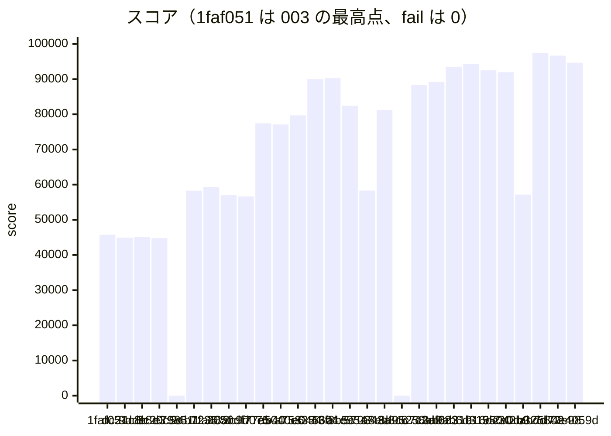

# 振り返り：投稿の関数の評価から、締めの 94267 点と europe・america の往復の削減まで（2026-10-31 の 13〜16 時台）

- 書いた日時：2026-10-31 16:58
- 基準のコミット：d68af30（16:47 に読んだ main の先頭）。記録の最新は、bb9aa0e が足した 4e4059d の 94673 点の行です。
- docs/retro/003_up-to-sig-verify-cache.md（基準 dc24c8b、45745 点まで）の続きです。範囲は、dc24c8b（#12、44918 点）から d68af30 までです。
  - 003 は dc24c8b を評価していないので、ここから始めます。
  - 依頼の時点では、main の先頭は 7d77e98 でした。書いている間に、e07614b（7d77e98 の 96689 点の記録）・4e4059d・bb9aa0e（4e4059d の 94673 点の記録）・d68af30（計測を戻す）が足されました。どれも含めます。
  - docs ブランチの取り込み（5220be7・b580577、overview 002 を含む）も、この間に main に入りました。
  - コミットの直前（16:58）の main の先頭は 4e34a5e です。d68af30 の後に、8f43191（asia1・asia2 の検索を台のメモリの写しで照合、#13）・ebf39e5（europe1・america1 で今日の投稿を台のメモリに、#12）・3f96d12（エクスポートで画像の表を引かない、#15）・9e8a081（画像の判定で区画を 1 つに絞る）と、記録の 3 行（d68af30 の 94937 点、8f43191 の 96266 点、2996be9 の 94789 点）が足されました。書き終えた後に入ったので、この文書では評価しません。
  - 依頼では「main のチェックアウトに未追跡の `sql/012_relationship_functions.sql` がある」とされていました。16:40 に確かめると、このファイルは 55042b9（16:22）で main にコミット済みで、91969 点の記録の行もありました。そのため範囲に含めます。
- 材料は次のとおりです。
  - git log dc24c8b..d68af30、`docs/scores.tsv` の 20261031-125956 以降の行
  - issue の本文とコメント（16:42 に読み、16:47 に更新の時刻を確かめた）
  - `logs/notes/` の 003 の後のメモ：gap-to-first.md・sign-offload-spec.md・sign-offload-done.md・image-files-design.md・search-packed.md・search-memo-clone.md・newcomer-growth.md・research-handoff.md・day4-newcomer-path.md・initial-images-runbook.md・asia2-app-runbook.md・state-mirror-design.md・reboot-*.txt・final-*.txt・bench-results.md（最後の節は 14:05 の回）
  - リポジトリの外のメモ（`~/obsidian/ai-docs/isucon2026/20261031_main/`）：操作役の引き継ぎ_1341.md・新しい観点のissue候補.md・画像URLの署名の負荷を下げる案.md・4台のCPUとメモリの使い方の調査.md（16:41）
  - `logs/` の analyze の出力（20261031-130002〜163950）と `logs/kit-notes.md`
  - `pprotein/data/` の asia1 の pprof（13:01〜13:56 の収集。これより後のファイルはありません）
  - asia1 と asia2 への読み取りだけの ssh（16:50）：初期データの画像の書き出しの印と、asia2 のアプリの自動起動
  - `logs/`・`pprotein/`・`logs/notes/` は git の管理外で、main のチェックアウトにあります。
- 台どうしの通信の形は、docs/overview/002_communication-map.md にあります。この文書では繰り返しません。
- issue の状態（16:47）：#10・#11・#12・#13・#15・#16 が OPEN、#14 は 13:13 に完了で閉じました。#15・#16 は 13:22 に立ちました。どの issue も、最後のコメントは 13:38（#13）です。

## スコアの推移

`docs/scores.tsv` の 20261031-125956 以降の行を、そのまま引きます。

```text
time	rev	pass	score	memo	expect	fail
20261031-125956	dc24c8b	true	44918	perf: 投稿の手順を PostgreSQL の関数にまとめ、DB との往復を 12 回から 1〜2 回にする (#12)	europe・america の POST /api/posts が約 1 秒縮み、両リージョンの人数が増える	0
20261031-130629	9dde8d3	true	45169	perf: 登録の INSERT と読み直しを 1 文にし、DB との往復を 4 回から 1 回にする (#12)	投稿の 409 が 0 に戻り、europe・america のログイン・友達申請・登録が速くなって人数が増える	
20261031-131608	3c20c5e	true	44796	perf: PostgreSQL の全クエリのログを外し、asia2 のディスクへの書き込みを減らす (#14)	全クエリのログを外し、asia2 のディスク待ちと画像の INSERT が下がる。#7 の条件を測り直す	
20261031-132256	e798511	false	0	走行後の整合性チェックで Memories を取得できず fail（グランプリ）	署名を europe1・america1 に任せ、同時実行を絞り、synchronous_commit=off・ログ info	
20261031-132903	24b7235	true	58270	fix: Memories とエクスポートの同時実行の絞りを戻す（1 本の待ち行列で走行後の整合性チェックが時間切れになり fail した） (#12)	署名の委譲で asia1 の CPU が空き、synchronous_commit=off で asia2 のディスク待ちが下がる	0
20261031-133759	1fa48af	true	59315	perf: max_wal_size と checkpoint_timeout を上げ、ベンチの最中に WAL 起因のチェックポイントを走らせない (#14)	ベンチの最中の WAL 起因のチェックポイントが消え、asia2 のディスク待ちと画像の INSERT が下がる	
20261031-134148	2050df7	true	57015	perf: ユーザー検索の候補を 1 行ずつでなく、全員分を長さ付きの 1 つの文字列にまとめて読む (#13)	ユーザー検索の候補をまとめて読み、asia1 の CPU の検索の分が減る	
20261031-134835	2c9d075	true	56651	fix: 検索の名前の正規化のメモに、検索 1 回分の文字列の部分文字列でなく複製を覚える (#13)	検索の名前のメモが検索 1 回分の文字列をつかまなくなり、走行中に各台のメモリが積み上がらない（スコアは 57015 と同じ程度）	
20261031-135512	f77ab40	true	77400	perf: 投稿の画像の中身を受けた台のディスクに置き、DB には中身を持つ台だけを書く (#12)	投稿の画像の INSERT が DB から消え、asia2 の CPU が空き、4 日目に途中から入った人の投稿が増える	
20261031-140527	e5040e6	true	77121	fix: 投稿の画像のファイルは DB がロールバックしたときだけ消し、取り寄せの接続を台ごとに 32 本まで残す (#12)	失敗のときの扱いの直しだけなので 77400 と同じ程度、画像の取得・エクスポートの 5xx が 0 のまま	
20261031-140915	a753354	true	79694	perf: エクスポートで期間の表を投稿ごとに全件なめず、主キーで 1 行ずつ引く (#15)	エクスポートの平均が下がり（前は 582ms）、DB の 1 位の合計が減る	
20261031-141214	e045604	true	89993	perf: ユーザー検索を、正規化した名前の列で DB が絞り、当たった人だけを全列で 1 回で読む (#13)	ユーザー検索の string_agg（前は合計 121 秒）が DB の上位から消え、asia2 の CPU が空く。初期化は 1 秒ほど延びる	
20261031-141728	43f8b5c	true	90281	perf: 画像の持ち主の鍵を台ごとのメモリに覚え、画像の取得で DB に聞くのを生死確認の 1 回にする (#10)	画像の持ち主の鍵のクエリ（前は 1.4 万回・34 秒）が消え、画像の取得が速くなる。検索の直しで 2 回目の初期化の後も検索が合う	
20261031-142957	a1e9547	true	82418	perf: 初期データの投稿の画像をベンチの外で asia1 のディスクに書き出し、エクスポートと画像の取得はそこから読む (#15)	エクスポートと画像の取得で初期データの画像を asia1 のディスクから読み、DB の上位 1・2 位が減る。書き出しの直後で asia2 のキャッシュが冷えている	
20261031-143711	570343a	true	58319	fix: deploy の疎通確認をアプリの /internal/health で行う（nginx の無い asia2 でもアプリを動かすので、nginx の index.html では確かめられない） (#16)	asia2 のアプリが asia の 3 分の 1 を受け、asia1 の CPU が空き、asia の人数が増える。asia2 の DB の空き（前は id 48%）が減る	
20261031-144350	a8ed3c6	true	81218	perf: asia1 の nginx が画像のアップロードと応答を一時ファイルに書かないようにする (#16)	asia1 の nginx が一時ファイルを書かなくなり、asia1 のディスク待ち（前は 23%）と投稿・プロフィール画像の応答が下がる	
20261031-144722	6d95258	false	0	perf: 画像の取得は asia1 だけで受け、初期データの画像を asia1 のディスクから返す (#16)	55s〜1m0s のエラー率 897/3865 が上限 10% を超えて fail（画像の取得を asia1 だけで受けた回）	
20261031-145153	1c713a9	true	88333	fix: 全台のアプリに GOMEMLIMIT を付け、asia1 の OOM による 502 を防ぐ (#16)	GOMEMLIMIT で asia1 のアプリが 1500MiB の近くで止まり、OOM が起きない。画像の取得を asia1 だけで受け、asia2 の DB の画像の読み込みが減る	
20261031-150801	c2df023	true	89215	perf: 画像の取得で持ち主の鍵と生死確認を 1 回のクエリで読み、当たらない鍵のキャッシュを外す (#10)	画像の取得で DB に聞くのが 1 回になり、鍵のクエリ（前は 1.2 万回・27 秒）が消える	
20261031-151641	ab6d319	true	93541	chore: 計測を外す	締め：計測を外し、全台の再起動の試験の後の 1 回目（キャッシュが冷えている）	
20261031-151641	ab6d319	true	94267	chore: 計測を外す	締め：計測を外した状態の 2 回目	
20261031-155626	b16dc30	true	92525	chore: 計測を戻す	europe・america の調査用（計測あり）	
20261031-162559	55042b9	true	91969	perf: 友達申請の承認・拒否・取り下げとフォローを DB の関数 1 往復にし、europe・america の新しい人の投稿を間に合わせる	europe・america の承認とフォローが 1 往復になり、新しい人が間に合って翌日も増える	
20261031-163117	e0cabdd	true	57161	perf: 友達フィードの DB の往復を 6 回から 2 回にまとめる (#11)	europe・america のセッションの写しと友達フィードの往復まとめで、新しい人が増える	
20261031-163500	b325802	true	97440	Revert "perf: 友達フィードの DB の往復を 6 回から 2 回にまとめる (#11)"	友達フィードの往復まとめを戻し、asia の新しい人が投稿に間に合う。europe・america のセッションの写しは残す	
20261031-163950	7d77e98	true	96689	perf: europe1・america1 で SQL ごとの文の準備の往復を省き、DB の接続を閉じずに起動時に開いておく (#12)	検索のブロックを SQL で外し、europe1・america1 の文の準備の往復を省いて、europe・america の新しい人が増える	
20261031-164447	4e4059d	true	94673	perf: europe1・america1 だけ、閲覧者の友達・ブロックなどを 1 回のクエリで読み、友達どうしの組は UNION でインデックスから引く (#11)	europe1・america1 の友達フィードの往復をまとめ、europe・america のフィードが速くなる	
```

- 27 回のうち、25 回が pass、2 回が fail（e798511 と 6d95258）です。
- 45745 点（003 の最高、1faf051）から 97440 点（b325802）まで、2.13 倍になりました。締めとして測った 94267 点（ab6d319）は 2.06 倍です。
- 1 回のベンチに入った施策は、次のとおりです。003 の範囲（8 回のうち 6 回が複数）より、施策ごとの行が増えました。
  - 施策 1 つの行（16 回）：dc24c8b・1fa48af・2050df7・2c9d075・f77ab40・e5040e6・a753354・e045604・a1e9547・a8ed3c6・6d95258・1c713a9・c2df023・55042b9・b325802（戻しただけ）・4e4059d
  - 3c20c5e の回：0a900f2（計測の道具の直し）と 3c20c5e。アプリの動きを変えるのは 3c20c5e だけです。
  - 複数の施策の行（6 回）：
    - 9dde8d3 の回：8a5bc7d・5c305fe・a8076bd・9dde8d3
    - e798511 の回（fail）：3b932da・ecbd55e・c0f8a6b・e798511
    - 24b7235 の回：c0f8a6b を戻した後の、3b932da・ecbd55e・e798511 の 3 つ
    - 43f8b5c の回：a368728（検索の直し）と 43f8b5c
    - 570343a の回：8955a76（asia2 のアプリ）と 570343a（deploy の疎通確認）
    - e0cabdd の回：458d437（計測を外す）・8042f30・e0cabdd
    - 7d77e98 の回：9bc4b00・7d77e98
  - 施策の無い行（3 回）：ab6d319 の 2 回（計測を外す）と b16dc30（計測を戻す）
- memo は、どの行も最後のコミットの件名か、fail の理由です。施策の組は expect の側に書かれています。
- fail 列は、dc24c8b と 24b7235 の行が 0 で、残りの 25 行は空です。
- 同じ版を 2 回測った行が、初めてできました。ab6d319 の 93541 点（全台の再起動の後、キャッシュが冷えた 1 回目）と 94267 点です。差は 726 点（0.8%）です。1 回目は条件が違うので、これだけでぶれの幅は決められません。



asia1 の nginx のアクセスログ（`logs/<時刻>-alp.txt`）から、負荷の大きさを並べます。asia の利用者は、asia2 でアプリを動かした後も、すべて asia1 の nginx を通ります。登録は `POST /api/auth/register` の回数です。CPU は `logs/<時刻>-<台>/summary.txt` の pidstat の平均（1 コア = 100%）です。analyze の出力が無い回（2050df7・c2df023 より後など）は載せていません。

```text
回        score  登録  asia1 のリクエスト  POST /api/posts  GET /api/feeds/friends  GET /api/users  GET /api/me/export  asia1 isureal  asia2 postgres  asia2 isureal
1faf051   45745   397  31078               1206・0.734       2174・1.103              0.711           163・1.032           126.1%         103.1%          ―
dc24c8b   44918   396  30946               1256・0.669       2172・1.128              0.727           148・1.064           127.9%         101.2%          ―
9dde8d3   45169   396  30364               1215・0.659       2107・1.169              0.785           157・1.137           130.9%         101.7%          ―
3c20c5e   44796   364  30657               1150・0.564       2044・0.957              0.665           162・1.020           127.9%          96.3%          ―
24b7235   58270   432  39787               1392・0.678       2838・0.870              0.592           225・1.098            77.8%         120.9%          ―
1fa48af   59315   440  40837               1433・0.687       3029・0.849              0.649           204・1.118            82.7%         126.6%          ―
2c9d075   56651   414  40440               1332・0.689       2891・0.800              0.593           185・1.125            68.5%         127.2%          ―
f77ab40   77400   724  50980               1999・0.586       3677・0.861              0.712           239・1.147            78.6%         118.8%          ―
e5040e6   77121   854  50021               2112・0.608       3406・1.183              0.923           235・1.168            76.4%         120.6%          ―
a753354   79694   751  50928               2112・0.619       3748・0.917              0.715           239・1.177            81.4%         128.7%          ―
e045604   89993   939  56230               2459・0.902       3989・0.962              0.611           262・1.250            76.5%         117.0%          ―
43f8b5c   90281   949  56379               2414・0.822       4058・0.924              0.601           297・1.241            78.9%         117.3%          ―
a1e9547   82418   692  53996               2000・0.585       3826・0.655              0.423           283・0.711            74.8%         105.0%          ―
570343a   58319   535  41455               1482・1.031       3074・0.455              0.343           169・0.931            44.2%          88.7%          16.8%
a8ed3c6   81218   881  52576               2143・0.911       3866・0.970              0.671           248・1.034            58.7%         111.0%          22.8%
1c713a9   88333   904  56395               2343・0.792       4215・0.915              0.553           286・0.793            70.8%         113.1%          18.5%
```

詰まっている台の移り変わりを、vmstat（`logs/<時刻>-<台>/vmstat.txt`）で見ます。負荷の秒は us+sy が 10% 以上の秒、詰まりの秒は us+sy が 80% 以上の秒です。#16 の数え方と同じです。wa は負荷の秒の平均です。b325802 と 7d77e98 の回は、計測を外していて alp はありませんが、vmstat は残っています。

```text
回        score  asia1 詰まり/負荷  asia2 詰まり/負荷  asia2 の wa  詰まっている台
1faf051   45745  42/64              15/74              20%          asia1
dc24c8b   44918  44/64              16/73              21%          asia1
9dde8d3   45169  47/65              15/72              20%          asia1
3c20c5e   44796  45/63              15/72              22%          asia1
24b7235   58270  11/64              44/72              15%          asia2（署名の委譲の後）
1fa48af   59315  11/63              43/71              14%          asia2
2c9d075   56651   1/63              44/73              13%          asia2
f77ab40   77400  21/68              38/82              14%          asia2
e5040e6   77121  23/63              32/71              19%          両方
a753354   79694  25/63              38/71              17%          両方
e045604   89993  28/63              35/73              18%          両方
43f8b5c   90281  28/64              27/69              21%          両方
a1e9547   82418  27/65              24/72              14%          両方
570343a   58319   3/67              30/76               9%          asia1 は wa 23%（ディスク待ち）
a8ed3c6   81218   7/64              45/70               8%          asia2
1c713a9   88333   8/64              43/68               6%          asia2
b325802   97440  10/60              40/70               5%          asia2
7d77e98   96689  14/62              40/71               6%          asia2
```

asia1 の CPU プロファイル（どれも 240 秒、`go tool pprof -top -cum`）から、主な関数の cum を並べます。ファイルは、各回の収集で asia1 に当たるいちばん大きいものです。13:56 より後の pprof は、`pprotein/data/` にありません。

```text
回               ファイル       総サンプル  imageSignature   Memories        エクスポート    ユーザー検索    投稿
dc24c8b          dmipzt6oxyxs   81.62s      46.68s 57.19%    30.17s 36.96%   16.87s 20.67%   8.70s 10.66%    4.26s  5.22%
9dde8d3          dmiq3vx4zmqw   83.60s      48.92s 58.52%    30.41s 36.38%   19.46s 23.28%   9.19s 10.99%    4.18s  5.00%
3c20c5e          dmiqcalh0ohk   84.18s      50.05s 59.46%    31.47s 37.38%   19.30s 22.93%   9.20s 10.93%    3.99s  4.74%
e798511（fail）  dmiqgtopimx4   54.06s       3.02s  5.59%     0.70s  1.29%    0.53s  0.98%  21.29s 39.38%    7.45s 13.78%
24b7235          dmiqk9w8y7ew   50.56s       4.07s  8.05%     2.88s  5.70%    2.76s  5.46%  11.59s 22.92%    5.14s 10.17%
2050df7          dmiqw0ttk1qo   41.62s       4.75s 11.41%     3.17s  7.62%    2.81s  6.75%   3.24s  7.78%    4.69s 11.27%
2c9d075          dmir0jgvgplc   41.38s       4.54s 10.97%     3.42s  8.26%    2.38s  5.75%   3.21s  7.76%    4.84s 11.70%
f77ab40          dmir5pw2kavk   50.21s       5.78s 11.51%     3.76s  7.49%    2.82s  5.62%   6.11s 12.17%    6.22s 12.39%
```

- Memories とエクスポートの cum には、その中で呼ぶ imageSignature の分が含まれます。
- 1fa48af の回は、pprof がありません。収集の 240 秒のうちに deploy して、収集が Failed になりました（操作役の引き継ぎ_1341.md の「13:35 の回で起きた」）。

## やったことと効果（時系列）

### 投稿・友達申請・ログイン・登録を DB の関数に（dc24c8b・5c305fe・a8076bd・9dde8d3、#12）、44918 点・45169 点

- dc24c8b は、投稿の手順を PostgreSQL の関数にまとめ、DB との往復を 12 回から 1〜2 回にしました。単独でベンチし、44918 点でした。45745 点とほぼ同じで、fail は 0 です。
- dc24c8b には不具合がありました。アプリが時刻を決めてから DB に送るので、投稿期間の切り替わりを待った投稿が 409 になりました。8a5bc7d で、待った後に時刻を取り直すようにしました（research-handoff.md の「学んだこと」）。
- 5c305fe（友達申請）・a8076bd（ログイン）・9dde8d3（登録）は、research/rtt の c0ff217・010673c・403e8c4 と同じパッチです（`git patch-id` で確かめた。以下の cherry-pick も同じ方法で確かめています）。8a5bc7d と合わせた 4 つを 1 回でベンチし、45169 点でした。
- europe1 の新しい利用者の経路は速くなりました（bench-results.md、europe1 の access.ltsv）。19447 点の回と比べて、登録 1.24 → 0.729 秒・ログイン 1.27 → 0.196 秒・友達申請 1.57 → 0.261 秒・期間の取得 0.59 → 0.294 秒・投稿 2.33 → 0.588 秒です。asia1 の 409 も 0 件になりました。
- それでも europe・america の人数は増えませんでした。ベンチの出力では、europe が 7・7・8・9・9・8 人、america が 6・6・8・8・8・7 人です。
- asia1 の `POST /api/friend-requests` は 0.388 秒で、変わっていません。asia1 から DB までは往復 0.4ms なので、往復を減らしても asia では効きにくいと見ています（#13 のコメント、推測）。
- asia の 4 日目に途中から入った人の投稿の割合は 43%（237 人中 102 人）で、関門の手前のままでした。

### europe・america を止める判断（13:20〜13:30）

- 13:14 の gap-to-first.md は、「点は人数の増え方で決まり、europe・america は 1 日目から関門で止まっている」と見立てていました。
- 13:20 に、同じメモが自ら訂正しました。europe の利用者は毎期間ほぼ全員が投稿し、投稿の後にフィードも取っていました（43 組中 43）。それでも、負荷の間に登録したのは europe 2 人・america 2 人だけでした。
- 13:30 ごろ、人間が europe・america 向けの案（複製・全ハンドラーの 1 往復化・中継）をやめ、asia に戻すと決めました（gap-to-first.md）。「署名を前もって計算した表」を作ることも決めましたが、main にも worktree のブランチにも見当たりません。
- この判断は、15:53 以降に覆ります（後の「europe・america の往復を減らす」）。

### 計測を外す道具（0a900f2）と全クエリのログを外す（3c20c5e、#14）、44796 点

- 0a900f2 は、fix/pg-measure の 4d57680 と同じパッチです。003 で「main に入っていないもの」に挙げた 1-1（PostgreSQL の計測を外せない）が、これで main に入りました。
- 3c20c5e は、`log_min_duration_statement` を -1 にし、全クエリのログを止めました。コメントの理由は「1 回のベンチで 60MB を超えて書き、asia2 のディスク待ちが 20% あった」です。
- 44796 点で、前の回とほぼ同じです。asia2 の負荷の秒の wa は 20% → 22% で、下がっていません。
- 13:13 に、#14 を完了で閉じました。閉じる条件（asia2 の詰まりの秒が 26 以下で fail しない）を、7 回分の表をコメントに貼って確かめています。003 の「#14 の数字」で、数字の上では満たしていると書いたものです。
- 13:22 に #15（エクスポート）と #16（構成：asia1 の CPU）を立てました。役なしのセッションの「新しい観点のissue候補.md」が元です。#16 の本文には、#14 の WAL の項目と、#7（asia2 にもアプリ）の進める条件が 13:16 の回で初めてそろったことが書かれています。

### 4 つを 1 回で入れて fail（3b932da・ecbd55e・c0f8a6b・e798511）

- 4 つを 13:18 に入れ、1 回でベンチしました。
  - 3b932da：asia2 の `synchronous_commit = off`。
  - ecbd55e：アプリのログを debug から info に下げる。
  - どちらも、サーバーの AGENTS.md の 3 節で避けていたものです。人間が「3 節によらず入れる」と決めました（コードのコメント）。
  - c0f8a6b：Memories とエクスポートの同時実行を、台ごとに 1 本に絞る。research/heavy の b97df38 と同じパッチです。
  - e798511：画像 URL の署名を europe1・america1 にまとめて頼む。research/sign-offload の dbecfad と同じパッチです。仕様の 6 節（ルーター経由の遅延、「外部に委譲しない」に当たらないと見ること、鍵が VPC の中を流れること）は、人間が 13:05 ごろ「この仕様どおりで構わない」と答えています（sign-offload-done.md）。
- sign-offload-done.md は「効き目を分けて見るため、b97df38 とは別々のベンチで入れるのがよい」と書いていました。実際は同じ回に入りました。
- 13:22 の回は fail でした。走行の後の整合性チェックで、Memories を取得できませんでした。
  - asia1 の nginx で、`/api/memories` の 499 が 45 件ありました。すべて 04:21:42 UTC に集中し、平均 15 秒待って切られています。アプリの側は context canceled の 500 です（bench-results.md、操作役の調べ）。
  - 1 本に絞った待ち行列に、走行の終わりの確認の Memories がまとめて並び、時間切れになった、という見立てです。b97df38 は、走行の終わりにまとめて来る取得を見落としていました。
- この回の pprof（dmiqgtopimx4）では、Memories の cum が 0.70 秒まで減っています。絞りで待たされ、処理まで進まなかった分と見ます（推測）。

### 絞りを戻す（24b7235）、58270 点

- 24b7235 で c0f8a6b を戻しました。fail の記録の 31 秒後です。
- 58270 点で、前の pass（44796 点）の 1.30 倍です。この 3 つ（synchronous_commit・ログ・署名の委譲）は 1 回で測ったので、分けられません。
- 署名の委譲が効いたことは、CPU の数字で分かります。
  - asia1 の pprof で、imageSignature は 50.05 秒（59.46%）→ 4.07 秒（8.05%）、総サンプルは 84.18 → 50.56 秒です。
  - asia1 の詰まりの秒は 45/63 → 11/64 です。
  - europe1・america1 のアプリの CPU は、1.2%・1.1% → 14.2%・14.5% に上がりました。
- 詰まりは asia2 に移りました。asia2 の詰まりの秒は 15/72 → 44/72 です。asia2 の pgss の上位は、どれも画像でした（`logs/20261031-132909-pgss.txt`）。投稿の関数が 1466 回・平均 173.86ms、その中の画像の INSERT が平均 165.47ms・合計 243 秒、エクスポートが 234 回・平均 606.74ms です。
- asia の 4 日目に途中から入った人の投稿の割合は、43% → 76% に上がりました。5 日目の新規は 6 人のままです。
- #10 の閉じる条件のうち、「imageSignature の cum が 15% を切る」は、この回で満たしました。もう 1 つの「pgss の上位 3 に画像の判定のクエリが無い」は、満たしていません。

### WAL のチェックポイント（1fa48af、#14）、59315 点

- `max_wal_size = 8GB`・`checkpoint_timeout = 15min` にしました。58270 点の回で、04:27:19 から 23 秒で約 290MB の WAL を書き、チェックポイントが続けて走っていたためです（コードのコメント）。
- 59315 点で、1.02 倍です。asia2 の負荷の秒の wa は 15% → 14%、画像の INSERT の平均は 165.47 → 169.16ms です。効き目は、この 1 回では見分けられません。

### ユーザー検索を 1 つの文字列で読む（2050df7）とメモの直し（2c9d075、#13）、57015 点・56651 点

- 2050df7 は、research/search-agg の d38d611 と同じパッチです（search-packed.md）。24b7235 の回の asia1 で、検索が CPU の 22.9% を使い、そのうち 19.5% が約 5000 行を 1 行ずつ受け取る処理だったためです。全員分を `string_agg` で 1 つの文字列にまとめ、長さで切り出します。
- asia1 の CPU は減りました。検索のハンドラの cum は 11.59 秒（22.92%）→ 3.24 秒（7.78%）、総サンプルは 50.56 → 41.62 秒です。
- 点は 59315 → 57015 点に下がりました。
  - DB の側の検索のクエリは、1266 回・平均 29.36ms（1fa48af の回、1 行ずつの SQL）→ 1169 回・平均 58.5ms（2c9d075 の回、まとめた SQL）です。2050df7 の回の pgss は `logs/` にありません。
  - asia2 の EXPLAIN ANALYZE では、まとめた SQL は 4.5ms、前の SQL は 1.7ms でした（search-packed.md）。この差は、入れる前に分かっていました。
  - このとき詰まっていたのは asia2 です（詰まりの秒 43〜44）。空いていた asia1 の仕事を、詰まっていた asia2 に移した形だと見ます（推測）。
- 2050df7 の reviewer が、部分文字列をメモに覚えると検索 1 回分の約 430KB を GC が手放さない、と指摘しました。2c9d075（research/search-memo-clone の 8e7c2e5 と同じ）で `strings.Clone` するように直し、56651 点でした。
- 2c9d075 の回で、asia の 4 日目の投稿の割合は 91% でした。それでも 5 日目の新規は 11 人で、増えませんでした。これで「投稿の割合が 89% 前後を越えれば翌日に増える」という見立てが外れました（後の「人数の関門の見立ての移り変わり」）。

### 投稿の画像を受けた台のディスクに置く（f77ab40、#12）、77400 点

- research/imgfiles の 595530b と同じパッチです。設計は image-files-design.md にあります。調査役は「人間が設計を見て、実装を進めてよいと言った」と伝えています（操作役の引き継ぎ_1341.md。伝聞なので、操作役は入れる前に人間に確かめる手順でした）。
  - 投稿を受けた台が、画像を `/home/isucon/image-store/` に置きます。一時ファイルに書いて fsync し、名前を変えてから DB の関数を呼びます。
  - DB の image_objects には中身を空にした行を作り、image_object_locations の host 列（`sql/010_image_files.sql`）に中身を持つ台を書きます。
  - 別の台の画像は、内部の窓口 :8081 の `GET /internal/images/:id` で取り寄せます。初期化では、ほかの台に `POST /internal/purge-images` を送ります。
  - 見せてよいかの判断（署名・削除・退会）は、今までどおり毎回 DB で行います。
  - 設計の段階で、再起動の後も残ること・初期化・ほかのリージョンからの取得・削除の 5 秒の規則を、マニュアルと突き合わせています。
- 77400 点で、それまでの最高（59315 点）の 1.30 倍です。この範囲で最も大きい伸びです。
- 効いた所です。
  - 画像の INSERT は、1418 回・平均 198.5ms・合計 281.5 秒（2c9d075 の回）から、pgss の上位から消えました。投稿の関数は 2104 回・平均 5.2ms です（`logs/20261031-135512-pgss.txt`）。
  - 登録は 414 → 724、asia1 のリクエストは 40440 → 50980 件です。
  - asia の 4 日目の投稿の割合は 94%（276 人中 260 人）、5 日目の新規は 293 人でした。それまでは、どの回も 5〜11 人でした。最終日の投稿は 389 → 692 人です。
- asia2 は、4〜5 日目にまだ CPU を使い切っていました（詰まりの秒 38/82）。
- 13:58〜13:59 に、表ごとの行数と台ごとの画像の id を控えたファイル（`logs/notes/reboot-*.txt`）があります。前後の行数は一致しています。名前から、再起動の試験の記録と見ます（推測）。003 の時点では、再起動の試験を一度も通していませんでした。

### 失敗のときのファイルの扱い（e5040e6）、77121 点

- 投稿の画像のファイルを、DB がロールバックしたときだけ消すようにしました。取り寄せの接続も、台ごとに 32 本まで残します。
- 77121 点で、77400 点と同じ程度です。expect どおりです。
- この回の人数は増えました（bench-results.md の最後の節）。4 日目は期間内に 99%、5 日目の新規は 468 人、最終日の投稿は 802 人です。グランプリの人数は asia 753・europe 15・america 11 でした。
- それでも点は伸びていません。5 日目の期間内に投稿の応答が返ったのは 84% で、友達フィードは平均 1.95 秒でした。人数が増えた分、5 日目の検証と最終日の 1 人あたりの点を削っている、という見立てです（推測）。
- 4〜5 日目は、asia2 も asia1 もほぼ使い切っていました（asia1 の id 2〜24%）。

### エクスポートの期間の表（a753354、#15）、79694 点

- research/export-windows の 4bc6206 と同じパッチです。投稿の件数を 1 件と見積もって、期間の表を投稿ごとに全件なめていたので、`CROSS JOIN LATERAL ... OFFSET 0` で主キーから引くようにしました（コードのコメント）。
- expect の「エクスポートの平均が下がる」は、起きていません。エクスポートのクエリは平均 581.9ms → 608.2ms です（pgss）。
- 79694 点は前の回の 1.03 倍です。この施策によるとは言えず、ぶれの内と見ます（推測）。

### ユーザー検索を DB で絞る（e045604）と初期化のトリガー（a368728、#13）、89993 点

- research/search-columns の 9797664 と同じパッチです。アプリの正規化の結果を users の 2 列（`sql/011_users_search_text.sql`）に持ち、DB で絞ってから当たった人だけを読みます。名前が変わったのに正規化を書き直さなかった更新では、トリガーが列を NULL に戻します。NULL の行は必ず読み、アプリで確かめます。
- 89993 点で、前の回の 1.13 倍です。
  - 検索のクエリは、2118 回・平均 57.1ms・合計 121 秒 → 2597 回・平均 29.7ms・合計 77 秒です。
  - asia1 の `GET /api/users` は 0.715 → 0.611 秒、登録は 751 → 939 です。
- ベンチの後に、不具合が見つかりました。reset.sql は `session_replication_role = replica` で流れるので、普通のトリガーが動きません。表示名を初期値に戻しても古い正規化が残り、次の走行の検索から外れていました。a368728 で `ENABLE ALWAYS TRIGGER` にしました。
  - 89993 点の回は初期化の 1 回目だったので、ずれが出ていません。次の走行から検索の結果が変わりうる状態でした。fail の前に止められています。
  - a368728 は、次の 43f8b5c と同じ回に入りました。

### 画像の持ち主の鍵を台のメモリに（43f8b5c、#10）、90281 点

- research/owner-key の 50dff2f と同じパッチです。画像の持ち主の鍵と区画の時刻を台ごとに覚え、2 回目から DB に聞かないようにしました。
- 90281 点で、前の回と同じ程度です。
- 鍵のクエリは、14045 回 → 12282 回にしか減っていません。15:00 の state-mirror-design.md は、14:51 の回で画像の取得 13529 回に対して鍵のクエリが 12474 回、当たりは約 8% と数えています。画像の大半は、1 台で 1 回しか取られません。
- 当たりの割合は、入れる前に数えていませんでした。後の c2df023 で、このキャッシュを外しています。

### 初期データの画像を asia1 のディスクに（a1e9547、#15）、82418 点

- research/initial-images の 903f320 と同じパッチです（initial-images-runbook.md）。
  - 初期データの投稿の画像 625111 枚（約 9.5GB、0.5% の抜き取りからの見積もり）を、asia1 の `/home/isucon/initial-images/` に書き出します。
  - 書き出しはベンチの合間に、手で `isureal extract-initial-images` を流します。終わりの印 `.done` があるときだけ、アプリはディスクから読みます。印が無ければ、今までどおり DB から読みます。
  - 16:50 に asia1 で確かめると、`.done` は 05:27 UTC（14:27）に作られ、中身は「625111 images」でした。
- 82418 点で、90281 点から 8.7% 下がりました。expect には「書き出しの直後で asia2 のキャッシュが冷えている」とあります。
- DB と応答は軽くなりました。
  - エクスポートのクエリは 627.1ms → 161.4ms、画像の判定のクエリは 5.9ms → 4.0ms です（`logs/20261031-142957-pgss.txt`）。
  - asia1 の `GET /api/me/export` は 1.241 → 0.711 秒、友達フィードは 0.924 → 0.655 秒です。
- 一方で、登録は 949 → 692、asia1 のリクエストは 56379 → 53996 件に減りました。点が下がった理由は確かめていません。キャッシュが冷えたこと（expect の見立て）と、asia1 の負荷の秒の wa が 4% → 9% に上がったことが候補です（推測）。
- 書き出しは `make deploy` では行われません。新しい台で deploy だけをすると、DB から読みます。結果は正しいが遅い、という扱いです（runbook）。

### asia2 でもアプリを動かす（8955a76・570343a、#16）、58319 点

- research/asia2-app の 03d1ad5 と同じパッチです（asia2-app-runbook.md）。
  - asia1 の nginx から、同じリージョンの asia2（往復 0.4ms）のアプリにも振り分けます。`X-Client-IP` のハッシュで、同じ接続元はいつも同じ台に行きます。isureal-guard が台ごとのログで BAN を数えるためです。重みは asia1:asia2 = 2:1 です。
  - 投稿・エクスポート・初期化は asia1 だけで受けます。
  - DB の接続は、max_connections 100 に収めるため、asia1 30・asia2 25・europe1 15・america1 15 にしました。
- runbook は、入れる条件を「4〜5 日目の asia2 の id が 2〜3 割空いていること」としていました。条件を確かめた記録は、`logs/notes/` にありません。
- deploy の疎通確認は nginx の index.html を見ていたので、nginx の無い asia2 で通りませんでした。570343a で、アプリの `/internal/health` を見るようにしました。
- asia2 の自動起動（`systemctl enable`）は、deploy が配れないので手で行う手順です。16:50 に確かめると、asia2 の isureal-go と isureal-guard は enabled・active でした。
- 58319 点で、82418 点から 29% 下がりました。
  - asia1 の負荷の秒の wa が 23% になり、`POST /api/posts` は 0.585 → 1.031 秒に遅れました。
  - asia2 のアプリは 16.8%、postgres は 88.7% です。
  - 画像の取得の半分ほどが asia2 に振られ、asia2 は初期データの画像を DB の TOAST から読みました。画像の判定のクエリは 4.0 → 7.1ms です。6d95258 のコメントにも同じ数字（4.0ms → 7.3ms）があります。

### nginx の一時ファイル（a8ed3c6）、81218 点

- asia1 の nginx は、既定のバッファを超える画像のアップロードと応答を一時ファイルに書いていました。起動からの書き込みは 25.7GB で、アプリは 0.76GB でした（コードのコメント）。`proxy_request_buffering off` などで、ディスクに書かないようにしました。
- 81218 点に戻りました。asia1 の負荷の秒の wa は 23% → 8% です。
- 一時ファイルは前からあったはずなのに、なぜ 8955a76 の後に急にディスク待ちが目立ったのかは、確かめていません。

### 画像の取得を asia1 だけで受けて fail（6d95258）、GOMEMLIMIT で 88333 点（1c713a9）

- 6d95258 で、`/api/images/` を asia1 だけに送るようにしました。初期データの画像は asia1 のディスクにしか無いからです。
- 14:47 の回は fail でした。55 秒〜1 分 0 秒のエラー率が 897/3865 で、上限の 10% を超えました。
- asia1 のアプリが 2.5GB まで膨らみ、OOM で kill され、502 が続きました（1c713a9 のコメント）。台のメモリは 3.8GB で、swap はありません。
- 1c713a9 で、全台に `GOMEMLIMIT=1500MiB`（asia2 は PostgreSQL と同居するので 600MiB）を付けました。fail の記録の約 2 分後です。88333 点でした。
- 16:40 の調べでは、asia1 のアプリの常駐は 1.46GB で、上限の 94% にあります。負荷の間は空きが約 110MB まで減り、kswapd0 が動いています。GC が上限の近くで CPU を使っているかは、まだ確かめていません（4台のCPUとメモリの使い方の調査.md）。
- asia2 のアプリを入れる前の 90281 点を、この時点では超えていません。asia2 のアプリが差し引きで効いたかは、分けられていません。16:40 の調べは、asia の 4 vCPU はどちらも詰まっていて、asia2 のアプリは DB と CPU を取り合っている、と見ています（推測）。

### 画像の判定を 1 回のクエリに（c2df023、#10）、89215 点

- 15:00 の state-mirror-design.md は、画像の判定と検索を asia1 のメモリで行う大きな設計を出しました。同時に、asia1 の画像の取得 12734 件を数え、初期データの画像が 72% だと示しました。設計が DB から外せるのは約 28% にとどまります。締めに間に合わないので、小さい案（鍵と生死確認を 1 回のクエリに）を選びました。
- c2df023 は、research/image-one-query の aac6ebb と同じパッチです。43f8b5c の鍵のキャッシュも外しました。
- 89215 点で、前の回の 1.01 倍です。DB の側は、生死確認 89.0 秒と鍵 27.2 秒の合計 116 秒が、1 つのクエリの 89.7 秒になりました（`logs/20261031-150804-pgss.txt`）。
- この回は、`logs/` に pgss しかありません。alp と vmstat の出力は無いです。

### 締め：計測を外して再起動の試験（ab6d319）、93541 点・94267 点

- 15:09 に `make measure-off` でアクセスログ・pprof の待ち受け・pg_stat_statements の追跡・全クエリのログを外しました（ab6d319）。
- 15:10〜15:11 に、全台の再起動の前後で表ごとの行数を数えました（`logs/notes/final-rows-*.txt`）。前後は一致しています。台ごとの画像の id も控えてあり、asia2 の行は空です。reboot-test の道具は PostgreSQL で動かないので、手で数えた形です。
- 93541 点（キャッシュが冷えた 1 回目）と 94267 点（2 回目）です。94267 点は、その時点の最高でした。
- 計測ありの c2df023（89215 点）との差は 4300〜5000 点です。計測を外した分と見ますが、ぶれと分けられません（推測）。

### europe・america の往復を減らす（15:53〜、b16dc30・55042b9・458d437・8042f30・e0cabdd・b325802・9bc4b00・7d77e98・4e4059d）

- 15:53 に、「europe・america の調査用」として計測を戻し（b16dc30）、92525 点でした。13:30 に止めた europe・america の作業を、締めの後に再開した形です。再開の判断の記録は、`logs/notes/` にありません。
- `make measure-on` は、PostgreSQL の `log_min_duration_statement` を 0 に戻しました（b16dc30 の diff）。3c20c5e で外すと決めた全クエリのログが、92525 点と 91969 点の 2 回で、また書かれていました。この 2 回の analyze の出力は `logs/` にありません。
- 55042b9 は、友達申請の承認・拒否・取り下げとフォローを、DB の関数（`sql/012_relationship_functions.sql`）1 往復にしました。コメントは「europe1 では承認が 1.19 秒・フォローが 1.22 秒かかり、新しく来た人が投稿期間の 9 秒のうちに投稿を終えられず、翌日の新しい人が増えなかった」としています。91969 点でした。
- 16:26 に計測を外し（458d437）、次の 2 つと一緒に 1 回でベンチしました。57161 点で、41% 下がりました。
  - 8042f30（research/session-cache の c205344 と同じ）：europe1・america1 だけ、確かめたセッションを台のメモリに 3 秒覚える。`ISUREAL_SESSION_CACHE=1` の台だけで動きます。
  - e0cabdd（research/feed-rtt の dbc8a76 と同じ）：友達フィードの DB の往復を 6 回から 2 回にまとめる。全台で動きます。
- 記録の 14 秒後に、e0cabdd だけを戻しました（b325802）。97440 点で、この範囲の最高です。55042b9 と 8042f30 は残っています。
- 原因は、4e4059d のコメントに書かれています。「`low IN (副問い合わせ) OR high IN (副問い合わせ)` の形は friendships を全件なめ、友達の多い人で 1 回 117ms かかって asia2 の CPU を使い切った」。asia の台でも動いたので、asia の利用者の経路が詰まりました。
- 9bc4b00（research/search-blocks の 00a3870 と同じ）は、検索のブロックを候補を絞る SQL で外し、往復を 1 回減らします。7d77e98（research/db-rtt の 5d7817c と同じ）は、europe1・america1 で文の準備の往復を省き、DB の接続を起動時に全部開いておきます。2 つを 1 回でベンチし、96689 点でした。
- 4e4059d（research/feed-union の dbf68cf と同じ）は、e0cabdd の考えを europe1・america1 だけに絞って作り直しました。閲覧者の状態を 1 回のクエリで読み、友達どうしの組は低い側と高い側を別々に引いて UNION します。`ISUREAL_VIEWER_ONE_QUERY=1` の台だけで動きます。94673 点でした。
- 97440・96689・94673 点の差が施策によるかは、分けられません。ab6d319 の 2 回の差（726 点）より大きいですが、1 回ずつの値です。
- この 4 つの回で europe・america の人数が増えたかは、記録がありません。bench-results.md は 14:05 の回で止まっています。この作業の目的（翌日の新しい人を増やす）を確かめる数字が、まだ無い状態です。
- 16:35 と 16:39 の回でも、asia2 の詰まりの秒は 40/70・40/71 です。europe1・america1 のアプリの CPU は 20% 前後です（4台のCPUとメモリの使い方の調査.md）。

## 人数の関門の見立ての移り変わり

この範囲で、点を最も動かしたのは「asia の利用者が 5 日目に増えるか」でした。見立ては 3 回変わりました。

```text
回        score  4 日目の新規  SQL の割合  期間内に投稿の応答（ジャーナル）  5 日目の新規
9dde8d3   45169  237           43%         ―                                7
24b7235   58270  265           76%         ―                                6
2c9d075   56651  250           91%         79%（検証までの見積もり 64%）     11
f77ab40   77400  276           94%         93%（同 76%）                     293
e5040e6   77121  248           ―           99%（同 98%）                     468
```

- 数えたのは、`logs/notes/newcomer-post-rate.sql`（SQL の割合）と、asia1 のジャーナルの投稿の応答の時刻（day4-newcomer-path.md）です。e5040e6 の行は bench-results.md の最後の節によります。
- 1 つ目の見立て（003、12 時台）：途中から入った人がその期間に投稿できないと、人数が増えない。#12 の目標「9 割以上」になりました。
- 2 つ目（13:48、2c9d075 の回）：SQL の割合が 91% でも、5 日目は 11 人でした。1 つ目が外れました。newcomer-growth.md は、2・3 日目の新規はどの回もほぼ一定で、4 日目だけが点につれて変わると示しました。
- 3 つ目（14:20〜14:30）：SQL は期間の後に返った投稿も数えていて、甘いと分かりました。ジャーナルで数え直すと、2c9d075 の回は 79% でした。f77ab40 の回は 93% で、5 日目に 293 人が入りました。関門は「期間内に投稿の応答が返った割合」なら 79% と 93% の間、「検証まで済んだ割合」なら 64% と 76% の間にある、という見立てです（推測）。どちらの指標かは、この 2 回では分けられません。
- 越えた理由は、asia2 の DB から画像の INSERT が消え、4 日目の経路が速くなったことと見ます（推測）。4 日目の投稿の応答の p90 は 10.27 秒 → 8.74 秒で、期間（約 9 秒）の内側に入りました。
- 最終日の新規は、どの回も 0〜2 人でした。人数が増えるのは 5 日目まで、と見ています（推測）。

## 的確だったアプローチ

- 関門の数え方を、甘い SQL からジャーナルの応答時刻に直しました。91% と 94% では区別できなかった 2 回が、79% と 93% として見分けられました。その上で、f77ab40 で関門を越えたことを確かめています。
- 詰まっている台を、vmstat で毎回確かめました。署名の委譲の後に asia1 から asia2 へ移ったことが、45/63 → 11/64 と 15/72 → 44/72 の数字で分かります。次に asia2 の DB の 1 位（画像の INSERT）を消す f77ab40 を選び、この範囲で最も大きい伸びになりました。
- 大きな設計は、先にマニュアルと突き合わせました。画像のファイル化（再起動の後・初期化・リージョンをまたぐ取得・削除の 5 秒）と、署名の委譲（「外部に委譲しない」の読み方は人間が確かめた）です。どちらも fail を出さずに入りました。
- 署名の委譲は、前提を先に確かめてから作りました。asia1 に sha_ni が無く europe1・america1 にあること、往復 101ms、セキュリティグループと ufw です。失敗した分は asia1 で計算する作りにし、imageSignature は 59% → 8% になりました。
- fail と大きな下がりを、すぐに戻しました。c0f8a6b は fail の記録の 31 秒後、e0cabdd は記録の 14 秒後に戻しています。6d95258 の OOM は、原因を確かめて記録の約 2 分後に GOMEMLIMIT で直しました。
- 1 回のベンチに 1 つの施策という形が、増えました。27 回のうち 16 回が施策 1 つの行です。
- 作る前に数えて、規模を決めました。state-mirror-design.md は初期データの画像が 72% だと数え、2〜3 時間の設計をやめて 20〜30 分の c2df023 を選びました。
- 締めで、計測を外した版を 2 回測り、全台の再起動の前後で行数を比べました。003 で残っていた「再起動の試験を一度も通していない」は、手で数える形で解消しました。
- 失敗の理由を、コードのコメントに数字で残しました。4e4059d のコメントは e0cabdd の失敗の原因を、1c713a9 は OOM の様子を書いています。後から diff だけで経緯が追えます。
- worktree で作り、操作役が cherry-pick しました。元のブランチが分かった 20 個は、どれも元のコミットと同じパッチです。

## うまくいかなかったこと

- 4 つを 1 回で入れて fail しました。sign-offload-done.md が「別々のベンチで」と書いていたのに、守れませんでした。fail の原因（c0f8a6b）は 1 つでしたが、戻した後の 58270 点も、3 つの施策の合計です。
- 走行の終わりの整合性チェックを、制約として考えていませんでした。c0f8a6b は、走行の終わりにまとめて来る Memories を待たせて fail しました。
- 詰まっている台に仕事を移しました。
  - 2050df7 は、asia2 が詰まっている時に、検索 1 回の DB の時間を約 2 倍にしました。EXPLAIN で 4.5ms 対 1.7ms と分かっていましたが、点は 59315 → 57015 点に下がりました。
  - asia2 のアプリは、DB と同じ 2 vCPU を取り合います。runbook の入れる条件（asia2 に 2〜3 割の空き）を確かめた記録がありません。
- 全台に効く変更を、本番の形のデータで試さずに入れました。e0cabdd は europe・america のための施策でしたが、asia でも動き、friendships の全件読みで 41% 下がりました。後の 8042f30・7d77e98・4e4059d は、環境変数で europe1・america1 だけに絞っています。
- 当たりの割合を数えずに、キャッシュを入れました。43f8b5c の当たりは約 8% でした。003 の 6bccaf7（期限 1 時間）と同じ形の失敗です。
- expect と結果が離れた施策がありました。a753354 のエクスポートは 582ms → 608ms、3c20c5e の asia2 の wa は 20% → 22% です。
- asia2 のアプリを入れてから、58319 点・81218 点・fail・88333 点と 4 回かかり、直し（570343a・a8ed3c6・1c713a9）が 3 つ要りました。8955a76 の差し引きの効き目は、まだ分かりません。
- 計測が欠けました。
  - pprof は 13:56 より後にありません。理由は確かめていません。
  - analyze の出力が無い回が 9 回あります（e798511・2050df7・6d95258・ab6d319 の 2 回・b16dc30・55042b9・e0cabdd・4e4059d）。c2df023 は pgss だけ、b325802 と 7d77e98 は vmstat と pidstat だけです。
  - 計測を戻した 2 回（b16dc30・55042b9）は「europe・america の調査用」でしたが、その出力が `logs/` にありません。
  - bench-results.md は 14:05 の回で止まりました。その後の 15 回は、途中から入った人の割合も、リージョンごとの人数もありません。europe・america の作業の効き目を、人数で確かめられない状態です。
- `make measure-on` が、全クエリのログを黙って戻しました。3c20c5e の判断が、計測ありの 2 回で崩れています。
- fail 列は、27 行のうち 25 行が空です。fail の 2 行も空です。
- issue を更新していません。13:38 より後、`(#N)` の付いたコミットが 20 ほど入りましたが、コメントがありません。閉じる条件を数字の上で満たした issue も、OPEN のままです（後の「open の issue との関係」）。
- europe・america の扱いが、記録なしに 2 回変わりました。13:30 に「ベンチはもともと増やさない（推測）」として止め、15:53 に「往復が遅くて翌日に増えなかった」として再開しました。2 つの見立てを突き合わせた記録がありません。
- `make deploy` で再現できない手順が増えました。初期データの画像の書き出しと、asia2 の `systemctl enable` です。どちらも今は済んでいますが、runbook が `logs/notes/`（git の管理外）にしかありません。
- 003 の残りのうち、次のものが変わっていません。issue の決まり（4a84b78）は main に入っていません。エクスポートの JOIN の条件 `i.created_at = p.posted_at` を初期データで確かめた記録もありません。a1e9547 は初期データの画像をディスクから読むようにしましたが、この JOIN はそのまま残っています。
- worktree は、main を除いて 42 個になりました（003 の時点は 23 個）。

## 次に活かすこと

### 進め方

- expect に、詰まっている台への影響を書きます。「asia1 の CPU が減る」だけでなく、「asia2 の DB の 1 回の時間が増えない」まで確かめてから入れます。2050df7 のように、EXPLAIN の数字が先に手元にあることもあります。
- 走行の終わりの整合性チェックを、施策を選ぶときの制約に入れます。待たせる・捨てる・遅らせる施策は、走行の終わりにまとめて来る取得で試します。
- リージョン向けの施策は、最初から環境変数でその台だけに絞ります。全台で動くクエリの形を変えるときは、asia2 で EXPLAIN（ANALYZE は読み取りの SELECT だけ）を取ってから入れます。
- キャッシュは、入れる前に当たりの割合を数えます。ログから、同じ鍵が同じ台で 2 回以上来る割合を出せます。
- ベンチのたびに、リージョンごとの人数と、途中から入った人の割合（ジャーナルの数え方）を残します。どの役が書くかを決めます。europe・america の作業を続けるなら、まず 4 回分の人数が要ります。
- 計測を戻すときは、全クエリのログを戻さないようにします。d68af30 で計測を戻したので、16:58 の main（4e34a5e）でも `log_min_duration_statement = 0` です（`server/asia2/etc/postgresql/16/main/conf.d/isu-measure.conf`）。締めで計測を外すときに、-1 になることを確かめます。
- 締めの前に、`make deploy` の外の手順を 1 か所にまとめます。初期データの画像の書き出し（印は 14:27 に作成済み）と、asia2 の自動起動（16:50 に enabled を確かめた）です。

### open の issue との関係（16:47 の状態）

- #10 画像の取得：imageSignature の cum は 8.05%〜11.51% で、15% 未満の条件は 24b7235 の回から満たしています。もう 1 つの条件は満たしていません。c2df023 の回でも、画像の判定のクエリが DB の 1 位（89.7 秒）です。16:40 の調べでも 1 位（15650 回・108 秒）でした。
- #11 フィード：asia1 の友達フィードの平均は、a1e9547 からの 4 回で 0.455〜0.970 秒です。0.61 秒未満の条件は安定していません。0.455 秒の回（570343a）は 58319 点に下がった回で、負荷が小さかった分と見ます（推測）。1 回に読む行数の条件は、確かめていません。e0cabdd は戻しました。4e4059d は europe1・america1 だけに効く形です。
- #12 投稿する：数字の上では、閉じる条件を満たしています。f77ab40 の回で 4 日目の割合が 94%（ジャーナルで 93%）、e5040e6 の回で 99% です。asia の人数も 4 日目で止まらず、5 日目に 293 人・468 人が入りました。どちらも pass です。閉じるかは、操作役が証拠を付けて人間に諮ることです。
- #13 つながりと検索：検索のクエリの平均は 17.2〜32.8ms で、20ms 未満が安定していません。`POST /api/friend-requests` の asia1 の平均は 0.236〜0.433 秒で、0.197 秒未満に届いていません。
- #15 エクスポート：a1e9547 の後、エクスポートのクエリは 161〜253ms に下がりました。それでも DB の上位 3 に入っています（c2df023 の回で 3 位）。asia1 の平均は 0.711〜1.034 秒で、0.5 秒未満に届いていません。
- #16 構成：asia1 の詰まりの秒は、24b7235 の回から負荷の秒の半分未満（1〜28 秒 / 60〜68 秒）です。24b7235 の回は pass なので、数字の上では満たしています。ただし、今の詰まりは asia2 です（40/70 前後）。閉じるなら、asia2 の CPU を目標にした issue を立て直すかを、合わせて人間に諮ります。

### キットへの気付き

終わってから、isucon-kit の issue にするかを人間が決めます。ここでは並べるだけにします。

- `logs/kit-notes.md` に控えたままのもの：
  - deploy の疎通確認（HEALTH_URL）が全台で共通で、nginx の無い台で通らない（570343a で回避）。
  - apply-overlay がシンボリックリンクを配らないので、`systemctl enable` を deploy で再現できない。
  - 003 から続くもの：measure-off が PostgreSQL を外さない（main では 0a900f2 で直した。isucon-kit にも入れる）、issue を機能ごとの目標で立てる（4a84b78、main に未取り込み）、`make test` が test_local.sh で止まる、など。
- この振り返りで見つけたもので、`logs/kit-notes.md` にまだ無いものです。
  - `make measure-on` が、PostgreSQL の全クエリのログを決め打ちで 0 に戻す。リポジトリで外すと決めた設定（3c20c5e）が、計測を戻すたびに崩れる。
  - pprotein の収集の 240 秒のあいだに deploy すると、収集が Failed になる（13:35 の回）。待つ時間が、1 施策 1 ベンチの回し方を遅らせる。
  - reboot-test が PostgreSQL で動かないので、締めでは行数を手で数えた（`final-rows-*.txt`）。PostgreSQL 用の行数の比べ方が要る。
  - `make deploy` の外で一度だけ流す手順（データの書き出し、サービスの enable など）を、リポジトリの中に残す置き場所が無い。今は `logs/notes/` の runbook だけにある。
  - `make score` が、リージョンごとの人数や途中から入った人の割合を残さない。人数で点が決まる問題では、施策の効き目をスコアだけで見分けにくい。
